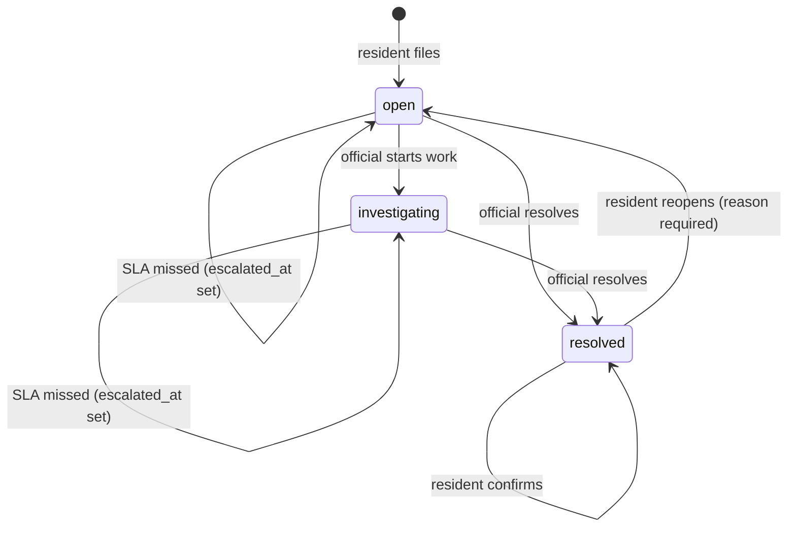
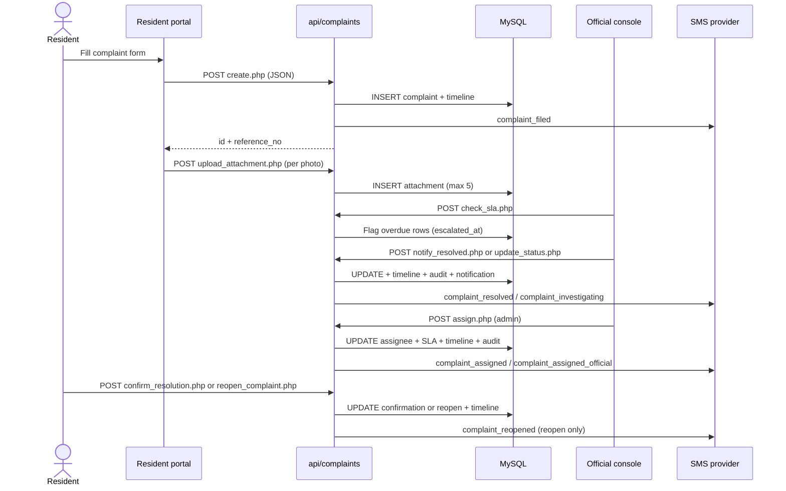

# Complaint Management Module — Process and Source Code

- **Project:** BarangayLink — Barangay Sampaguita, Tagana-an, Surigao del Norte
- **Document scope:** the resident complaint (community concern) workflow, its database tables, API endpoints, safeguards, and a full source appendix.
- **Source snapshot:** 15 November 2026 (the same code included in `source-code.txt` at the project root).
- **How this document was produced:** by reading the files listed below. No test suite was executed while writing it.

---

## Contents

1. [What the module does](#1-what-the-module-does)
2. [Actors and permissions](#2-actors-and-permissions)
3. [Where the code lives](#3-where-the-code-lives)
4. [Data model](#4-data-model)
5. [Status and confirmation lifecycle](#5-status-and-confirmation-lifecycle)
6. [The process, step by step](#6-the-process-step-by-step)
7. [API reference](#7-api-reference)
8. [Concurrency and consistency rules](#8-concurrency-and-consistency-rules)
9. [Security and privacy controls](#9-security-and-privacy-controls)
10. [Failure handling and operator notes](#10-failure-handling-and-operator-notes)
11. [Reporting and AI commentary](#11-reporting-and-ai-commentary)
12. [Verification](#12-verification)
13. [Appendix A — Database schema](#appendix-a--database-schema)
14. [Appendix B — Backend source code](#appendix-b--backend-source-code)
15. [Appendix C — Frontend source code](#appendix-c--frontend-source-code)

---

## 1. What the module does

The complaint module lets a resident report a community problem and lets barangay officials triage it. It covers:

- filing a complaint with a category, location, severity, free-text description, optional category-specific details, and optional photos;
- an official queue with status, severity, official note, assignee, response target (SLA), and duplicate/sharing controls;
- a timeline of every status change and every administrative action;
- a comment thread between the resident and officials;
- authorized photo evidence stored outside the web root;
- resolution, resident confirmation, and reopening when the problem is not actually fixed;
- an opt-in **community concerns board** that shows only anonymized summaries of reports an administrator chose to share;
- SMS and in-app notifications at filing, investigation, assignment, resolution, and reopening;
- audit-log entries for every official action.

Complaints are **private by default**. Nothing a resident writes appears on the community board until an administrator explicitly enables sharing for that complaint. Even then, the board exposes only the complaint number, category, severity, status, filing date, and a count of grouped reports — never the resident's name, exact location, description, note, comments, or photos.

## 2. Actors and permissions

| Actor | Can do | Cannot do |
|---|---|---|
| **Resident** (active resident session) | File a complaint; list only their own complaints; read their own timeline, comments, and photos; add comments (and delete their own via the API); upload photos to their own complaints; confirm a resolution; reopen a resolved complaint with a reason; browse the community board. | See another resident's complaint; change status, severity, official note, assignee, sharing, or duplicate links; confirm/reopen someone else's complaint. |
| **Official — staff** (`official_role = staff`) | See every complaint; update status, severity, and official note; resolve; add comments (and delete any comment via the API); view photos; trigger the SLA check. | Assign/reassign officials; change sharing; link duplicates; upload photos (no UI control). |
| **Official — admin** (the Barangay Captain) | Everything a staff official can do, **plus** assignment, community sharing, and duplicate linking. | — |
| **System** | Escalate overdue response targets (`check_sla.php`), write timeline entries, write audit entries, send SMS notifications. | — |

Role gates are enforced server-side, not just hidden in the UI:

- `require_official_admin()` checks `$_SESSION['official_role'] === 'admin'` and returns **403** otherwise (`api/common.php`).
- `enforce_active_session()` revalidates that the account still exists and is active.
- Resident-only endpoints explicitly reject officials (`api/complaints/public_list.php`, `confirm_resolution.php`, `reopen_complaint.php`).
- Ownership checks run inside each endpoint that reads or writes resident data.

## 3. Where the code lives

| Layer | Files |
|---|---|
| Database | `database/database.sql` (tables `complaints`, `complaint_updates`, `complaint_comments`, `complaint_attachments`, plus `notifications`, `audit_log`, `sms_log`, `resident_sms_preferences`) |
| Backend API | `api/complaints/*.php` (24 files, listed in Appendix B) |
| Resident UI | `pages/resident.php` (complaints tab + filing modal), `js/resident.js` (complaint functions) |
| Official UI | `pages/official.php` (complaints tab), `js/official.js` (complaint queue, detail workspace, management) |
| Community board | `pages/community_complaints.php`, `js/community-complaints.js` |
| Styling | `css/resident.css`, `css/official.css` (complaint classes) |
| Shared services | `api/common.php` (JSON helpers, guards, audit), `api/sms.php` (`notify_resident`, `notify_official`), `api/_session.php` |
| Adjacent reporting | `api/stats/complaints_report.php`, `api/ai/analyze_complaints.php` |

## 4. Data model

### 4.1 `complaints` — one row per report

| Column | Type | Purpose |
|---|---|---|
| `id` | INT PK | Internal identifier; also displayed as the concern number on the board. |
| `resident_id` | INT NULL, FK → `residents.id` | Filer. Nullable for legacy rows. New complaints always carry the session's resident ID. |
| `reference_no` | VARCHAR(50), UNIQUE | Human reference, e.g. `CSR-20261115-A1B2C3`. |
| `resident_name` | VARCHAR(100) | Snapshot of the filer's name at filing time. |
| `category` | VARCHAR(100) | One of the five categories, or `Other`. |
| `severity` | ENUM(`low`,`medium`,`high`,`critical`) | Drives the response target. |
| `location_text` | VARCHAR(150) | Specific location. |
| `description` | TEXT | Resident's narrative. |
| `date_filed` | VARCHAR(30) | Display string in `M d, Y` format (legacy design; the monthly report parses it with `STR_TO_DATE`). |
| `status` | VARCHAR(30) | `open`, `investigating`, or `resolved` (validated in code; not an ENUM). |
| `official_note` | VARCHAR(255) | Public-facing update from the barangay, shown to the resident. |
| `resident_confirmation` | ENUM(`pending`,`confirmed`,`reopened`) NULL | Resident's response to a resolution. |
| `confirmed_at` | DATETIME NULL | When the resident confirmed. |
| `reopened_at` | DATETIME NULL | When the resident last reopened. |
| `extra_fields_json` | JSON NULL | Category-specific answers (for example `drainage_issue: blocked_drain`). |
| `assigned_official_id` | INT NULL, FK → `barangay_officials.id` | Current assignee. |
| `sla_due_at` | DATETIME NULL | Response target. |
| `escalated_at` | DATETIME NULL | Set once by the SLA check when the target is missed. |
| `is_public` | TINYINT(1) | Administrator-controlled board sharing. Default `0`. |
| `duplicate_of_id` | INT NULL, FK → `complaints.id` | If set, this report is a duplicate/related report of the primary complaint. |

Indexes: `idx_complaint_sla (status, escalated_at, sla_due_at)`, `idx_complaint_public (is_public, duplicate_of_id, id)`, `idx_complaint_duplicates (duplicate_of_id, is_public, id)`. `duplicate_of_id` uses `ON DELETE RESTRICT`, so a primary report cannot be deleted while related reports point at it. There is no hard delete anywhere in the module.

### 4.2 `complaint_updates` — the timeline

Every filing, status change, assignment change, sharing change, duplicate link, confirmation, reopening, and SLA escalation adds a row:

`actor_type` (`resident` / `official` / `system`), `actor_id`, `from_status`, `to_status`, `note`, `created_at`. The timeline is ordered by `created_at, id`, and the API resolves the actor's display name from the matching table. It is the authoritative history because `complaints` itself has no `created_at`/`updated_at` columns.

### 4.3 `complaint_comments` — discussion thread

`complaint_id`, `actor_type` (`resident` / `official`), `actor_id`, `body` TEXT, `deleted_at` NULL, `created_at`. Deletion is a soft delete, so the thread keeps its structure. Comments are capped at **2,000 characters** and cannot be edited.

### 4.4 `complaint_attachments` — evidence metadata

`complaint_id`, `file_path` (a storage key, not a URL), `mime`, `byte_size`, `uploaded_by_type`, `uploaded_by_id`, `deleted_at`, `created_at`.

- Allowed types: **JPEG and PNG only**.
- Maximum **5 active attachments per complaint** (enforced while holding a row lock).
- Maximum upload size: **50 MB** per file.
- New files live under `COMPLAINT_ATTACHMENT_STORAGE_DIR`, outside the web root, as `private:v1/{complaint_id}/{32-hex-uuid}.{jpg|png}`.
- Legacy rows with keys of the form `complaint_attachments/{id}/{uuid}.{jpg|png}` remain readable.
- Files are served only through `api/complaints/view_attachment.php`, which checks the session and ownership.

### 4.5 Side-effect tables

| Table | Written when |
|---|---|
| `notifications` | Official status changes (`update_status.php`, `notify_resolved.php`) and assignment changes (`assign.php`) create an in-app notification for the resident. Confirm/reopen do not insert one. |
| `audit_log` | Every official mutation: status update, resolution, assignment, sharing, duplicate link, official comment add/delete, and system SLA escalation. |
| `sms_log` | Every attempted/skipped SMS, with endpoint, number, status, and reason. |
| `resident_sms_preferences` | The resident's per-category opt-out; `complaints_enabled` covers complaint SMS. |

### 4.6 Category-specific extra fields

`api/complaints/_extra_fields.php` is the single schema used by the form, the write validator, and both portals' display code:

| Category | Fields and allowed options |
|---|---|
| Road / Infrastructure | `road_issue`: pothole, damaged_road, streetlight, sidewalk, other. `access_impact`: passable, partly_blocked, blocked. |
| Noise / Public Disturbance | `noise_source`: music, construction, vehicles, gathering, other. `usual_time`: daytime, evening, overnight, varies. |
| Flooding / Drainage | `drainage_issue`: blocked_drain, flooding, standing_water, other. `affected_area`: one_property, street, several_streets. |
| Public Safety | `safety_hazard`: poor_lighting, unsafe_structure, blocked_path, other. `ongoing`: yes, no, unsure. |
| Other | No extra fields. |

Writes are strict: the submitted value must be a JSON object, every key must belong to the selected category, every value must be one of that field's options, and empty values are dropped. Reads are tolerant: unknown keys and invalid stored values are silently ignored, so old or tampered rows never leak arbitrary content.

## 5. Status and confirmation lifecycle

A complaint has **two independent state fields**:

- `status`: `open` → `investigating` → `resolved`, with reopening back to `open`.
- `resident_confirmation`: `NULL` → `pending` (when resolved) → `confirmed` or `reopened`.

Keeping them separate means the barangay can resolve a complaint while the resident's confirmation is still pending, and a resident can reopen without erasing the resolution history.



| Step | Actor | Endpoint | `status` | `resident_confirmation` | Side effects |
|---|---|---|---|---|---|
| File | Resident | `create.php` | `open` | `NULL` | Timeline "Complaint filed."; SMS `complaint_filed`; optional photo uploads afterwards. |
| Update | Official | `update_status.php` | any allowed status | On resolve: `pending`. On other status changes: cleared, except an unresolved complaint already marked `reopened` keeps `reopened`. | Timeline; audit; in-app notification when status changed; SMS for `investigating`/`resolved`. |
| Resolve | Official | `notify_resolved.php` (UI path) | `resolved` | `pending` | Same as above, audit action "Resolved complaint". |
| Confirm | Resident | `confirm_resolution.php` | `resolved` | `confirmed`, `confirmed_at = NOW()` | Timeline "Resident confirmed the resolution." |
| Reopen | Resident | `reopen_complaint.php` | `open` | `reopened`, `reopened_at = NOW()`, `confirmed_at = NULL`, `escalated_at = NULL` | Comment with the reason; timeline; SMS `complaint_reopened`. |
| SLA miss | System | `check_sla.php` | unchanged | unchanged | `escalated_at = NOW()`; timeline; audit "Escalated complaint SLA". |

**Response targets.** `_sla.php` maps severity to hours: **critical 24**, **high 48**, **medium 72**, **low 168**. The target is stamped only on the **first** assignment. Reassignment preserves the original deadline. Unassigning leaves the deadline in place, so the clock keeps running while nobody is assigned.

**Important operational consequence:** `check_sla.php` is called by the official console whenever the complaint list loads (`loadComplaints()` in `js/official.js`). There is no cron job. If no official opens the console, overdue complaints are not marked escalated until someone does.

## 6. The process, step by step



### 6.1 Filing a complaint (resident)

1. The resident opens **Complaints & Concerns → New Complaint** (`pages/resident.php`).
2. The form collects category, location, severity, description, optional category-specific details, and up to **3** photos (JPEG/PNG, max 50 MB each). The photo limit here is a UI limit; the server accepts up to 5 active photos per complaint.
3. `js/resident.js` validates required fields client-side and posts JSON to `api/complaints/create.php` with `extra_fields` assembled from the visible category block.
4. `create.php`:
   - requires an active session and an actual resident session (`401` otherwise);
   - requires POST;
   - rejects non-object JSON and non-string complaint fields (`422`);
   - trims and validates severity against the allowlist;
   - requires category, location, and description;
   - validates extra fields against the category schema;
   - generates the reference number `CSR-{YYYYMMDD}-{6 uppercase hex}`;
   - stores `date_filed` as `M d, Y`, status `open`, note "Received. Pending review.";
   - inserts the complaint with a prepared statement;
   - inserts a `complaint_updates` row with `from_status = NULL`, `to_status = open`, note "Complaint filed." (a timeline failure is logged but does not roll back the complaint);
   - sends the SMS "your complaint … was received" through `notify_resident(..., 'complaints_enabled')`;
   - returns `id`, `reference_no`, and a success message.
5. The browser then uploads each photo sequentially to `upload_attachment.php`. The complaint is already committed at this point, so an upload failure never loses the report.
6. If any photo fails, the form enters **retry mode**: every field is disabled so the resident cannot submit a duplicate, a banner reports how many photos failed, and **Retry Upload** or **Skip and Close** is offered. A successful retry closes the form and refreshes the list.
7. On success the list reloads, the modal closes, and a toast confirms the reference number.

**What the resident sees afterwards:** the complaint card shows reference, category, status badge, severity, progress (0% open, 50% investigating, 100% resolved), date, and note. **View Details** opens a tabbed dialog with overview, extra details, barangay response, photos, timeline, and comments.

### 6.2 Resident list and detail

- `api/complaints/list.php` detects whether the session is an official or a resident. Officials get every complaint plus duplicate metadata (`duplicate_of_id`, `is_duplicate`, `duplicate_reference_no`, `duplicate_children_count`). Residents get only rows where `c.resident_id = ?`.
- Both variants compute `is_overdue` (open/investigating, due date present, due date passed), `resolution_update_id` (the latest update row that entered `resolved` from a non-resolved state), `attachment_count`, and the assignee's name and account status.
- Extra fields are returned twice: raw cleaned values and a display-ready `{label, value}` list.
- The detail dialog fetches timeline (`timeline.php`), comments (`list_comments.php`), and attachments (`list_attachments.php`) separately. Each panel fails independently; a failed timeline or photo list does not close the dialog.

### 6.3 Official queue and triage

1. Opening the Complaints tab calls `check_sla.php`, then `list.php`, then renders cards with status, severity, filing date, filer, SLA state, description preview, official note, attachment count, and **View details**.
2. Search filters by category, filer name, or reference; the status filter narrows to open / investigating / resolved.
3. The detail workspace has three tabs — Overview, Timeline, Comments — and a **Manage complaint** panel:
   - **Status** (`open`, `investigating`, `resolved`), **Severity** (low…critical), **Official note** (≤255 characters). Saving calls `notify_resolved.php` when the selected status is `resolved`, otherwise `update_status.php`.
   - A save with no changes returns `changed: false` and writes nothing.
   - Admins additionally see **assignment**, **sharing**, and **related report** controls.
4. When an official changes the status, the server locks the row, computes whether status/note/severity actually changed, and then — in one transaction — updates the row, appends a timeline entry, writes an audit entry, and inserts an in-app notification if the status changed. Commit happens before any SMS attempt.
5. SMS rules for `update_status.php` / `notify_resolved.php`:
   - nothing changed → skipped, "No SMS is sent when nothing changed";
   - note/severity only → skipped, "No SMS is sent when the status is unchanged";
   - resolved → `complaint_resolved`, including the official note when present;
   - investigating → `complaint_investigating`, greeting the resident by first name;
   - open → no SMS;
   - no linked resident → skipped.
6. A failed SMS never fails the request. The response reports `sms_status` and `sms_reason`, and the UI appends "SMS notification failed; the complaint was saved."

### 6.4 Assignment and SLA

`assign.php` is **admin-only**:

- Only `open` or `investigating` complaints can be assigned.
- The target must be an **active** official.
- The request carries `expected_assigned_official_id`; if the current assignee no longer matches, the server returns **409** ("Assignment changed. Refresh…").
- `null` unassigns; an unchanged value returns `changed: false`.
- On first assignment, `sla_due_at = NOW() + severity hours`. On reassignment it is preserved.
- Each change writes a timeline note (assigned / reassigned / unassigned), an audit entry, and an in-app notification. SMS goes to the assigned official (`complaint_assigned_official`) and the resident (`complaint_assigned`) after commit, except on unassign.

`check_sla.php` (any official) escalates up to **100** overdue rows per call:

- selects `open`/`investigating` rows with `sla_due_at <= NOW()` and `escalated_at IS NULL`, `FOR UPDATE`;
- sets `escalated_at = NOW()`, but only if the row still qualifies;
- writes a system timeline entry ("Response target missed; flagged for administrator review.") and a system audit entry;
- does not change status, does not notify anyone, and is safe to call repeatedly (already-escalated rows are skipped);
- retries up to 3 times on a deadlock.

### 6.5 Resolution, confirmation, and reopening

**Resolution** sets `resident_confirmation = 'pending'` and clears `confirmed_at`. The resident then has two choices in their detail dialog:

- **Confirm resolution** (`confirm_resolution.php`): verifies the session's resident owns the complaint, verifies the complaint is `resolved`, verifies the client's `expected_resolution_id` still matches the latest resolution event, then sets `confirmed` + `confirmed_at` and appends a timeline entry. Repeating the call is idempotent (`changed: false`, "already confirmed").
- **Still broken? Reopen complaint** (`reopen_complaint.php`): requires a reason of 1–2,000 characters. It verifies ownership and the same `expected_resolution_id`, then in one transaction sets status back to `open`, marks `reopened`, clears `confirmed_at`, stamps `reopened_at`, clears `escalated_at`, and recomputes `sla_due_at` **only if an official is assigned** (`NOW() + severity hours`; otherwise `NULL`). The reason becomes a resident comment, and a timeline entry records the reopening. SMS `complaint_reopened` is sent after commit. If the complaint is already reopened, the call is idempotent.

The `expected_resolution_id` is the anti-stale-action guard: it is the newest `complaint_updates.id` whose `to_status = 'resolved'` and whose `from_status` is not `resolved`. If an official resolves again after a reopening, the old ID no longer matches, and the resident's stale dialog gets **409** "The resolution changed. Refresh the complaint before responding."

### 6.6 Comments

- Both roles can post on a complaint they are allowed to see; residents only on their own.
- Body is trimmed, must not be only whitespace, and is capped at **2,000 characters**.
- Residents can delete only their own comments; officials can delete any comment.
- Deletion is a soft delete (`deleted_at`), and deleted comments disappear from the thread.
- Official comments and deletions are audited. Comments do not generate notifications or SMS.
- Both delete endpoints are wired and permission-tested, but neither portal currently renders a delete control; the thread UI is read-and-post only.

### 6.7 Photos and evidence

- Residents upload to their own complaints. The API accepts official uploads to any complaint, but the official workspace currently only displays evidence; there is no upload control in the official UI.
- The endpoint accepts only JPEG/PNG, verified by content sniffing (`finfo`, then `getimagesize` fallback), not by filename.
- The storage directory must be absolute, readable/writable, and must not overlap the project root or the web document root. If it is missing or unsafe, uploads fail closed with a configuration message, while complaints and all other features keep working.
- Upload stores the file under a random name while holding the complaint row lock, inserts the metadata row, and commits. If the transaction outcome is uncertain, the new file is deliberately preserved and logged for reconciliation rather than deleted; it is deleted only when rollback is confirmed.
- `view_attachment.php` validates the stored key against two exact patterns, verifies the complained ID inside the key matches, resolves the real path, rejects symlinks, re-sniffs the MIME type, requires an active session, and enforces resident ownership. It responds with `Cache-Control: private, no-store`, `X-Content-Type-Options: nosniff`, and `Content-Disposition: inline`.
- `delete_attachment.php` soft-deletes the row. There is no delete control in either portal yet.

### 6.8 Sharing and duplicate linking (admin)

Both operations are private-by-default and administrator-only.

- **Sharing** (`set_visibility.php`): flips `is_public`. The request carries `expected_is_public` and `expected_duplicate_of_id`; a mismatch returns **409** with a message naming what changed. Each change adds a timeline note and an audit entry. Sharing a duplicate is technically possible, but the board query hides it; the primary report's count only includes children that are themselves public.
- **Duplicate linking** (`set_duplicate.php`): links a complaint to a primary report, or unlinks it with `null`. Rules:
  - a complaint cannot link to itself;
  - only a **hidden** complaint can be linked (hide it first);
  - the target must not itself be a duplicate (choose a primary report);
  - the source must not already have related reports (it would stop being a primary);
  - both rows are locked in ascending ID order to avoid deadlocks; the transaction retries up to 3 times on a deadlock;
  - the link change is written to the timeline and audit log; no notification is sent.
- The official portal exposes **View related report** and the number of related reports; the resident sees a short "linked to a related report" note. Every complaint remains tracked separately; a duplicate is not merged or deleted.

### 6.9 Community concerns board

`pages/community_complaints.php` is resident-only. Officials receive a 403 page; unauthenticated visitors are redirected to login. The board loads `api/complaints/public_list.php` and renders cards client-side with `textContent` (no HTML injection).

`public_list.php`:

- requires a resident session and GET;
- selects only `is_public = 1` **and** `duplicate_of_id IS NULL`;
- supports `category` (one of the five or `Other`), `status` (`open`/`investigating`/`resolved`), `before_id` cursor, and `limit` (default **20**, maximum **50**);
- `Other` matches `NULL`, the literal `Other`, or any category not in the known list;
- returns only `id`, `category`, `severity`, `status`, `filed_on` (normalized to `YYYY-MM-DD` or `null`), and `published_report_count`;
- normalizes unknown categories/severities/statuses to `Other` / `unknown`, so malformed stored data never renders as arbitrary text;
- paginates newest-first by ID and returns `has_more` plus `next_before_id`.

The page itself explains that private details stay off the board; it shows only the concern number, category, severity, status, filing date, and the shared-report count.

### 6.10 Notifications and SMS

Complaint-related SMS events:

| Event | Trigger | Recipient | Preference key |
|---|---|---|---|
| `complaint_filed` | `create.php` | Resident | `complaints_enabled` |
| `complaint_investigating` | `update_status.php` → investigating | Resident | `complaints_enabled` |
| `complaint_resolved` | resolve endpoint | Resident | `complaints_enabled` |
| `complaint_assigned` | `assign.php` (not on unassign) | Resident | `complaints_enabled` |
| `complaint_assigned_official` | `assign.php` (not on unassign) | Assigned official | — (official SMS has no resident preference) |
| `complaint_reopened` | `reopen_complaint.php` | Resident | `complaints_enabled` |

`notify_resident()` additionally:

- normalizes the number to `+639XXXXXXXXX`;
- skips when SMS is not configured, the resident has no/invalid contact, the category is opted out, or the daily cap of **5 sent messages per resident per event type** is reached;
- logs every skip or failure to `sms_log` with a reason;
- never throws into the complaint transaction (callers wrap it and report status).

In-app notifications are independent of SMS opt-out. They are inserted inside the same transaction as the status/assignment change.

### 6.11 Audit trail

`log_audit()` records: official ID and name (or `System`), action, target type `complaint`, target reference, and details. Complaint actions currently written:

- `Updated complaint status`
- `Resolved complaint`
- `Updated complaint assignment`
- `Updated complaint sharing`
- `Updated complaint duplicate link`
- `Added complaint comment`
- `Deleted complaint comment`
- `Escalated complaint SLA` (system)

Audit failures inside a mutation deliberately abort the transaction, so an official action cannot commit without its audit record.

## 7. API reference

All endpoints start with `require_once __DIR__ . '/../common.php'` and `session_start()`, then a session guard. JSON responses use `{ "success": true, ... }` or `{ "success": false, "message": "..." }`.

| Method | Endpoint | Who | Purpose |
|---|---|---|---|
| POST | `api/complaints/create.php` | Resident | File a complaint. Returns `id`, `reference_no`. |
| GET | `api/complaints/list.php` | Resident / Official | Scoped complaint list with SLA, resolution, attachment, duplicate metadata. |
| GET | `api/complaints/public_list.php` | Resident only | Anonymized community board, filtered and paginated. |
| GET | `api/complaints/timeline.php` | Owner / Official | Ordered status/action timeline. |
| GET | `api/complaints/list_comments.php` | Owner / Official | Non-deleted comments with actor names. |
| POST | `api/complaints/add_comment.php` | Owner / Official | Add a comment (≤2,000 chars). |
| POST | `api/complaints/delete_comment.php` | Owner / Official | Soft-delete a comment. |
| GET | `api/complaints/list_attachments.php` | Owner / Official | Evidence metadata + authorized URLs. |
| POST | `api/complaints/upload_attachment.php` | Owner / Official | Upload JPEG/PNG evidence (multipart). |
| POST | `api/complaints/delete_attachment.php` | Owner / Official | Soft-delete evidence. |
| GET/HEAD | `api/complaints/view_attachment.php` | Owner / Official | Stream an authorized image. |
| POST | `api/complaints/update_status.php` | Official | Change status, severity, official note. |
| POST | `api/complaints/notify_resolved.php` | Official | Resolve with optional note/severity. |
| POST | `api/complaints/assign.php` | Admin | Assign, reassign, or unassign. |
| POST | `api/complaints/check_sla.php` | Official | Escalate overdue response targets (≤100). |
| POST | `api/complaints/confirm_resolution.php` | Resident owner | Confirm a resolution. |
| POST | `api/complaints/reopen_complaint.php` | Resident owner | Reopen with a reason. |
| POST | `api/complaints/set_visibility.php` | Admin | Enable/disable community sharing. |
| POST | `api/complaints/set_duplicate.php` | Admin | Link/unlink a related report. |

State-changing endpoints call `require_post()`; `set_visibility.php` and `set_duplicate.php` additionally require `Content-Type: application/json` and a JSON object body.

## 8. Concurrency and consistency rules

The module assumes multiple officials and residents can act at the same time. The rules below are enforced in SQL, not only in JavaScript.

| Operation | Lock / guard | Behaviour on conflict |
|---|---|---|
| Status/note/severity update | `SELECT ... FOR UPDATE` on the complaint; one transaction for row + timeline + audit + notification | Last writer wins only after reading current state; no lost audit entry. |
| Assignment | Row lock + `expected_assigned_official_id` | **409** with "Assignment changed. Refresh…" |
| Confirm / reopen | Row lock + `expected_resolution_id` | **409** with "The resolution changed. Refresh…" |
| Sharing | Row lock + `expected_is_public` + `expected_duplicate_of_id` | **409** naming what changed. |
| Duplicate link | Locks both rows in ascending ID order + `expected_duplicate_of_id`; deadlock retry ×3 | **409** on stale link; retry on deadlock. |
| Photo upload | Complaint row lock; count of active attachments checked under the lock; random filename; DB commit before treating the file as committed | 6th photo rejected with **422**; uncertain commit preserves the file and logs it. |
| SLA check | `FOR UPDATE` on up to 100 overdue rows; conditional update re-checks eligibility; deadlock retry ×3 | Already-escalated rows are skipped safely. |
| List loads | Read-only; official UI uses a request sequence/epoch so a stale response cannot overwrite a newer list | Stale responses are ignored. |

Design consequences worth preserving:

- **No database lock is held across an SMS or provider call.** SMS happens after commit.
- **No `exit` inside a transaction.** Endpoints roll back and then return JSON.
- **Unchanged saves write nothing** and return `changed: false`.
- **For official mutations, timeline and audit are part of the transaction.** If either fails, the whole mutation rolls back. Resident filing is the exception: a timeline failure there is logged without losing the complaint.

## 9. Security and privacy controls

| Risk | Control |
|---|---|
| Unauthorized access | Active-session revalidation on every endpoint; explicit role and ownership checks; resident-only endpoints reject officials, and official-only endpoints reject residents. |
| SQL injection | Prepared statements for every query that carries user data. Option lists are allowlisted in PHP. |
| XSS | Frontend inserts dynamic text with `escapeHtml` or `textContent`; the community board builds nodes with `textContent`. |
| Path traversal / local file read | Attachment keys must match exact regexes; complaint ID inside the key must match; real path must stay inside the configured root; symlinks rejected; MIME re-sniffed. |
| Direct evidence access | Storage is outside the web root; files are streamed only through an authenticated endpoint with `no-store` and `nosniff`. |
| Privacy on the community board | Explicit administrator opt-in per complaint; query excludes linked duplicates; projection excludes name, location, description, note, comments, photos, and assignee. |
| Personal data in AI | `analyze_complaints.php` sends only aggregate counts (totals, category/severity counts, monthly counts) to Gemini — no names, locations, or narratives. |
| SMS abuse | Per-resident per-event daily cap of 5; opt-out preferences; numbers normalized; all attempts logged. |
| Unauthorized audit tampering | No endpoint updates or deletes `audit_log`; official actions require a successful audit insert. |
| Stale-action races | Optimistic tokens on assignment, resolution, sharing, and duplicate linking. |

Known gaps (documented, not fixed here): there is no CSRF token layer beyond `SameSite=Lax` cookies; complaint creation has no rate limit beyond session authentication; `category`, `location_text`, and `description` are bounded only by their database column widths, not by explicit server-side length checks; and `date_filed` is stored as display text.

## 10. Failure handling and operator notes

- **Photo storage not configured** → complaint filing still succeeds; each upload returns a clear configuration error. Set `COMPLAINT_ATTACHMENT_STORAGE_DIR` in `.env` to an absolute path outside the web root, then retry the upload.
- **SMS provider down** → the complaint/status change is already committed. `sms_status = failed` is returned and logged in `sms_log`; the UI tells the official the save succeeded.
- **SLA escalation lags** → there is no scheduler; escalation happens when the official console loads. For a real deployment, add a scheduled request to `check_sla.php` if escalation must be timely.
- **Photo upload interrupted** → resident stays in retry mode with the complaint already filed. **Skip and Close** keeps the complaint without the failed photos.
- **Stale official tab** → conflict responses tell the user to refresh; the UI reloads the complaint and shows the current assignment/sharing/resolution state.
- **Legacy photos** → rows with `complaint_attachments/{id}/{uuid}.{jpg|png}` keys still resolve without the private storage setting, but new uploads require it.
- **No hard delete** → complaints, comments, attachments, and duplicate links are all soft-deleted or unlinked. This preserves auditability and referential integrity.

## 11. Reporting and AI commentary

`api/stats/complaints_report.php` (official session) returns totals, category counts, severity counts, a category × severity cross-tab, and a monthly ranking. `api/ai/analyze_complaints.php` (official session, POST) computes the same aggregates and asks Gemini for narrative commentary only. The model receives counts, not personal data, and does not re-score or change any complaint. The official UI exposes the report under **AI → Complaints Report** with CSV export.

## 12. Verification

The repository includes a dedicated complaint regression suite. From the project root:

```powershell
node project-support/tests/review-2026-10-24/render-check.js
php project-support/tests/complaint-interface/storage-config-check.php
php project-support/tests/review-2026-10-24/run.php
```

The suite covers persistence, omitted fields, unchanged saves, Unicode note validation, authorization, assignment/response-target preservation, timeline ordering, notification counts, confirmation/reopening, comments, attachment counts, storage fail-closed behavior, and frontend rendering/draft retention. It uses a disposable schema and requires local MySQL; see `project-support/tests/complaint-interface/README.md` for details and browser-check guidance.

Manual checks worth repeating after any change:

1. File a complaint with each category and confirm the extra-field block switches correctly.
2. File with 0, 1, and 3 photos; simulate an upload failure and use both retry and skip.
3. As staff, change status and note; confirm the resident receives an in-app notification and the timeline shows one entry per save.
4. As admin, assign, reassign, and unassign; confirm the due date is set only once and SMS reasons are reported.
5. Resolve, then confirm as the resident; resolve again, then reopen with a reason; confirm the reason appears as a comment and the SLA is recomputed.
6. Share a complaint, verify it appears on the community board without private data, then hide it and verify it disappears.
7. Link a hidden complaint to a primary report; verify the board count and that the duplicate itself is not listed.
8. Miss a due date, reload the official console, and verify escalation is recorded once only.

---

## Appendix A — Database schema

`database/database.sql` — complaint tables (lines 505–540 and 610–662 of the current file):

```sql
-- ----------------------------------------------------------------------------
-- complaints
-- ----------------------------------------------------------------------------
CREATE TABLE IF NOT EXISTS `complaints` (
  `id` INT NOT NULL AUTO_INCREMENT,
  `resident_id` INT DEFAULT NULL,
  `reference_no` VARCHAR(50) NOT NULL,
  `resident_name` VARCHAR(100) NOT NULL,
  `category` VARCHAR(100) NOT NULL,
  `severity` ENUM('low','medium','high','critical') NOT NULL DEFAULT 'medium',
  `location_text` VARCHAR(150) NOT NULL,
  `description` TEXT NOT NULL,
  `date_filed` VARCHAR(30) NOT NULL,
  `status` VARCHAR(30) NOT NULL DEFAULT 'open',
  `official_note` VARCHAR(255) NOT NULL DEFAULT '',
  `resident_confirmation` ENUM('pending','confirmed','reopened') NULL DEFAULT NULL,
  `confirmed_at` DATETIME NULL DEFAULT NULL,
  `reopened_at` DATETIME NULL DEFAULT NULL,
  `extra_fields_json` JSON NULL DEFAULT NULL,
  `assigned_official_id` INT NULL DEFAULT NULL,
  `sla_due_at` DATETIME NULL DEFAULT NULL,
  `escalated_at` DATETIME NULL DEFAULT NULL,
  `is_public` TINYINT(1) NOT NULL DEFAULT 0,
  `duplicate_of_id` INT NULL DEFAULT NULL,
  PRIMARY KEY (`id`),
  UNIQUE KEY `reference_no` (`reference_no`),
  KEY `idx_complaint_sla` (`status`, `escalated_at`, `sla_due_at`),
  KEY `idx_complaint_public` (`is_public`, `duplicate_of_id`, `id`),
  KEY `idx_complaint_duplicates` (`duplicate_of_id`, `is_public`, `id`),
  CONSTRAINT `fk_complaint_resident` FOREIGN KEY (`resident_id`)
    REFERENCES `residents`(`id`),
  CONSTRAINT `fk_complaint_duplicate` FOREIGN KEY (`duplicate_of_id`)
    REFERENCES `complaints`(`id`) ON DELETE RESTRICT,
  CONSTRAINT `fk_complaint_assignee` FOREIGN KEY (`assigned_official_id`)
    REFERENCES `barangay_officials`(`id`) ON DELETE SET NULL
) ENGINE=InnoDB DEFAULT CHARSET=utf8mb4;
```

```sql
-- ----------------------------------------------------------------------------
-- complaint_updates
-- ----------------------------------------------------------------------------
CREATE TABLE IF NOT EXISTS `complaint_updates` (
  `id` BIGINT NOT NULL AUTO_INCREMENT,
  `complaint_id` INT NOT NULL,
  `actor_type` ENUM('resident','official','system') NOT NULL,
  `actor_id` INT NULL,
  `from_status` VARCHAR(30) NULL,
  `to_status` VARCHAR(30) NOT NULL,
  `note` TEXT NULL,
  `created_at` TIMESTAMP DEFAULT CURRENT_TIMESTAMP,
  PRIMARY KEY (`id`),
  KEY `idx_complaint_time` (`complaint_id`, `created_at`),
  CONSTRAINT `fk_update_complaint` FOREIGN KEY (`complaint_id`)
    REFERENCES `complaints`(`id`) ON DELETE CASCADE
) ENGINE=InnoDB DEFAULT CHARSET=utf8mb4;

-- ----------------------------------------------------------------------------
-- complaint_comments
-- ----------------------------------------------------------------------------
CREATE TABLE IF NOT EXISTS `complaint_comments` (
  `id` BIGINT NOT NULL AUTO_INCREMENT,
  `complaint_id` INT NOT NULL,
  `actor_type` ENUM('resident','official') NOT NULL,
  `actor_id` INT NOT NULL,
  `body` TEXT NOT NULL,
  `deleted_at` DATETIME NULL,
  `created_at` TIMESTAMP NOT NULL DEFAULT CURRENT_TIMESTAMP,
  PRIMARY KEY (`id`),
  KEY `idx_comment_thread` (`complaint_id`, `deleted_at`, `created_at`, `id`),
  CONSTRAINT `fk_comment_complaint` FOREIGN KEY (`complaint_id`)
    REFERENCES `complaints`(`id`) ON DELETE CASCADE
) ENGINE=InnoDB DEFAULT CHARSET=utf8mb4;

-- ----------------------------------------------------------------------------
-- complaint_attachments
-- ----------------------------------------------------------------------------
CREATE TABLE IF NOT EXISTS `complaint_attachments` (
  `id` BIGINT NOT NULL AUTO_INCREMENT,
  `complaint_id` INT NOT NULL,
  `file_path` VARCHAR(255) NOT NULL,
  `mime` VARCHAR(64) NOT NULL,
  `byte_size` INT NOT NULL,
  `uploaded_by_type` ENUM('resident','official') NOT NULL,
  `uploaded_by_id` INT NOT NULL,
  `deleted_at` DATETIME NULL,
  `created_at` TIMESTAMP DEFAULT CURRENT_TIMESTAMP,
  PRIMARY KEY (`id`),
  KEY `idx_complaint` (`complaint_id`, `deleted_at`),
  CONSTRAINT `fk_attach_complaint` FOREIGN KEY (`complaint_id`)
    REFERENCES `complaints`(`id`) ON DELETE CASCADE
) ENGINE=InnoDB DEFAULT CHARSET=utf8mb4;
```

Related side-effect tables:

```sql
-- ----------------------------------------------------------------------------
-- notifications
-- ----------------------------------------------------------------------------
CREATE TABLE IF NOT EXISTS `notifications` (
  `id` INT NOT NULL AUTO_INCREMENT,
  `resident_id` INT DEFAULT NULL,
  `title` VARCHAR(120) NOT NULL,
  `body` VARCHAR(255) NOT NULL,
  `is_read` TINYINT(1) NOT NULL DEFAULT 0,
  `created_at` VARCHAR(30) NOT NULL,
  PRIMARY KEY (`id`),
  CONSTRAINT `fk_notification_resident` FOREIGN KEY (`resident_id`)
    REFERENCES `residents`(`id`)
) ENGINE=InnoDB DEFAULT CHARSET=utf8mb4;

-- ----------------------------------------------------------------------------
-- audit_log
-- ----------------------------------------------------------------------------
CREATE TABLE IF NOT EXISTS `audit_log` (
  `id` INT NOT NULL AUTO_INCREMENT,
  `official_id` INT DEFAULT NULL,
  `official_name` VARCHAR(100) NOT NULL,
  `action` VARCHAR(100) NOT NULL,
  `target_type` VARCHAR(50) NOT NULL,
  `target_reference` VARCHAR(100) DEFAULT NULL,
  `details` TEXT,
  `created_at` TIMESTAMP DEFAULT CURRENT_TIMESTAMP,
  PRIMARY KEY (`id`),
  CONSTRAINT `fk_audit_official` FOREIGN KEY (`official_id`)
    REFERENCES `barangay_officials`(`id`)
) ENGINE=InnoDB DEFAULT CHARSET=utf8mb4;
```

```sql
-- ----------------------------------------------------------------------------
-- sms_log
-- ----------------------------------------------------------------------------
CREATE TABLE IF NOT EXISTS `sms_log` (
  `id` BIGINT NOT NULL AUTO_INCREMENT,
  `resident_id` INT NULL,
  `official_id` INT NULL,
  `endpoint` VARCHAR(64) NOT NULL,
  `to_number` VARCHAR(20) NOT NULL DEFAULT '',
  `status` ENUM('sent','failed','skipped') NOT NULL,
  `reason` VARCHAR(255) NULL,
  `http_message_id` VARCHAR(64) NULL,
  `created_at` TIMESTAMP DEFAULT CURRENT_TIMESTAMP,
  PRIMARY KEY (`id`),
  KEY `idx_resident_time` (`resident_id`, `created_at`),
  KEY `idx_endpoint_time` (`endpoint`, `created_at`)
) ENGINE=InnoDB DEFAULT CHARSET=utf8mb4;
```

> Note: `notifications` is defined at lines 542–555, `audit_log` at 557–572, and `sms_log` at 664–680. `resident_sms_preferences` follows and is not reproduced here.

---

## Appendix B — Backend source code

### B.1 Filing

#### `api/complaints/create.php`

```php
<?php
/**
 * BarangayLink - Web-based barangay management system for Brgy. Sampaguita.
 * Copyright (C) 2026 Jun Gem Riege M. Dulduco
 * Licensed under the GNU General Public License v3.0 (or later).
 * See the LICENSE file in the project root for the full text.
 */

require_once __DIR__ . '/../common.php';
require_once __DIR__ . '/_extra_fields.php';
session_start();
enforce_active_session();

if (empty($_SESSION['resident_id'])) {
  http_response_code(401);
  echo json_encode(['success' => false, 'message' => 'Unauthorized']);
  exit;
}

require_post();

$db = get_db();
$rawRequest = json_decode(file_get_contents('php://input'));
if (!$rawRequest instanceof stdClass) json_error('A valid JSON object is required.', 422);
$input = get_object_vars($rawRequest);
foreach (['category', 'location_text', 'description', 'severity'] as $field) {
  if (array_key_exists($field, $input) && $input[$field] !== null && !is_string($input[$field])) {
    json_error('Complaint fields must be text.', 422);
  }
}

$category = trim((string)($input['category'] ?? ''));
$location = trim((string)($input['location_text'] ?? ''));
$description = trim((string)($input['description'] ?? ''));
$severity = strtolower(trim((string)($input['severity'] ?? 'medium')));
$allowedSeverity = ['low', 'medium', 'high', 'critical'];
if (!in_array($severity, $allowedSeverity, true)) {
  json_error('Invalid severity. Allowed values are: low, medium, high, critical.', 422);
}
if ($category === '' || $location === '' || $description === '') {
  json_error('Category, location, and description are required.');
}

try {
  $extraFields = complaint_extra_fields_validate($category, $input['extra_fields'] ?? null);
  $extraFieldsJson = $extraFields
    ? json_encode((object)$extraFields, JSON_UNESCAPED_UNICODE | JSON_THROW_ON_ERROR)
    : null;
} catch (InvalidArgumentException $error) {
  json_error($error->getMessage(), 422);
}

$prefix = 'CSR-' . date('Ymd') . '-';
$ref = $prefix . strtoupper(substr(md5(uniqid((string)mt_rand(), true)), 0, 6));
$residentId = (int)$_SESSION['resident_id'];
$residentName = trim((string)($_SESSION['resident_name'] ?? ''));
if ($residentName === '') {
  json_error('Resident session expired. Please log in again.', 401);
}
$dateFiled = date('M d, Y');
$status = 'open';
$note = 'Received. Pending review.';

$stmt = $db->prepare("INSERT INTO complaints
  (resident_id, reference_no, resident_name, category, severity, location_text, description, date_filed, status, official_note, extra_fields_json)
  VALUES (?, ?, ?, ?, ?, ?, ?, ?, ?, ?, ?)");
if (!$stmt) json_error('Failed to prepare complaint insert.', 500);
$stmt->bind_param('issssssssss',
  $residentId, $ref, $residentName, $category, $severity,
  $location, $description, $dateFiled, $status, $note, $extraFieldsJson);
if (!$stmt->execute()) {
  json_db_error('Failed to submit complaint', $stmt->error);
}
$complaintId = (int)$db->insert_id;
$stmt->close();

$actorType = 'resident';
$fromStatus = null;
$toStatus = 'open';
$filedNote = 'Complaint filed.';
$updStmt = $db->prepare(
  'INSERT INTO complaint_updates (complaint_id, actor_type, actor_id, from_status, to_status, note)
   VALUES (?, ?, ?, ?, ?, ?)'
);
if ($updStmt) {
  $updStmt->bind_param('isisss', $complaintId, $actorType, $residentId, $fromStatus, $toStatus, $filedNote);
  if (!$updStmt->execute()) error_log('complaint_updates insert failed: ' . $updStmt->error);
  $updStmt->close();
}

$residentFirstName = trim(explode(' ', $residentName)[0] ?? $residentName);
if ($residentFirstName === '') $residentFirstName = 'there';
$smsBody = "Hi {$residentFirstName}, your complaint {$ref} was received by Brgy. Sampaguita. "
         . "We'll update you on any changes.";
notify_resident($residentId, 'complaint_filed', $smsBody, 'complaints_enabled');

json_success([
    'id'           => $complaintId,
    'reference_no' => $ref,
    'message'      => 'Complaint submitted successfully.',
]);
?>
```

#### `api/complaints/_extra_fields.php`

```php
<?php
/** One schema for complaint validation, form choices, and display labels. */
function complaint_extra_fields_schema(): array {
  return [
    'Road / Infrastructure' => [
      'road_issue' => ['label' => 'Infrastructure issue', 'options' => [
        'pothole' => 'Pothole', 'damaged_road' => 'Damaged road',
        'streetlight' => 'Streetlight', 'sidewalk' => 'Sidewalk', 'other' => 'Other',
      ]],
      'access_impact' => ['label' => 'Access impact', 'options' => [
        'passable' => 'Passable', 'partly_blocked' => 'Partly blocked', 'blocked' => 'Blocked',
      ]],
    ],
    'Noise / Public Disturbance' => [
      'noise_source' => ['label' => 'Noise source', 'options' => [
        'music' => 'Music', 'construction' => 'Construction', 'vehicles' => 'Vehicles',
        'gathering' => 'Gathering', 'other' => 'Other',
      ]],
      'usual_time' => ['label' => 'Usual time', 'options' => [
        'daytime' => 'Daytime', 'evening' => 'Evening', 'overnight' => 'Overnight', 'varies' => 'Varies',
      ]],
    ],
    'Flooding / Drainage' => [
      'drainage_issue' => ['label' => 'Drainage issue', 'options' => [
        'blocked_drain' => 'Blocked drain', 'flooding' => 'Flooding',
        'standing_water' => 'Standing water', 'other' => 'Other',
      ]],
      'affected_area' => ['label' => 'Affected area', 'options' => [
        'one_property' => 'One property', 'street' => 'Street', 'several_streets' => 'Several streets',
      ]],
    ],
    'Public Safety' => [
      'safety_hazard' => ['label' => 'Safety concern', 'options' => [
        'poor_lighting' => 'Poor lighting', 'unsafe_structure' => 'Unsafe structure',
        'blocked_path' => 'Blocked path', 'other' => 'Other',
      ]],
      'ongoing' => ['label' => 'Is the concern still present?', 'options' => [
        'yes' => 'Yes', 'no' => 'No', 'unsure' => 'Unsure',
      ]],
    ],
    'Other' => [],
  ];
}

/** Strict writes. Raw nested JSON must retain stdClass vs array identity. */
function complaint_extra_fields_validate(string $category, mixed $raw): array {
  if ($raw === null) return [];
  if (!$raw instanceof stdClass) {
    throw new InvalidArgumentException('Additional details must be a JSON object.');
  }
  $schema = complaint_extra_fields_schema()[$category] ?? [];
  $clean = [];
  foreach (get_object_vars($raw) as $key => $value) {
    if (!array_key_exists($key, $schema)) {
      throw new InvalidArgumentException('An additional field is not valid for this category.');
    }
    if (!is_string($value)) {
      throw new InvalidArgumentException('Additional detail values must be text options.');
    }
    $value = trim($value);
    if ($value === '') continue;
    if (!array_key_exists($value, $schema[$key]['options'])) {
      throw new InvalidArgumentException('An additional detail option is not valid.');
    }
    $clean[$key] = $value;
  }
  return $clean;
}

/** Tolerant reads: never expose unknown stored keys or invalid enum values. */
function complaint_extra_fields_read(string $category, ?string $json): array {
  if ($json === null || $json === '') return [];
  $raw = json_decode($json);
  if (!$raw instanceof stdClass) return [];
  $schema = complaint_extra_fields_schema()[$category] ?? [];
  $clean = [];
  foreach ($schema as $key => $field) {
    if (!property_exists($raw, $key) || !is_string($raw->{$key})) continue;
    $value = trim($raw->{$key});
    if (array_key_exists($value, $field['options'])) $clean[$key] = $value;
  }
  return $clean;
}

/** Human-readable projection in schema order, shared by both portals. */
function complaint_extra_fields_display(string $category, array $values): array {
  $display = [];
  foreach (complaint_extra_fields_schema()[$category] ?? [] as $key => $field) {
    $value = $values[$key] ?? null;
    if (!is_string($value) || !array_key_exists($value, $field['options'])) continue;
    $display[] = ['label' => $field['label'], 'value' => $field['options'][$value]];
  }
  return $display;
}
```

#### `api/complaints/_official_note.php`

```php
<?php
// Match the existing VARCHAR(255) column; omitted notes remain untouched.
function complaint_read_official_note(array $input): ?string {
  if (!array_key_exists('official_note', $input)) return null;
  if (!is_string($input['official_note'])) json_error('Official note must be text.');
  $note = trim($input['official_note']);
  if (preg_match('//u', $note) !== 1 || preg_match_all('/./us', $note) > 255) {
    json_error('Official note must contain at most 255 characters.');
  }
  return $note;
}
```

### B.2 Reading complaints

#### `api/complaints/list.php`

```php
<?php
/**
 * BarangayLink - Web-based barangay management system for Brgy. Sampaguita.
 * Copyright (C) 2026 Jun Gem Riege M. Dulduco
 * Licensed under the GNU General Public License v3.0 (or later).
 * See the LICENSE file in the project root for the full text.
 */

require_once __DIR__ . '/../common.php';
require_once __DIR__ . '/_extra_fields.php';
session_start();
enforce_active_session();

$officialSession = !empty($_SESSION['official_id']);
$residentSession = !empty($_SESSION['resident_id']);
if (!$officialSession && !$residentSession) {
        http_response_code(401);
        echo json_encode(['success' => false, 'message' => 'Unauthorized']);
        exit;
}

$db = get_db();

$columns = "c.id, c.resident_id, c.reference_no, c.resident_name, c.category, c.severity, c.location_text, c.description, c.date_filed, c.status, c.official_note, c.extra_fields_json,
        c.resident_confirmation, c.confirmed_at, c.reopened_at,
        c.assigned_official_id, c.sla_due_at, c.escalated_at,
        CASE
          WHEN a.id IS NULL THEN NULL
          WHEN TRIM(CONCAT(COALESCE(a.fname, ''), ' ', COALESCE(a.lname, ''))) = '' THEN NULL
          ELSE TRIM(CONCAT(COALESCE(a.fname, ''), ' ', COALESCE(a.lname, '')))
        END AS assigned_official_name,
        a.status AS assigned_official_status,
        CASE
          WHEN c.status IN ('open', 'investigating')
           AND c.sla_due_at IS NOT NULL
           AND c.sla_due_at <= NOW()
          THEN 1 ELSE 0
        END AS is_overdue,
        COALESCE((SELECT MAX(u.id) FROM complaint_updates u
                  WHERE u.complaint_id = c.id AND u.to_status = 'resolved'
                    AND COALESCE(u.from_status, '') <> 'resolved'), 0) AS resolution_update_id,
        (SELECT COUNT(*) FROM complaint_attachments photo WHERE photo.complaint_id = c.id AND photo.deleted_at IS NULL) AS attachment_count,
        c.is_public";
if ($officialSession) {
  $sql = "SELECT {$columns},
        c.duplicate_of_id,
        (c.duplicate_of_id IS NOT NULL) AS is_duplicate,
        parent.reference_no AS duplicate_reference_no,
        (SELECT COUNT(*) FROM complaints child WHERE child.duplicate_of_id = c.id) AS duplicate_children_count
        FROM complaints c
        LEFT JOIN barangay_officials a ON a.id = c.assigned_official_id
        LEFT JOIN complaints parent ON parent.id = c.duplicate_of_id
        ORDER BY c.id DESC";
} else {
  $sql = "SELECT {$columns},
        (c.duplicate_of_id IS NOT NULL) AS is_duplicate
        FROM complaints c
        LEFT JOIN barangay_officials a ON a.id = c.assigned_official_id
        WHERE c.resident_id = ?
        ORDER BY c.id DESC";
}
$stmt = $db->prepare($sql);
if (!$stmt) json_error('Failed to prepare complaints query.', 500);
if (!$officialSession) {
  $residentId = (int)$_SESSION['resident_id'];
  $stmt->bind_param('i', $residentId);
}
$rows = db_query_all($stmt);
$stmt->close();

foreach ($rows as &$row) {
  $extraFields = complaint_extra_fields_read((string)$row['category'], $row['extra_fields_json']);
  $row['extra_fields'] = (object)$extraFields;
  $row['extra_fields_display'] = complaint_extra_fields_display((string)$row['category'], $extraFields);
  unset($row['extra_fields_json']);
  $row['is_public'] = (int)$row['is_public'] === 1;
  $row['is_duplicate'] = (int)$row['is_duplicate'] === 1;
  if ($officialSession) {
    $row['duplicate_of_id'] = $row['duplicate_of_id'] === null ? null : (int)$row['duplicate_of_id'];
    $row['duplicate_children_count'] = (int)$row['duplicate_children_count'];
    $row['duplicate_reference_no'] = $row['duplicate_reference_no'] === null
      ? null
      : (string)$row['duplicate_reference_no'];
  }
}
unset($row);

json_success(['complaints' => $rows]);
?>
```

#### `api/complaints/timeline.php`

```php
<?php
require_once __DIR__ . '/../common.php';
session_start();
enforce_active_session();

$officialSession = !empty($_SESSION['official_id']);
$residentSession = !empty($_SESSION['resident_id']);
if (!$officialSession && !$residentSession) {
  json_error('Unauthorized', 401);
}

$complaintId = (int)($_GET['complaint_id'] ?? 0);
if ($complaintId <= 0) {
  json_error('Valid complaint id is required.');
}

$db = get_db();

// Authorization: residents can only see their own complaints.
if (!$officialSession) {
  $stmt = $db->prepare('SELECT resident_id FROM complaints WHERE id = ? LIMIT 1');
  $stmt->bind_param('i', $complaintId);
  $rows = db_query_all($stmt);
  $stmt->close();
  if (!$rows) json_error('Complaint not found.', 404);
  if ((int)($rows[0]['resident_id'] ?? 0) !== (int)$_SESSION['resident_id']) {
    json_error('Unauthorized', 403);
  }
}

$sql = "SELECT u.id, u.actor_type, u.actor_id, u.from_status, u.to_status, u.note, u.created_at,
  CASE
    WHEN u.actor_type = 'resident' THEN (SELECT CONCAT(fname,' ',lname) FROM residents WHERE id = u.actor_id)
    WHEN u.actor_type = 'official' THEN (SELECT CONCAT(fname,' ',lname) FROM barangay_officials WHERE id = u.actor_id)
    ELSE 'System'
  END AS actor_name
  FROM complaint_updates u
  WHERE u.complaint_id = ?
  ORDER BY u.created_at ASC, u.id ASC";
$stmt = $db->prepare($sql);
if (!$stmt) json_error('Failed to prepare timeline query.', 500);
$stmt->bind_param('i', $complaintId);
$rows = db_query_all($stmt);
$stmt->close();

json_success(['updates' => $rows]);
```

### B.3 Official updates

#### `api/complaints/update_status.php`

```php
<?php
/**
 * BarangayLink - Web-based barangay management system for Brgy. Sampaguita.
 * Copyright (C) 2026 Jun Gem Riege M. Dulduco
 * Licensed under the GNU General Public License v3.0 (or later).
 * See the LICENSE file in the project root for the full text.
 */

require_once __DIR__ . '/../common.php';
require_once __DIR__ . '/_official_note.php';
session_start();
enforce_active_session();

if (empty($_SESSION['official_id'])) {
  http_response_code(401);
  echo json_encode(['success' => false, 'message' => 'Unauthorized']);
  exit;
}

require_post();

$input = read_json_input();
$id = (int)($input['id'] ?? 0);
$status = trim((string)($input['status'] ?? ''));
$hasOfficialNote = array_key_exists('official_note', $input);
$officialNote = complaint_read_official_note($input);
$severity = trim((string)($input['severity'] ?? ''));

if ($id <= 0 || $status === '') {
  json_error('Complaint id and status are required.');
}

$allowed = ['open', 'investigating', 'resolved'];
if (!in_array($status, $allowed, true)) {
  json_error('Invalid status. Allowed values are: open, investigating, resolved.');
}
$allowedSeverity = ['low', 'medium', 'high', 'critical'];
if ($severity !== '' && !in_array($severity, $allowedSeverity, true)) {
  json_error('Invalid severity. Allowed values are: low, medium, high, critical.');
}

$officialId = (int)$_SESSION['official_id'];
$officialName = (string)($_SESSION['official_name'] ?? '');
session_write_close();

$db = get_db();
$changed = false;
$statusChanged = false;
$residentId = 0;
$referenceNo = '';
try {
  if (!$db->begin_transaction()) throw new RuntimeException($db->error);
  $stmt = $db->prepare(
    'SELECT id, status, official_note, severity, resident_confirmation, confirmed_at, resident_id, reference_no
       FROM complaints WHERE id = ? FOR UPDATE'
  );
  if (!$stmt) throw new RuntimeException($db->error);
  $stmt->bind_param('i', $id);
  if (!$stmt->execute()) throw new RuntimeException($stmt->error);
  $result = $stmt->get_result();
  if (!$result) throw new RuntimeException($stmt->error);
  $complaint = $result->fetch_assoc();
  $stmt->close();
  if (!$complaint) throw new DomainException('Complaint not found.', 404);

  $residentId = (int)($complaint['resident_id'] ?? 0);
  $referenceNo = (string)$complaint['reference_no'];
  $storedNote = (string)($complaint['official_note'] ?? '');
  $storedSeverity = (string)($complaint['severity'] ?? '');
  $effectiveSeverity = $severity !== '' ? $severity : $storedSeverity;
  $oldStatus = (string)$complaint['status'];
  $statusChanged = $oldStatus !== $status;
  $effectiveOfficialNote = $hasOfficialNote ? $officialNote : $storedNote;
  $noteChanged = $hasOfficialNote && $storedNote !== $effectiveOfficialNote;
  $severityChanged = $effectiveSeverity !== $storedSeverity;
  $confirmation = $complaint['resident_confirmation'];
  $confirmedAt = $complaint['confirmed_at'];
  if ($statusChanged) {
    if ($status === 'resolved') {
      $confirmation = 'pending';
    } else {
      $confirmation = $oldStatus !== 'resolved' && $confirmation === 'reopened' ? 'reopened' : null;
    }
    $confirmedAt = null;
  }
  $changed = $statusChanged || $noteChanged || $severityChanged;
  if ($changed) {
    $confirmationIsNull = $confirmation === null ? 1 : 0;
    $confirmationValue = $confirmation === null ? '' : (string)$confirmation;
    $confirmedIsNull = $confirmedAt === null ? 1 : 0;
    $confirmedValue = $confirmedAt === null ? '1000-01-01 00:00:00' : (string)$confirmedAt;
    $update = $db->prepare(
      'UPDATE complaints
          SET status = ?, official_note = ?, severity = ?,
              resident_confirmation = CASE WHEN ? = 1 THEN NULL ELSE ? END,
              confirmed_at = CASE WHEN ? = 1 THEN NULL ELSE ? END
        WHERE id = ?'
    );
    if (!$update) throw new RuntimeException($db->error);
    $update->bind_param(
      'sssisisi',
      $status,
      $effectiveOfficialNote,
      $effectiveSeverity,
      $confirmationIsNull,
      $confirmationValue,
      $confirmedIsNull,
      $confirmedValue,
      $id
    );
    if (!$update->execute()) {
      $updateError = $update->error;
      $update->close();
      throw new RuntimeException($updateError);
    }
    $update->close();

    $actorType = 'official';
    $timelineNoteIsNull = $hasOfficialNote && $effectiveOfficialNote === '' ? 1 : 0;
    $timelineNote = $effectiveOfficialNote;
    $timeline = $db->prepare(
      'INSERT INTO complaint_updates (complaint_id, actor_type, actor_id, from_status, to_status, note)
       VALUES (?, ?, ?, ?, ?, IF(? = 1, NULL, ?))'
    );
    if (!$timeline) throw new RuntimeException($db->error);
    $timeline->bind_param('isissis', $id, $actorType, $officialId, $oldStatus, $status, $timelineNoteIsNull, $timelineNote);
    if (!$timeline->execute()) {
      $timelineError = $timeline->error;
      $timeline->close();
      throw new RuntimeException($timelineError);
    }
    $timeline->close();

    $auditOk = log_audit(
      $db,
      $officialId,
      $officialName,
      'Updated complaint status',
      'complaint',
      $referenceNo,
      "New status: {$status}"
    );
    if (!$auditOk) throw new RuntimeException('Audit log failed');

    if ($statusChanged && $residentId > 0) {
      $title = 'Complaint Update';
      $body = "Your complaint {$referenceNo} is now {$status}.";
      $createdAt = date('Y-m-d H:i:s');
      $isRead = 0;
      $notify = $db->prepare('INSERT INTO notifications (resident_id, title, body, is_read, created_at) VALUES (?, ?, ?, ?, ?)');
      if (!$notify) throw new RuntimeException($db->error);
      $notify->bind_param('issis', $residentId, $title, $body, $isRead, $createdAt);
      if (!$notify->execute()) {
        $notifyError = $notify->error;
        $notify->close();
        throw new RuntimeException($notifyError);
      }
      $notify->close();
    }
  }
  if (!$db->commit()) throw new RuntimeException($db->error);
} catch (DomainException $error) {
  $db->rollback();
  json_error($error->getMessage(), $error->getCode());
} catch (Throwable $error) {
  $db->rollback();
  json_db_error('Failed to update complaint', $error->getMessage());
}

$sms = ['status' => 'skipped', 'reason' => 'No SMS is sent when nothing changed.'];
if ($changed && !$statusChanged) {
  $sms = ['status' => 'skipped', 'reason' => 'No SMS is sent when the status is unchanged.'];
} elseif ($statusChanged && $residentId <= 0) {
  $sms = ['status' => 'skipped', 'reason' => 'No SMS was sent because this complaint has no linked resident.'];
} elseif ($statusChanged && $residentId > 0 && ($status === 'resolved' || $status === 'investigating')) {
  try {
    if ($status === 'resolved') {
      $noteText = $hasOfficialNote && $effectiveOfficialNote !== '' ? " Official note: {$effectiveOfficialNote}" : '';
      $sms = notify_resident(
        $residentId,
        'complaint_resolved',
        "Your complaint with reference number {$referenceNo} has been resolved by Barangay Hall of Sampaguita." . $noteText,
        'complaints_enabled'
      );
    } else {
      $firstName = 'there';
      $nameStmt = $db->prepare('SELECT fname FROM residents WHERE id = ? LIMIT 1');
      if ($nameStmt) {
        $nameStmt->bind_param('i', $residentId);
        if ($nameStmt->execute()) {
          $nameResult = $nameStmt->get_result();
          $nameRow = $nameResult ? $nameResult->fetch_assoc() : null;
          $candidate = trim((string)($nameRow['fname'] ?? ''));
          if ($candidate !== '') $firstName = $candidate;
        }
        $nameStmt->close();
      }
      $sms = notify_resident(
        $residentId,
        'complaint_investigating',
        "Hi {$firstName}, your complaint {$referenceNo} is now being investigated by the barangay.",
        'complaints_enabled'
      );
    }
  } catch (Throwable $error) {
    error_log('Complaint status SMS failed: ' . $error->getMessage());
    $sms = ['status' => 'failed', 'reason' => 'The complaint was saved, but SMS could not be sent.'];
  }
} elseif ($statusChanged) {
  $sms = ['status' => 'skipped', 'reason' => 'No SMS is sent for this status.'];
}

if (!$changed) {
  $message = 'No changes were saved.';
} elseif (!$statusChanged) {
  $message = 'Complaint details saved.';
} else {
  $message = "Complaint status updated to {$status}.";
}

json_success([
  'changed' => $changed,
  'sms_status' => $sms['status'],
  'sms_reason' => $sms['reason'],
  'message' => $message
]);
?>
```

#### `api/complaints/notify_resolved.php`

```php
<?php
/**
 * BarangayLink - Web-based barangay management system for Brgy. Sampaguita.
 * Copyright (C) 2026 Jun Gem Riege M. Dulduco
 * Licensed under the GNU General Public License v3.0 (or later).
 * See the LICENSE file in the project root for the full text.
 */

require_once __DIR__ . '/../common.php';
require_once __DIR__ . '/_official_note.php';
session_start();
enforce_active_session();

if (empty($_SESSION['official_id'])) {
  http_response_code(401);
  echo json_encode(['success' => false, 'message' => 'Unauthorized']);
  exit;
}

require_post();

$input = read_json_input();
$id = (int)($input['id'] ?? 0);
$hasOfficialNote = array_key_exists('official_note', $input);
$officialNote = complaint_read_official_note($input);
$severity = trim((string)($input['severity'] ?? ''));
if ($id <= 0) {
  json_error('Valid complaint id is required.');
}
$allowedSeverity = ['low', 'medium', 'high', 'critical'];
if ($severity !== '' && !in_array($severity, $allowedSeverity, true)) {
  json_error('Invalid severity. Allowed values are: low, medium, high, critical.');
}

$officialId = (int)$_SESSION['official_id'];
$officialName = (string)($_SESSION['official_name'] ?? '');
session_write_close();

$status = 'resolved';
$db = get_db();
$changed = false;
$statusChanged = false;
$residentId = 0;
$referenceNo = '';
try {
  if (!$db->begin_transaction()) throw new RuntimeException($db->error);
  $stmt = $db->prepare(
    'SELECT id, status, official_note, severity, resident_confirmation, confirmed_at, resident_id, reference_no
       FROM complaints WHERE id = ? FOR UPDATE'
  );
  if (!$stmt) throw new RuntimeException($db->error);
  $stmt->bind_param('i', $id);
  if (!$stmt->execute()) throw new RuntimeException($stmt->error);
  $result = $stmt->get_result();
  if (!$result) throw new RuntimeException($stmt->error);
  $complaint = $result->fetch_assoc();
  $stmt->close();
  if (!$complaint) throw new DomainException('Complaint not found.', 404);

  $residentId = (int)($complaint['resident_id'] ?? 0);
  $referenceNo = (string)$complaint['reference_no'];
  $storedNote = (string)($complaint['official_note'] ?? '');
  $storedSeverity = (string)($complaint['severity'] ?? '');
  $effectiveSeverity = $severity !== '' ? $severity : $storedSeverity;
  $oldStatus = (string)$complaint['status'];
  $statusChanged = $oldStatus !== $status;
  $effectiveOfficialNote = $hasOfficialNote ? $officialNote : $storedNote;
  $noteChanged = $hasOfficialNote && $storedNote !== $effectiveOfficialNote;
  $severityChanged = $effectiveSeverity !== $storedSeverity;
  $confirmation = $complaint['resident_confirmation'];
  $confirmedAt = $complaint['confirmed_at'];
  if ($statusChanged) {
    if ($status === 'resolved') {
      $confirmation = 'pending';
    } else {
      $confirmation = $oldStatus !== 'resolved' && $confirmation === 'reopened' ? 'reopened' : null;
    }
    $confirmedAt = null;
  }
  $changed = $statusChanged || $noteChanged || $severityChanged;
  if ($changed) {
    $confirmationIsNull = $confirmation === null ? 1 : 0;
    $confirmationValue = $confirmation === null ? '' : (string)$confirmation;
    $confirmedIsNull = $confirmedAt === null ? 1 : 0;
    $confirmedValue = $confirmedAt === null ? '1000-01-01 00:00:00' : (string)$confirmedAt;
    $update = $db->prepare(
      'UPDATE complaints
          SET status = ?, official_note = ?, severity = ?,
              resident_confirmation = CASE WHEN ? = 1 THEN NULL ELSE ? END,
              confirmed_at = CASE WHEN ? = 1 THEN NULL ELSE ? END
        WHERE id = ?'
    );
    if (!$update) throw new RuntimeException($db->error);
    $update->bind_param(
      'sssisisi',
      $status,
      $effectiveOfficialNote,
      $effectiveSeverity,
      $confirmationIsNull,
      $confirmationValue,
      $confirmedIsNull,
      $confirmedValue,
      $id
    );
    if (!$update->execute()) {
      $updateError = $update->error;
      $update->close();
      throw new RuntimeException($updateError);
    }
    $update->close();

    $actorType = 'official';
    $timelineNoteIsNull = $hasOfficialNote && $effectiveOfficialNote === '' ? 1 : 0;
    $timelineNote = $effectiveOfficialNote;
    $timeline = $db->prepare(
      'INSERT INTO complaint_updates (complaint_id, actor_type, actor_id, from_status, to_status, note)
       VALUES (?, ?, ?, ?, ?, IF(? = 1, NULL, ?))'
    );
    if (!$timeline) throw new RuntimeException($db->error);
    $timeline->bind_param('isissis', $id, $actorType, $officialId, $oldStatus, $status, $timelineNoteIsNull, $timelineNote);
    if (!$timeline->execute()) {
      $timelineError = $timeline->error;
      $timeline->close();
      throw new RuntimeException($timelineError);
    }
    $timeline->close();

    $auditOk = log_audit(
      $db,
      $officialId,
      $officialName,
      'Resolved complaint',
      'complaint',
      $referenceNo,
      $hasOfficialNote && $effectiveOfficialNote !== '' ? " Official note: {$effectiveOfficialNote}" : ''
    );
    if (!$auditOk) throw new RuntimeException('Audit log failed');

    if ($statusChanged && $residentId > 0) {
      $title = 'Complaint Update';
      $body = "Your complaint {$referenceNo} is now {$status}.";
      $createdAt = date('Y-m-d H:i:s');
      $isRead = 0;
      $notify = $db->prepare('INSERT INTO notifications (resident_id, title, body, is_read, created_at) VALUES (?, ?, ?, ?, ?)');
      if (!$notify) throw new RuntimeException($db->error);
      $notify->bind_param('issis', $residentId, $title, $body, $isRead, $createdAt);
      if (!$notify->execute()) {
        $notifyError = $notify->error;
        $notify->close();
        throw new RuntimeException($notifyError);
      }
      $notify->close();
    }
  }
  if (!$db->commit()) throw new RuntimeException($db->error);
} catch (DomainException $error) {
  $db->rollback();
  json_error($error->getMessage(), $error->getCode());
} catch (Throwable $error) {
  $db->rollback();
  json_db_error('Failed to resolve complaint', $error->getMessage());
}

$sms = ['status' => 'skipped', 'reason' => 'No SMS is sent when nothing changed.'];
if ($changed && !$statusChanged) {
  $sms = ['status' => 'skipped', 'reason' => 'No SMS is sent when the status is unchanged.'];
} elseif ($statusChanged && $residentId <= 0) {
  $sms = ['status' => 'skipped', 'reason' => 'No SMS was sent because this complaint has no linked resident.'];
} elseif ($statusChanged && $residentId > 0) {
  try {
    $noteText = $hasOfficialNote && $effectiveOfficialNote !== '' ? " Official note: {$effectiveOfficialNote}" : '';
    $sms = notify_resident(
      $residentId,
      'complaint_resolved',
      "Your complaint with reference number {$referenceNo} has been resolved by Barangay Hall of Sampaguita." . $noteText,
      'complaints_enabled'
    );
  } catch (Throwable $error) {
    error_log('Resolved complaint SMS failed: ' . $error->getMessage());
    $sms = ['status' => 'failed', 'reason' => 'The complaint was saved, but SMS could not be sent.'];
  }
}

if (!$changed) {
  $message = 'No changes were saved.';
} elseif (!$statusChanged) {
  $message = 'Complaint details saved. No SMS is sent when the status is unchanged.';
} else {
  $message = "Complaint resolved. {$sms['reason']}";
}

json_success([
  'changed' => $changed,
  'status_updated' => $statusChanged,
  'sms_status' => $sms['status'],
  'sms_reason' => $sms['reason'],
  'message' => $message
]);
?>
```

### B.4 Resident response

#### `api/complaints/confirm_resolution.php`

```php
<?php
require_once __DIR__ . '/../common.php';
session_start();
enforce_active_session();
$isOfficial = !empty($_SESSION['official_id']);
$residentId = (int)($_SESSION['resident_id'] ?? 0);
if ($isOfficial) json_error('Resident access required.', 403);
if ($residentId <= 0) json_error('Unauthorized', 401);
require_post();
session_write_close();
$input = read_json_input();
$complaintId = filter_var($input['complaint_id'] ?? null, FILTER_VALIDATE_INT);
$expectedResolutionId = filter_var($input['expected_resolution_id'] ?? null, FILTER_VALIDATE_INT);
if ($complaintId === false || $complaintId === null || $complaintId <= 0) {
  json_error('Valid complaint id is required.', 422);
}
if ($expectedResolutionId === false || $expectedResolutionId === null || $expectedResolutionId < 0) {
  json_error('Valid expected resolution id is required.', 422);
}
$db = get_db();
$changed = false;
try {
  if (!$db->begin_transaction()) throw new RuntimeException($db->error);
  $stmt = $db->prepare(
    'SELECT id, resident_id, status, resident_confirmation, confirmed_at, reopened_at
       FROM complaints WHERE id = ? FOR UPDATE'
  );
  if (!$stmt) throw new RuntimeException($db->error);
  $stmt->bind_param('i', $complaintId);
  if (!$stmt->execute()) throw new RuntimeException($stmt->error);
  $result = $stmt->get_result();
  if (!$result) throw new RuntimeException($stmt->error);
  $complaint = $result->fetch_assoc();
  $stmt->close();
  if (!$complaint) throw new DomainException('Complaint not found.', 404);
  if ((int)$complaint['resident_id'] !== $residentId) throw new DomainException('Unauthorized', 403);
  $stmt = $db->prepare(
    "SELECT COALESCE(MAX(id), 0) AS resolution_id FROM complaint_updates
      WHERE complaint_id = ? AND to_status = 'resolved'
        AND COALESCE(from_status, '') <> 'resolved'"
  );
  if (!$stmt) throw new RuntimeException($db->error);
  $stmt->bind_param('i', $complaintId);
  if (!$stmt->execute()) throw new RuntimeException($stmt->error);
  $result = $stmt->get_result();
  if (!$result) throw new RuntimeException($stmt->error);
  $resolutionId = (int)$result->fetch_assoc()['resolution_id'];
  $stmt->close();
  if ($resolutionId !== $expectedResolutionId) {
    throw new DomainException('The resolution changed. Refresh the complaint before responding.', 409);
  }
  if ($complaint['status'] !== 'resolved') {
    throw new DomainException('Only a resolved complaint can be confirmed.', 409);
  }
  if ($complaint['resident_confirmation'] !== 'confirmed') {
    $stmt = $db->prepare(
      "UPDATE complaints SET resident_confirmation = 'confirmed', confirmed_at = NOW() WHERE id = ?"
    );
    if (!$stmt) throw new RuntimeException($db->error);
    $stmt->bind_param('i', $complaintId);
    if (!$stmt->execute()) throw new RuntimeException($stmt->error);
    $stmt->close();
    $stmt = $db->prepare(
      "INSERT INTO complaint_updates (complaint_id, actor_type, actor_id, from_status, to_status, note)
       VALUES (?, 'resident', ?, 'resolved', 'resolved', 'Resident confirmed the resolution.')"
    );
    if (!$stmt) throw new RuntimeException($db->error);
    $stmt->bind_param('ii', $complaintId, $residentId);
    if (!$stmt->execute()) throw new RuntimeException($stmt->error);
    $stmt->close();
    $changed = true;
  }
  if (!$db->commit()) throw new RuntimeException($db->error);
} catch (DomainException $error) {
  $db->rollback();
  json_error($error->getMessage(), $error->getCode());
} catch (Throwable $error) {
  $db->rollback();
  json_db_error('Failed to confirm complaint resolution', $error->getMessage());
}
json_success([
  'changed' => $changed,
  'message' => $changed ? 'Resolution confirmed. Thank you.' : 'This resolution was already confirmed.'
]);
```

#### `api/complaints/reopen_complaint.php`

```php
<?php
require_once __DIR__ . '/../common.php';
require_once __DIR__ . '/_sla.php';
session_start();
enforce_active_session();
$isOfficial = !empty($_SESSION['official_id']);
$residentId = (int)($_SESSION['resident_id'] ?? 0);
if ($isOfficial) json_error('Resident access required.', 403);
if ($residentId <= 0) json_error('Unauthorized', 401);
require_post();
session_write_close();
$input = read_json_input();
$complaintId = filter_var($input['complaint_id'] ?? null, FILTER_VALIDATE_INT);
$expectedResolutionId = filter_var($input['expected_resolution_id'] ?? null, FILTER_VALIDATE_INT);
if ($complaintId === false || $complaintId === null || $complaintId <= 0) {
  json_error('Valid complaint id is required.', 422);
}
if ($expectedResolutionId === false || $expectedResolutionId === null || $expectedResolutionId < 0) {
  json_error('Valid expected resolution id is required.', 422);
}
if (!isset($input['reason']) || !is_string($input['reason'])) json_error('Reopen reason must be text.', 422);
$reason = trim($input['reason']);
if ($reason === '' || preg_match('/^[\s\p{Z}]*$/u', $reason) === 1) {
  json_error('Tell us what is still broken.', 422);
}
if (mb_strlen($reason, 'UTF-8') > 2000) json_error('Reasons must be 2,000 characters or fewer.', 422);
$db = get_db();
$changed = false;
try {
  if (!$db->begin_transaction()) throw new RuntimeException($db->error);
  $stmt = $db->prepare(
    'SELECT id, resident_id, reference_no, status, resident_confirmation, severity, assigned_official_id
       FROM complaints WHERE id = ? FOR UPDATE'
  );
  if (!$stmt) throw new RuntimeException($db->error);
  $stmt->bind_param('i', $complaintId);
  if (!$stmt->execute()) throw new RuntimeException($stmt->error);
  $result = $stmt->get_result();
  if (!$result) throw new RuntimeException($stmt->error);
  $complaint = $result->fetch_assoc();
  $stmt->close();
  if (!$complaint) throw new DomainException('Complaint not found.', 404);
  if ((int)$complaint['resident_id'] !== $residentId) throw new DomainException('Unauthorized', 403);
  $stmt = $db->prepare(
    "SELECT COALESCE(MAX(id), 0) AS resolution_id FROM complaint_updates
      WHERE complaint_id = ? AND to_status = 'resolved'
        AND COALESCE(from_status, '') <> 'resolved'"
  );
  if (!$stmt) throw new RuntimeException($db->error);
  $stmt->bind_param('i', $complaintId);
  if (!$stmt->execute()) throw new RuntimeException($stmt->error);
  $result = $stmt->get_result();
  if (!$result) throw new RuntimeException($stmt->error);
  $resolutionId = (int)$result->fetch_assoc()['resolution_id'];
  $stmt->close();
  if ($resolutionId !== $expectedResolutionId) {
    throw new DomainException('The resolution changed. Refresh the complaint before responding.', 409);
  }
  $alreadyReopened = $complaint['status'] === 'open' && $complaint['resident_confirmation'] === 'reopened';
  if (!$alreadyReopened && $complaint['status'] !== 'resolved') {
    throw new DomainException('Only a resolved complaint can be reopened.', 409);
  }
  if (!$alreadyReopened) {
    $hours = complaint_sla_hours((string)$complaint['severity']);
    $stmt = $db->prepare(
      "UPDATE complaints SET status = 'open', resident_confirmation = 'reopened',
              confirmed_at = NULL, reopened_at = NOW(),
              sla_due_at = CASE WHEN assigned_official_id IS NULL THEN NULL
                                ELSE DATE_ADD(NOW(), INTERVAL ? HOUR) END,
              escalated_at = NULL
        WHERE id = ?"
    );
    if (!$stmt) throw new RuntimeException($db->error);
    $stmt->bind_param('ii', $hours, $complaintId);
    if (!$stmt->execute()) throw new RuntimeException($stmt->error);
    $stmt->close();
    $stmt = $db->prepare(
      "INSERT INTO complaint_comments (complaint_id, actor_type, actor_id, body) VALUES (?, 'resident', ?, ?)"
    );
    if (!$stmt) throw new RuntimeException($db->error);
    $stmt->bind_param('iis', $complaintId, $residentId, $reason);
    if (!$stmt->execute()) throw new RuntimeException($stmt->error);
    $commentId = (int)$db->insert_id;
    $stmt->close();
    $note = "Complaint reopened by resident. Comment ID: {$commentId}.";
    $stmt = $db->prepare(
      "INSERT INTO complaint_updates (complaint_id, actor_type, actor_id, from_status, to_status, note)
       VALUES (?, 'resident', ?, 'resolved', 'open', ?)"
    );
    if (!$stmt) throw new RuntimeException($db->error);
    $stmt->bind_param('iis', $complaintId, $residentId, $note);
    if (!$stmt->execute()) throw new RuntimeException($stmt->error);
    $stmt->close();
    $changed = true;
  }
  if (!$db->commit()) throw new RuntimeException($db->error);
} catch (DomainException $error) {
  $db->rollback();
  json_error($error->getMessage(), $error->getCode());
} catch (Throwable $error) {
  $db->rollback();
  json_db_error('Failed to reopen complaint', $error->getMessage());
}
$sms = ['status' => 'skipped', 'reason' => 'No SMS is sent for an unchanged complaint.'];
if ($changed) {
  try {
    $sms = notify_resident(
      $residentId, 'complaint_reopened',
      "Your complaint {$complaint['reference_no']} has been reopened. The barangay will review your update.",
      'complaints_enabled'
    );
  } catch (Throwable $error) {
    error_log('Reopened complaint SMS failed: ' . $error->getMessage());
    $sms = ['status' => 'failed', 'reason' => 'The complaint was saved, but SMS could not be sent.'];
  }
}
json_success([
  'changed' => $changed,
  'sms_status' => $sms['status'],
  'sms_reason' => $sms['reason'],
  'message' => $changed ? 'Complaint reopened. Your reason was added to the comments.' : 'This complaint was already reopened.'
]);
```

### B.5 Comments

#### `api/complaints/add_comment.php`

```php
<?php
require_once __DIR__ . '/../common.php';
session_start();
enforce_active_session();
$isOfficial = !empty($_SESSION['official_id']);
$residentId = (int)($_SESSION['resident_id'] ?? 0);
if (!$isOfficial && $residentId <= 0) json_error('Unauthorized', 401);
require_post();
$actorType = $isOfficial ? 'official' : 'resident';
$actorId = $isOfficial ? (int)$_SESSION['official_id'] : $residentId;
$officialName = (string)($_SESSION['official_name'] ?? '');
session_write_close();
$input = read_json_input();
$complaintId = filter_var($input['complaint_id'] ?? null, FILTER_VALIDATE_INT);
if ($complaintId === false || $complaintId === null || $complaintId <= 0) {
  json_error('Valid complaint id is required.', 422);
}
if (!isset($input['body']) || !is_string($input['body'])) {
  json_error('Comment body must be text.', 422);
}
$body = trim($input['body']);
if ($body === '' || preg_match('/^[\s\p{Z}]*$/u', $body) === 1) {
  json_error('Comment body is required.', 422);
}
if (mb_strlen($body, 'UTF-8') > 2000) {
  json_error('Comments must be 2,000 characters or fewer.', 422);
}
$db = get_db();
$stmt = $db->prepare('SELECT resident_id, reference_no FROM complaints WHERE id = ? LIMIT 1');
if (!$stmt) json_db_error('Comment complaint lookup', $db->error);
$stmt->bind_param('i', $complaintId);
$rows = db_query_all($stmt);
$stmt->close();
if (!$rows) json_error('Complaint not found.', 404);
$complaint = $rows[0];
if (!$isOfficial && (int)$complaint['resident_id'] !== $residentId) {
  json_error('Unauthorized', 403);
}
try {
  if (!$db->begin_transaction()) throw new RuntimeException($db->error);
  $stmt = $db->prepare(
    'INSERT INTO complaint_comments (complaint_id, actor_type, actor_id, body) VALUES (?, ?, ?, ?)'
  );
  if (!$stmt) throw new RuntimeException($db->error);
  $stmt->bind_param('isis', $complaintId, $actorType, $actorId, $body);
  if (!$stmt->execute()) throw new RuntimeException($stmt->error);
  $commentId = (int)$db->insert_id;
  $stmt->close();
  if ($isOfficial && !log_audit(
    $db, $actorId, $officialName, 'Added complaint comment', 'complaint',
    (string)$complaint['reference_no'], "Comment ID: {$commentId}"
  )) throw new RuntimeException('Official comment audit failed.');
  if (!$db->commit()) throw new RuntimeException($db->error);
} catch (Throwable $error) {
  $db->rollback();
  json_db_error('Failed to add complaint comment', $error->getMessage());
}
json_success(['id' => $commentId, 'message' => 'Comment posted.']);
```

#### `api/complaints/list_comments.php`

```php
<?php
require_once __DIR__ . '/../common.php';
session_start();
enforce_active_session();
$isOfficial = !empty($_SESSION['official_id']);
$residentId = (int)($_SESSION['resident_id'] ?? 0);
if (!$isOfficial && $residentId <= 0) json_error('Unauthorized', 401);
session_write_close();
if ($_SERVER['REQUEST_METHOD'] !== 'GET') json_error('Method not allowed.', 405);
$complaintId = filter_var($_GET['complaint_id'] ?? null, FILTER_VALIDATE_INT);
if ($complaintId === false || $complaintId === null || $complaintId <= 0) {
  json_error('Valid complaint id is required.', 422);
}
$db = get_db();
$stmt = $db->prepare('SELECT resident_id FROM complaints WHERE id = ? LIMIT 1');
if (!$stmt) json_db_error('Comment complaint lookup', $db->error);
$stmt->bind_param('i', $complaintId);
$rows = db_query_all($stmt);
$stmt->close();
if (!$rows) json_error('Complaint not found.', 404);
if (!$isOfficial && (int)$rows[0]['resident_id'] !== $residentId) {
  json_error('Unauthorized', 403);
}
$stmt = $db->prepare(
  "SELECT c.id, c.actor_type, c.actor_id, c.body, c.created_at,
          CASE WHEN c.actor_type = 'resident'
            THEN CONCAT(r.fname, ' ', r.lname)
            ELSE CONCAT(o.fname, ' ', o.lname)
          END AS actor_name
     FROM complaint_comments c
     LEFT JOIN residents r ON c.actor_type = 'resident' AND r.id = c.actor_id
     LEFT JOIN barangay_officials o ON c.actor_type = 'official' AND o.id = c.actor_id
    WHERE c.complaint_id = ? AND c.deleted_at IS NULL
    ORDER BY c.created_at ASC, c.id ASC"
);
if (!$stmt) json_db_error('Comment list prepare', $db->error);
$stmt->bind_param('i', $complaintId);
$comments = db_query_all($stmt);
$stmt->close();
foreach ($comments as &$comment) {
  $comment['id'] = (int)$comment['id'];
  $comment['actor_id'] = (int)$comment['actor_id'];
  $comment['actor_name'] = trim((string)($comment['actor_name'] ?? ''));
  if ($comment['actor_name'] === '') {
    $comment['actor_name'] = $comment['actor_type'] === 'official' ? 'Official' : 'Resident';
  }
}
unset($comment);
json_success(['comments' => $comments]);
```

#### `api/complaints/delete_comment.php`

```php
<?php
require_once __DIR__ . '/../common.php';
session_start();
enforce_active_session();
$isOfficial = !empty($_SESSION['official_id']);
$residentId = (int)($_SESSION['resident_id'] ?? 0);
if (!$isOfficial && $residentId <= 0) json_error('Unauthorized', 401);
require_post();
$officialId = (int)($_SESSION['official_id'] ?? 0);
$officialName = (string)($_SESSION['official_name'] ?? '');
session_write_close();
$input = read_json_input();
$commentId = filter_var($input['comment_id'] ?? null, FILTER_VALIDATE_INT);
if ($commentId === false || $commentId === null || $commentId <= 0) {
  json_error('Valid comment id is required.', 422);
}
$db = get_db();
$stmt = $db->prepare(
  'SELECT c.actor_type, c.actor_id, p.resident_id, p.reference_no
     FROM complaint_comments c JOIN complaints p ON p.id = c.complaint_id
    WHERE c.id = ? LIMIT 1'
);
if (!$stmt) json_db_error('Comment delete lookup', $db->error);
$stmt->bind_param('i', $commentId);
$rows = db_query_all($stmt);
$stmt->close();
if (!$rows) json_error('Comment not found.', 404);
$comment = $rows[0];
if (!$isOfficial && (
  (int)$comment['resident_id'] !== $residentId ||
  $comment['actor_type'] !== 'resident' || (int)$comment['actor_id'] !== $residentId
)) json_error('You can only delete your own comments.', 403);
try {
  if (!$db->begin_transaction()) throw new RuntimeException($db->error);
  $stmt = $db->prepare(
    'UPDATE complaint_comments SET deleted_at = NOW() WHERE id = ? AND deleted_at IS NULL'
  );
  if (!$stmt) throw new RuntimeException($db->error);
  $stmt->bind_param('i', $commentId);
  if (!$stmt->execute()) throw new RuntimeException($stmt->error);
  $deleted = (int)$stmt->affected_rows;
  $stmt->close();
  if ($isOfficial && $deleted > 0 && !log_audit(
    $db, $officialId, $officialName, 'Deleted complaint comment', 'complaint',
    (string)$comment['reference_no'], "Comment ID: {$commentId}"
  )) throw new RuntimeException('Official comment deletion audit failed.');
  if (!$db->commit()) throw new RuntimeException($db->error);
} catch (Throwable $error) {
  $db->rollback();
  json_db_error('Failed to delete complaint comment', $error->getMessage());
}
json_success(['deleted' => $deleted]);
```

### B.6 Attachments

#### `api/complaints/upload_attachment.php`

```php
<?php
require_once __DIR__ . '/../common.php';
require_once __DIR__ . '/_attachments.php';
session_start();
// Phase 3 hook: delete_attachment.php and the official upload path are wired
// server-side but have no UI. Expose delete controls in both portals alongside
// the Phase 3 comments feature so the soft-delete pattern stays consistent.
enforce_active_session();

$officialSession = !empty($_SESSION['official_id']);
$residentSession = !empty($_SESSION['resident_id']);
if (!$officialSession && !$residentSession) {
  json_error('Unauthorized', 401);
}
require_post();

$complaintId = (int)($_POST['complaint_id'] ?? 0);
if ($complaintId <= 0) json_error('Valid complaint id is required.');

if (!isset($_FILES['photo']) || !is_array($_FILES['photo'])) {
  json_error('Please select a photo.');
}
$upload = $_FILES['photo'];
$uploadError = (int)($upload['error'] ?? UPLOAD_ERR_NO_FILE);
if ($uploadError !== UPLOAD_ERR_OK) {
  $message = match ($uploadError) {
    UPLOAD_ERR_INI_SIZE, UPLOAD_ERR_FORM_SIZE => 'Photo exceeds the server upload limit.',
    UPLOAD_ERR_PARTIAL => 'Photo upload was interrupted. Please try again.',
    UPLOAD_ERR_NO_FILE => 'Please select a photo.',
    default => 'Photo upload failed.',
  };
  json_error($message, 422);
}
if (($upload['size'] ?? 0) > 50 * 1024 * 1024) {
  json_error('Photo must be 50MB or smaller.', 422);
}

$tmpPath = (string)($upload['tmp_name'] ?? '');
$mime = $tmpPath !== '' ? complaint_attachment_detect_mime($tmpPath) : false;
$extensions = ['image/jpeg' => 'jpg', 'image/png' => 'png'];
if (!is_string($mime) || !isset($extensions[$mime])) {
  json_error('Only JPEG and PNG images are allowed.', 422);
}
if ($tmpPath === '' || @getimagesize($tmpPath) === false) {
  json_error('Uploaded file is not a valid image.', 422);
}

$storage = complaint_attachment_private_root(true);
if (!$storage['ok']) {
  json_error($storage['message'], 500);
}

$actor = [
  'type' => $officialSession ? 'official' : 'resident',
  'id' => $officialSession ? (int)$_SESSION['official_id'] : (int)$_SESSION['resident_id'],
];
session_write_close();

$result = complaint_attachment_store_upload(
  get_db(),
  $actor,
  $complaintId,
  $tmpPath,
  $mime,
  (int)($upload['size'] ?? 0),
  true
);
if (empty($result['ok'])) {
  json_error((string)$result['message'], (int)$result['status']);
}

json_success([
  'attachment_id' => (int)$result['attachment_id'],
  'url' => (string)$result['url'],
]);
```

#### `api/complaints/list_attachments.php`

```php
<?php
require_once __DIR__ . '/../common.php';
require_once __DIR__ . '/_attachments.php';
session_start();
enforce_active_session();

$officialSession = !empty($_SESSION['official_id']);
$residentSession = !empty($_SESSION['resident_id']);
if (!$officialSession && !$residentSession) json_error('Unauthorized', 401);

$complaintId = (int)($_GET['complaint_id'] ?? 0);
if ($complaintId <= 0) json_error('Valid complaint id is required.');

$db = get_db();

if (!$officialSession) {
  $own = $db->prepare('SELECT resident_id FROM complaints WHERE id = ? LIMIT 1');
  $own->bind_param('i', $complaintId);
  $ownRows = db_query_all($own);
  $own->close();
  if (!$ownRows) json_error('Complaint not found.', 404);
  if ((int)($ownRows[0]['resident_id'] ?? 0) !== (int)$_SESSION['resident_id']) {
    json_error('Unauthorized', 403);
  }
}

$stmt = $db->prepare(
  'SELECT id, mime, byte_size, uploaded_by_type, created_at
     FROM complaint_attachments
    WHERE complaint_id = ? AND deleted_at IS NULL
    ORDER BY created_at ASC, id ASC'
);
$stmt->bind_param('i', $complaintId);
$rows = db_query_all($stmt);
$stmt->close();

$attachments = array_map(fn(array $r) => [
  'id'               => (int)$r['id'],
  'url'              => complaint_attachment_client_url((int)$r['id']),
  'mime'             => (string)$r['mime'],
  'byte_size'        => (int)$r['byte_size'],
  'uploaded_by_type' => (string)$r['uploaded_by_type'],
  'created_at'       => (string)$r['created_at'],
], $rows);

json_success(['attachments' => $attachments]);
```

#### `api/complaints/delete_attachment.php`

```php
<?php
require_once __DIR__ . '/../common.php';
session_start();
enforce_active_session();
// Phase 3 hook: no UI exposes this endpoint yet (see upload_attachment.php).
// Resident-own and official-any paths are both live and API-tested; the future
// detail-view delete control should honor both.

$officialSession = !empty($_SESSION['official_id']);
$residentSession = !empty($_SESSION['resident_id']);
if (!$officialSession && !$residentSession) {
  json_error('Unauthorized', 401);
}
require_post();

$input = read_json_input();
$attachmentId = (int)($input['attachment_id'] ?? 0);
if ($attachmentId <= 0) json_error('Valid attachment id is required.');

$db = get_db();
$stmt = $db->prepare('SELECT id, uploaded_by_type, uploaded_by_id, deleted_at FROM complaint_attachments WHERE id = ? LIMIT 1');
$stmt->bind_param('i', $attachmentId);
$rows = db_query_all($stmt);
$stmt->close();
if (!$rows) json_error('Attachment not found.', 404);
if (!empty($rows[0]['deleted_at'])) {
  json_success(['deleted' => 0, 'message' => 'Attachment was already deleted.']);
}

if ($residentSession && !$officialSession) {
  $uploaderType = (string)$rows[0]['uploaded_by_type'];
  $uploaderId   = (int)$rows[0]['uploaded_by_id'];
  if ($uploaderType !== 'resident' || $uploaderId !== (int)$_SESSION['resident_id']) {
    json_error('You can only delete your own attachments.', 403);
  }
}

$update = $db->prepare('UPDATE complaint_attachments SET deleted_at = NOW() WHERE id = ? AND deleted_at IS NULL');
$update->bind_param('i', $attachmentId);
if (!$update->execute()) {
  json_db_error('Failed to delete attachment', $update->error);
}
$affected = (int)$update->affected_rows;
$update->close();

json_success(['deleted' => $affected]);
```

#### `api/complaints/view_attachment.php`

```php
<?php
/**
 * BarangayLink - Authorized complaint evidence.
 * Copyright (C) 2026 Jun Gem Riege M. Dulduco
 * Licensed under the GNU General Public License v3.0 (or later).
 * See the LICENSE file in the project root for the full text.
 */

require_once __DIR__ . '/../common.php';
require_once __DIR__ . '/_attachments.php';

$method = (string)($_SERVER['REQUEST_METHOD'] ?? 'GET');
if ($method !== 'GET' && $method !== 'HEAD') {
  json_error('Method not allowed.', 405);
}

session_start();
enforce_active_session();

$officialSession = !empty($_SESSION['official_id']);
$residentId = (int)($_SESSION['resident_id'] ?? 0);
if (!$officialSession && $residentId <= 0) {
  json_error('Unauthorized', 401);
}
session_write_close();

$attachmentId = filter_var($_GET['id'] ?? null, FILTER_VALIDATE_INT);
if ($attachmentId === false || $attachmentId === null || $attachmentId <= 0) {
  json_error('Attachment not found.', 404);
}

$db = get_db();
$stmt = null;
try {
  $stmt = $db->prepare(
    'SELECT a.id, a.complaint_id, a.file_path, a.deleted_at, c.resident_id
       FROM complaint_attachments a
       INNER JOIN complaints c ON c.id = a.complaint_id
      WHERE a.id = ?
      LIMIT 1'
  );
  if (!$stmt) {
    error_log('Attachment view prepare failed: ' . $db->error);
    json_error('Something went wrong. Please try again.', 500);
  }
  $stmt->bind_param('i', $attachmentId);
  if (!$stmt->execute()) {
    error_log('Attachment view execute failed: ' . $stmt->error);
    json_error('Something went wrong. Please try again.', 500);
  }
  $result = $stmt->get_result();
  if (!$result) {
    error_log('Attachment view result failed: ' . $stmt->error);
    json_error('Something went wrong. Please try again.', 500);
  }
  $row = $result->fetch_assoc();
} catch (Throwable $error) {
  error_log('Attachment view failed: ' . $error->getMessage());
  json_error('Something went wrong. Please try again.', 500);
} finally {
  if ($stmt instanceof mysqli_stmt) $stmt->close();
}

if (!$row || !empty($row['deleted_at'])) {
  json_error('Attachment not found.', 404);
}
if (!$officialSession && (int)($row['resident_id'] ?? 0) !== $residentId) {
  json_error('You cannot view this attachment.', 403);
}

$resolved = complaint_attachment_resolve((string)$row['file_path'], (int)$row['complaint_id']);
if (!$resolved['ok']) {
  error_log('Attachment view rejected stored key (' . $resolved['error'] . ').');
  json_error('Attachment not found.', 404);
}

$mimeByExt = ['jpg' => 'image/jpeg', 'png' => 'image/png'];
$ext = (string)$resolved['ext'];
$detected = complaint_attachment_detect_mime($resolved['path']);
if (!isset($mimeByExt[$ext]) || $detected !== $mimeByExt[$ext]) {
  error_log('Attachment view rejected file contents.');
  json_error('Attachment not found.', 404);
}

$size = filesize($resolved['path']);
if ($size === false) {
  json_error('Attachment not found.', 404);
}

$filename = 'attachment-' . (int)$attachmentId . '.' . $ext;
header_remove('Content-Type');
header('Content-Type: ' . $mimeByExt[$ext]);
header('Content-Length: ' . (string)$size);
header('Cache-Control: private, no-store');
header('X-Content-Type-Options: nosniff');
header('Content-Disposition: inline; filename="' . $filename . '"');
if ($method === 'HEAD') {
  exit;
}
readfile($resolved['path']);
exit;
```

#### `api/complaints/_attachments.php`

```php
<?php
/**
 * BarangayLink - Complaint evidence storage.
 * Copyright (C) 2026 Jun Gem Riege M. Dulduco
 * Licensed under the GNU General Public License v3.0 (or later).
 * See the LICENSE file in the project root for the full text.
 *
 * New files live in COMPLAINT_ATTACHMENT_STORAGE_DIR under a private:v1 key.
 * Legacy complaint_attachments/{id}/{uuid}.{jpg|png} rows stay where they are
 * and are readable through the authorized endpoint without that setting.
 */

const COMPLAINT_ATTACHMENT_LEGACY_PATTERN = '/^complaint_attachments\/([1-9][0-9]*)\/([0-9a-f]{32})\.(jpg|png)$/';
const COMPLAINT_ATTACHMENT_PRIVATE_PATTERN = '/^private:v1\/([1-9][0-9]*)\/([0-9a-f]{32})\.(jpg|png)$/';

function complaint_attachment_project_root(): string {
  return dirname(__DIR__, 2);
}

function complaint_attachment_client_url(int $id): string {
  return '../api/complaints/view_attachment.php?id=' . $id;
}

function complaint_attachment_detect_mime(string $path): string|false {
  if (function_exists('finfo_open')) {
    $finfo = finfo_open(FILEINFO_MIME_TYPE);
    $mime = ($finfo && $path !== '') ? finfo_file($finfo, $path) : false;
    if ($finfo) finfo_close($finfo);
    if (is_string($mime) && $mime !== '') return $mime;
  }
  $info = @getimagesize($path);
  if (is_array($info) && isset($info['mime']) && is_string($info['mime']) && $info['mime'] !== '') {
    return $info['mime'];
  }
  return false;
}

/**
 * @return array{ok:bool,message:string,path:string,error:string}
 */
function complaint_attachment_private_root(bool $forWrite): array {
  // mod_php requests can lose putenv() values when another thread finishes.
  // Prefer the configuration snapshot loaded for this request by db.php.
  $key = 'COMPLAINT_ATTACHMENT_STORAGE_DIR';
  $configured = $_ENV[$key] ?? $_SERVER[$key] ?? getenv($key);
  $configured = is_string($configured) ? trim($configured) : '';
  if ($configured === '') {
    error_log('Complaint attachment storage is not configured.');
    return complaint_attachment_root_result(false, 'Complaint evidence storage is not configured.', '', 'missing');
  }
  if (str_contains($configured, "\0") || !complaint_attachment_is_absolute($configured)) {
    error_log('Complaint attachment storage is not an absolute path.');
    return complaint_attachment_root_result(false, 'Complaint evidence storage is not available.', '', 'unusable');
  }

  $real = realpath($configured);
  if ($real === false || !is_dir($real)) {
    error_log('Complaint attachment storage is missing or not a directory.');
    return complaint_attachment_root_result(false, 'Complaint evidence storage is not available.', '', 'unusable');
  }

  $project = realpath(complaint_attachment_project_root());
  $documentRoot = complaint_attachment_document_root();
  if ($project === false || complaint_attachment_overlaps_served_tree($real, $project, $documentRoot)) {
    error_log('Complaint attachment storage overlaps a served directory.');
    return complaint_attachment_root_result(false, 'Complaint evidence storage is not available.', '', 'served');
  }
  if (!is_readable($real) || ($forWrite && !is_writable($real))) {
    error_log('Complaint attachment storage is not readable or writable.');
    return complaint_attachment_root_result(false, 'Complaint evidence storage is not available.', '', 'unusable');
  }

  return complaint_attachment_root_result(true, '', $real, '');
}

/**
 * @return array{ok:bool,message:string,path:string,error:string}
 */
function complaint_attachment_root_result(bool $ok, string $message, string $path, string $error): array {
  return ['ok' => $ok, 'message' => $message, 'path' => $path, 'error' => $error];
}

function complaint_attachment_document_root(): ?string {
  $root = $_SERVER['DOCUMENT_ROOT'] ?? '';
  if (!is_string($root) || trim($root) === '') return null;
  $real = realpath($root);
  return $real === false ? null : $real;
}

function complaint_attachment_is_absolute(string $path): bool {
  if (preg_match('#^[A-Za-z]:[/\\\\]#', $path) === 1) return true;
  if (str_starts_with($path, '\\\\')) return true;
  return str_starts_with($path, '/');
}

function complaint_attachment_overlaps_served_tree(string $storage, string $project, ?string $documentRoot): bool {
  if (complaint_attachment_path_within($storage, $project) || complaint_attachment_path_within($project, $storage)) {
    return true;
  }
  if ($documentRoot === null) return false;
  return complaint_attachment_path_within($storage, $documentRoot)
    || complaint_attachment_path_within($documentRoot, $storage);
}

function complaint_attachment_normalize_path(string $path): string {
  $path = str_replace(['/', '\\'], DIRECTORY_SEPARATOR, $path);
  return rtrim($path, DIRECTORY_SEPARATOR);
}

function complaint_attachment_path_within(string $candidate, string $root): bool {
  $candidate = complaint_attachment_normalize_path($candidate);
  $root = complaint_attachment_normalize_path($root);
  if ($candidate === '' || $root === '') return false;
  $prefix = $root . DIRECTORY_SEPARATOR;
  if (DIRECTORY_SEPARATOR === '\\') {
    return strcasecmp($candidate, $root) === 0
      || strncasecmp($candidate, $prefix, strlen($prefix)) === 0;
  }
  return $candidate === $root || str_starts_with($candidate, $prefix);
}

/**
 * @return array{ok:bool,kind:string,complaint_id:int,uuid:string,ext:string}
 */
function complaint_attachment_parse_key(string $key): array {
  $empty = ['ok' => false, 'kind' => '', 'complaint_id' => 0, 'uuid' => '', 'ext' => ''];
  if ($key === '' || str_contains($key, "\0") || str_contains($key, '\\') || str_contains($key, '..')) {
    return $empty;
  }
  if (preg_match(COMPLAINT_ATTACHMENT_LEGACY_PATTERN, $key, $match) === 1) {
    return [
      'ok' => true,
      'kind' => 'legacy',
      'complaint_id' => (int)$match[1],
      'uuid' => $match[2],
      'ext' => $match[3],
    ];
  }
  if (preg_match(COMPLAINT_ATTACHMENT_PRIVATE_PATTERN, $key, $match) === 1) {
    return [
      'ok' => true,
      'kind' => 'private',
      'complaint_id' => (int)$match[1],
      'uuid' => $match[2],
      'ext' => $match[3],
    ];
  }
  return $empty;
}

/**
 * Resolve a stored key to a contained file path.
 * Legacy reads do not require private storage. Private reads do.
 *
 * @return array{ok:bool,path:string,ext:string,error:string}
 */
function complaint_attachment_resolve(string $key, int $complaintId): array {
  $parsed = complaint_attachment_parse_key($key);
  if (!$parsed['ok'] || $parsed['complaint_id'] !== $complaintId || $complaintId <= 0) {
    return ['ok' => false, 'path' => '', 'ext' => '', 'error' => 'rejected'];
  }

  if ($parsed['kind'] === 'legacy') {
    $root = complaint_attachment_legacy_root();
  } else {
    $storage = complaint_attachment_private_root(false);
    if (!$storage['ok']) {
      return ['ok' => false, 'path' => '', 'ext' => '', 'error' => $storage['error'] !== '' ? $storage['error'] : 'config'];
    }
    $root = $storage['path'];
  }
  if ($root === null || $root === '') {
    return ['ok' => false, 'path' => '', 'ext' => '', 'error' => 'rejected'];
  }

  $dest = $root . DIRECTORY_SEPARATOR . $parsed['complaint_id'] . DIRECTORY_SEPARATOR . $parsed['uuid'] . '.' . $parsed['ext'];
  $real = realpath($dest);
  if ($real === false || !is_file($real) || !complaint_attachment_path_within($real, $root)) {
    return ['ok' => false, 'path' => '', 'ext' => '', 'error' => 'rejected'];
  }
  if (is_link($dest)) {
    error_log('Complaint attachment path is a symlink.');
    return ['ok' => false, 'path' => '', 'ext' => '', 'error' => 'rejected'];
  }
  return ['ok' => true, 'path' => $real, 'ext' => $parsed['ext'], 'error' => ''];
}

function complaint_attachment_legacy_root(): ?string {
  $project = realpath(complaint_attachment_project_root());
  $base = $project === false ? false : realpath($project . DIRECTORY_SEPARATOR . 'complaint_attachments');
  if ($project === false || $base === false || !is_dir($base)) return null;
  if (!complaint_attachment_path_within($base, $project)) {
    error_log('Legacy complaint attachment directory escapes the project root.');
    return null;
  }
  return $base;
}

/**
 * Store one validated image while holding the complaint row lock.
 * $hooks is for in-process tests. The HTTP endpoint does not pass request data here.
 *
 * @param array{type:string,id:int} $actor
 * @param array{commit?:callable,rollback?:callable} $hooks
 * @return array{ok:bool,status:int,message:string,attachment_id?:int,url?:string}
 */
function complaint_attachment_store_upload(
  mysqli $db,
  array $actor,
  int $complaintId,
  string $tmpPath,
  string $mime,
  int $byteSize,
  bool $isUploadedFile,
  array $hooks = []
): array {
  $extensions = ['image/jpeg' => 'jpg', 'image/png' => 'png'];
  if ($complaintId <= 0 || !isset($extensions[$mime]) || $byteSize < 0 || $tmpPath === '' || !is_file($tmpPath)) {
    return ['ok' => false, 'status' => 422, 'message' => 'Uploaded file is not a valid image.'];
  }
  $actorType = (string)($actor['type'] ?? '');
  $actorId = (int)($actor['id'] ?? 0);
  if (($actorType !== 'official' && $actorType !== 'resident') || $actorId <= 0) {
    return ['ok' => false, 'status' => 401, 'message' => 'Unauthorized'];
  }

  $storage = complaint_attachment_private_root(true);
  if (!$storage['ok']) {
    return ['ok' => false, 'status' => 500, 'message' => $storage['message']];
  }

  $createdPath = null;
  $started = false;
  $commitAttempted = false;
  $complaintStmt = null;
  $countStmt = null;
  $insert = null;
  try {
    if (!$db->begin_transaction()) {
      error_log('Complaint attachment transaction failed to start: ' . $db->error);
      return ['ok' => false, 'status' => 500, 'message' => 'Unable to save attachment.'];
    }
    $started = true;

    $complaintStmt = $db->prepare('SELECT id, resident_id FROM complaints WHERE id = ? LIMIT 1 FOR UPDATE');
    if (!$complaintStmt) {
      throw new RuntimeException('Complaint lock prepare failed: ' . $db->error);
    }
    $complaintStmt->bind_param('i', $complaintId);
    if (!$complaintStmt->execute()) {
      throw new RuntimeException('Complaint lock execute failed: ' . $complaintStmt->error);
    }
    $complaintResult = $complaintStmt->get_result();
    if (!$complaintResult) {
      throw new RuntimeException('Complaint lock result failed: ' . $complaintStmt->error);
    }
    $complaint = $complaintResult->fetch_assoc();
    $complaintStmt->close();
    $complaintStmt = null;
    if (!$complaint) {
      complaint_attachment_finish_transaction($db, $started, true, null, $hooks);
      $started = false;
      return ['ok' => false, 'status' => 404, 'message' => 'Complaint not found.'];
    }
    if ($actorType === 'resident' && (int)($complaint['resident_id'] ?? 0) !== $actorId) {
      complaint_attachment_finish_transaction($db, $started, true, null, $hooks);
      $started = false;
      return ['ok' => false, 'status' => 403, 'message' => 'You can only attach photos to your own complaints.'];
    }

    $countStmt = $db->prepare('SELECT COUNT(*) AS c FROM complaint_attachments WHERE complaint_id = ? AND deleted_at IS NULL');
    if (!$countStmt) {
      throw new RuntimeException('Attachment count prepare failed: ' . $db->error);
    }
    $countStmt->bind_param('i', $complaintId);
    if (!$countStmt->execute()) {
      throw new RuntimeException('Attachment count execute failed: ' . $countStmt->error);
    }
    $countResult = $countStmt->get_result();
    if (!$countResult) {
      throw new RuntimeException('Attachment count result failed: ' . $countStmt->error);
    }
    $countRow = $countResult->fetch_assoc();
    $countStmt->close();
    $countStmt = null;
    if ((int)($countRow['c'] ?? 0) >= 5) {
      complaint_attachment_finish_transaction($db, $started, true, null, $hooks);
      $started = false;
      return ['ok' => false, 'status' => 422, 'message' => 'This complaint already has the maximum of 5 attachments.'];
    }

    $extension = $extensions[$mime];
    $uuid = bin2hex(random_bytes(16));
    $key = 'private:v1/' . $complaintId . '/' . $uuid . '.' . $extension;
    $directory = $storage['path'] . DIRECTORY_SEPARATOR . $complaintId;
    if (!is_dir($directory) && !mkdir($directory, 0755, true)) {
      throw new RuntimeException('Could not create the private attachment directory.');
    }
    $createdPath = $directory . DIRECTORY_SEPARATOR . $uuid . '.' . $extension;
    if (file_exists($createdPath)) {
      throw new RuntimeException('Generated attachment name already exists.');
    }
    $moved = $isUploadedFile
      ? move_uploaded_file($tmpPath, $createdPath)
      : rename($tmpPath, $createdPath);
    if (!$moved) {
      $createdPath = null;
      throw new RuntimeException('Could not move the attachment into private storage.');
    }
    $createdReal = realpath($createdPath);
    if ($createdReal === false || !complaint_attachment_path_within($createdReal, $storage['path']) || is_link($createdPath)) {
      throw new RuntimeException('Attachment path escaped private storage.');
    }

    $insert = $db->prepare(
      'INSERT INTO complaint_attachments
         (complaint_id, file_path, mime, byte_size, uploaded_by_type, uploaded_by_id)
       VALUES (?, ?, ?, ?, ?, ?)'
    );
    if (!$insert) {
      throw new RuntimeException('Attachment insert prepare failed: ' . $db->error);
    }
    $insert->bind_param('issisi', $complaintId, $key, $mime, $byteSize, $actorType, $actorId);
    if (!$insert->execute()) {
      throw new RuntimeException('Attachment insert failed: ' . $insert->error);
    }
    $attachmentId = (int)$insert->insert_id;
    $insert->close();
    $insert = null;

    // Set before the call so a false return and a thrown commit share one outcome.
    $commitAttempted = true;
    $committed = complaint_attachment_commit_transaction($db, $hooks);
    $started = false;
    if (!$committed) {
      complaint_attachment_rollback_transaction($db, $hooks, true);
      complaint_attachment_release_created_file($createdPath, false);
      $createdPath = null;
      return ['ok' => false, 'status' => 500, 'message' => 'Failed to save attachment record.'];
    }

    return [
      'ok' => true,
      'status' => 200,
      'message' => '',
      'attachment_id' => $attachmentId,
      'url' => complaint_attachment_client_url($attachmentId),
    ];
  } catch (Throwable $error) {
    error_log('Complaint attachment save failed: ' . $error->getMessage());
    if ($complaintStmt instanceof mysqli_stmt) $complaintStmt->close();
    if ($countStmt instanceof mysqli_stmt) $countStmt->close();
    if ($insert instanceof mysqli_stmt) $insert->close();
    if ($started || $commitAttempted) {
      $rolledBack = complaint_attachment_rollback_transaction($db, $hooks, $commitAttempted);
      $started = false;
      if ($createdPath !== null) {
        complaint_attachment_release_created_file($createdPath, $commitAttempted ? false : $rolledBack);
        $createdPath = null;
      }
    } elseif ($createdPath !== null) {
      complaint_attachment_release_created_file($createdPath, false);
      $createdPath = null;
    }
    return ['ok' => false, 'status' => 500, 'message' => 'Failed to save attachment record.'];
  }
}

/**
 * @param array{commit?:callable,rollback?:callable} $hooks
 */
function complaint_attachment_commit_transaction(mysqli $db, array $hooks): bool {
  if (isset($hooks['commit']) && is_callable($hooks['commit'])) {
    return $hooks['commit']($db) === true;
  }
  return $db->commit() === true;
}

/**
 * @param array{commit?:callable,rollback?:callable} $hooks
 */
function complaint_attachment_rollback_transaction(mysqli $db, array $hooks, bool $commitWasAttempted = false): bool {
  $housekeepingConfirmed = false;
  try {
    if (isset($hooks['rollback']) && is_callable($hooks['rollback'])) {
      $housekeepingConfirmed = $hooks['rollback']($db) === true;
    } elseif ($db->rollback() === true) {
      $housekeepingConfirmed = true;
    } elseif (!$commitWasAttempted) {
      // A statement error can end the transaction before rollback() is called.
      // That is safe to treat as confirmed only when commit was never attempted.
      $state = $db->query('SELECT @@in_transaction AS open_tx');
      $row = $state ? $state->fetch_assoc() : null;
      $housekeepingConfirmed = is_array($row) && (int)($row['open_tx'] ?? 1) === 0;
    }
  } catch (Throwable $error) {
    error_log('Complaint attachment rollback failed: ' . $error->getMessage());
    $housekeepingConfirmed = false;
  }
  // A later ROLLBACK can succeed after the server already committed.
  // That result is not proof the new file may be deleted.
  if ($commitWasAttempted) return false;
  return $housekeepingConfirmed;
}

/**
 * @param array{commit?:callable,rollback?:callable} $hooks
 */
function complaint_attachment_finish_transaction(
  mysqli $db,
  bool $started,
  bool $rollback,
  ?string $createdPath,
  array $hooks,
  bool $commitWasAttempted = false
): void {
  if (!$started && !$commitWasAttempted) return;
  if ($rollback) {
    $confirmed = complaint_attachment_rollback_transaction($db, $hooks, $commitWasAttempted);
    if ($createdPath !== null) {
      complaint_attachment_release_created_file($createdPath, $commitWasAttempted ? false : $confirmed);
    }
    return;
  }
  $commitWasAttempted = true;
  try {
    $committed = complaint_attachment_commit_transaction($db, $hooks);
  } catch (Throwable $error) {
    complaint_attachment_rollback_transaction($db, $hooks, true);
    if ($createdPath !== null) {
      complaint_attachment_release_created_file($createdPath, false);
    }
    throw $error;
  }
  if (!$committed && $createdPath !== null) {
    complaint_attachment_rollback_transaction($db, $hooks, true);
    complaint_attachment_release_created_file($createdPath, false);
  }
}

function complaint_attachment_release_created_file(?string $path, bool $rollbackConfirmed): void {
  if ($path === null || $path === '') return;
  if (!$rollbackConfirmed) {
    error_log('complaint attachment reconciliation: preserved new file after uncertain transaction: ' . $path);
    return;
  }
  if (is_file($path) && !unlink($path)) {
    error_log('complaint attachment reconciliation: could not remove uncommitted file: ' . $path);
  }
}
```

### B.7 Assignment and SLA

#### `api/complaints/assign.php`

```php
<?php
/**
 * BarangayLink - Web-based barangay management system for Brgy. Sampaguita.
 * Copyright (C) 2026 Jun Gem Riege M. Dulduco
 * Licensed under the GNU General Public License v3.0 (or later).
 * See the LICENSE file in the project root for the full text.
 */

require_once __DIR__ . '/../common.php';
require_once __DIR__ . '/_sla.php';
session_start();
require_official_admin();
require_post();

$input = read_json_input();
$complaintId = read_positive_id($input, 'complaint_id', false);
$targetId = read_positive_id($input, 'official_id', true);
$expectedId = read_positive_id($input, 'expected_assigned_official_id', true);

$actorId = (int)$_SESSION['official_id'];
$actorName = (string)($_SESSION['official_name'] ?? '');
session_write_close();

$db = get_db();
$changed = false;
$residentId = 0;
$referenceNo = '';

try {
  if (!$db->begin_transaction()) throw new RuntimeException($db->error);
  $stmt = $db->prepare(
    'SELECT id, assigned_official_id, status, severity, sla_due_at, escalated_at, resident_id, reference_no
       FROM complaints WHERE id = ? FOR UPDATE'
  );
  if (!$stmt) throw new RuntimeException($db->error);
  $stmt->bind_param('i', $complaintId);
  if (!$stmt->execute()) throw new RuntimeException($stmt->error);
  $result = $stmt->get_result();
  if (!$result) throw new RuntimeException($stmt->error);
  $complaint = $result->fetch_assoc();
  $stmt->close();
  if (!$complaint) throw new DomainException('Complaint not found.', 404);
  $status = (string)$complaint['status'];
  if ($status !== 'open' && $status !== 'investigating') {
    throw new DomainException('Only an open or investigating complaint can be assigned.', 409);
  }

  $currentAssignee = $complaint['assigned_official_id'] === null ? null : (int)$complaint['assigned_official_id'];
  $residentId = (int)($complaint['resident_id'] ?? 0);
  $referenceNo = (string)$complaint['reference_no'];

  if ($currentAssignee !== $targetId) {
    if ($currentAssignee !== $expectedId) {
      throw new DomainException('Assignment changed. Refresh the complaint before assigning again.', 409);
    }

    $targetName = '';
    if ($targetId !== null) {
      $officialStmt = $db->prepare(
        'SELECT id, fname, lname, status FROM barangay_officials WHERE id = ? LIMIT 1 FOR SHARE'
      );
      if (!$officialStmt) throw new RuntimeException($db->error);
      $officialStmt->bind_param('i', $targetId);
      if (!$officialStmt->execute()) throw new RuntimeException($officialStmt->error);
      $officialResult = $officialStmt->get_result();
      if (!$officialResult) throw new RuntimeException($officialStmt->error);
      $official = $officialResult->fetch_assoc();
      $officialStmt->close();
      if (!$official) throw new DomainException('Official not found.', 404);
      if ((string)$official['status'] !== 'active') {
        throw new DomainException('Only an active official can be assigned.', 422);
      }
      $targetName = trim(((string)$official['fname']) . ' ' . ((string)$official['lname']));
    }

    if ($targetId === null) {
      $update = $db->prepare('UPDATE complaints SET assigned_official_id = NULL WHERE id = ?');
      if (!$update) throw new RuntimeException($db->error);
      $update->bind_param('i', $complaintId);
    } else {
      $hours = complaint_sla_hours((string)$complaint['severity']);
      $update = $db->prepare(
        'UPDATE complaints
            SET assigned_official_id = ?,
                sla_due_at = CASE
                  WHEN sla_due_at IS NULL THEN DATE_ADD(NOW(), INTERVAL ? HOUR)
                  ELSE sla_due_at
                END
          WHERE id = ?'
      );
      if (!$update) throw new RuntimeException($db->error);
      $update->bind_param('iii', $targetId, $hours, $complaintId);
    }
    if (!$update->execute()) {
      $updateError = $update->error;
      $update->close();
      throw new RuntimeException($updateError);
    }
    $update->close();

    if ($targetId === null) {
      $note = 'Assignment removed'
        . ($currentAssignee === null ? '' : ' (official ID ' . $currentAssignee . ')')
        . '. Awaiting reassignment.';
    } elseif ($currentAssignee === null) {
      $shownName = $targetName !== '' ? $targetName : 'Official';
      $note = 'Assigned to ' . $shownName . ' (official ID ' . $targetId . ').';
    } else {
      $shownName = $targetName !== '' ? $targetName : 'Official';
      $note = 'Reassigned to ' . $shownName . ' (official ID ' . $targetId . '). Previous official ID: ' . $currentAssignee . '.';
    }
    $actorType = 'official';
    $timeline = $db->prepare(
      'INSERT INTO complaint_updates (complaint_id, actor_type, actor_id, from_status, to_status, note)
       VALUES (?, ?, ?, ?, ?, ?)'
    );
    if (!$timeline) throw new RuntimeException($db->error);
    $timeline->bind_param('isisss', $complaintId, $actorType, $actorId, $status, $status, $note);
    if (!$timeline->execute()) {
      $timelineError = $timeline->error;
      $timeline->close();
      throw new RuntimeException($timelineError);
    }
    $timeline->close();

    $oldText = $currentAssignee === null ? 'null' : (string)$currentAssignee;
    $newText = $targetId === null ? 'null' : (string)$targetId;
    $auditOk = log_audit(
      $db,
      $actorId,
      $actorName,
      'Updated complaint assignment',
      'complaint',
      $referenceNo,
      "assigned_official_id {$oldText} -> {$newText}"
    );
    if (!$auditOk) throw new RuntimeException('Audit log failed');

    if ($residentId > 0) {
      if ($targetId === null) {
        $title = 'Complaint awaiting assignment';
        $body = "Your complaint {$referenceNo} is awaiting reassignment.";
      } else {
        $title = 'Complaint assigned';
        $body = "Your complaint {$referenceNo} was assigned to a barangay official.";
      }
      if (mb_strlen($body, 'UTF-8') > 255) $body = mb_substr($body, 0, 255, 'UTF-8');
      $createdAt = date('Y-m-d H:i:s');
      $isRead = 0;
      $notify = $db->prepare(
        'INSERT INTO notifications (resident_id, title, body, is_read, created_at) VALUES (?, ?, ?, ?, ?)'
      );
      if (!$notify) throw new RuntimeException($db->error);
      $notify->bind_param('issis', $residentId, $title, $body, $isRead, $createdAt);
      if (!$notify->execute()) {
        $notifyError = $notify->error;
        $notify->close();
        throw new RuntimeException($notifyError);
      }
      $notify->close();
    }
    $changed = true;
  }

  if (!$db->commit()) throw new RuntimeException($db->error);
} catch (DomainException $error) {
  $db->rollback();
  json_error($error->getMessage(), (int)$error->getCode());
} catch (Throwable $error) {
  $db->rollback();
  json_db_error('Failed to assign complaint', $error->getMessage());
}

$residentSms = ['status' => 'skipped', 'reason' => 'No SMS is sent when the assignment is unchanged.'];
$officialSms = ['status' => 'skipped', 'reason' => 'No SMS is sent when the assignment is unchanged.'];
if (!$changed) {
  $message = 'Assignment unchanged.';
} elseif ($targetId === null) {
  $message = 'Complaint unassigned. It is awaiting reassignment.';
  $residentSms = ['status' => 'skipped', 'reason' => 'No SMS is sent when a complaint is unassigned.'];
  $officialSms = ['status' => 'skipped', 'reason' => 'No SMS is sent when a complaint is unassigned.'];
} else {
  $message = 'Complaint assignment saved.';
  try {
    $officialSms = notify_official(
      $targetId,
      'complaint_assigned_official',
      "Complaint {$referenceNo} was assigned to you. Sign in to BarangayLink to review it."
    );
  } catch (Throwable $error) {
    error_log('Assignment official SMS failed: ' . $error->getMessage());
    $officialSms = ['status' => 'failed', 'reason' => 'The assignment was saved, but SMS could not be sent.'];
  }
  if ($residentId > 0) {
    try {
      $residentSms = notify_resident(
        $residentId,
        'complaint_assigned',
        "Your complaint {$referenceNo} was assigned to a barangay official. Sign in to BarangayLink for updates.",
        'complaints_enabled'
      );
    } catch (Throwable $error) {
      error_log('Assignment resident SMS failed: ' . $error->getMessage());
      $residentSms = ['status' => 'failed', 'reason' => 'The assignment was saved, but SMS could not be sent.'];
    }
  } else {
    $residentSms = ['status' => 'skipped', 'reason' => 'No SMS was sent because this complaint has no linked resident.'];
  }
}

json_success([
  'changed' => $changed,
  'message' => $message,
  'assigned_official_id' => $targetId,
  'resident_sms' => $residentSms,
  'official_sms' => $officialSms,
]);

/**
 * Positive id, or null when $nullable and the JSON value is explicit null.
 * Missing, false, 0, empty string, and non-scalars are rejected.
 */
function read_positive_id(array $input, string $key, bool $nullable): int|null {
  if (!array_key_exists($key, $input)) {
    json_error('A valid ' . $key . ' is required.', 422);
  }
  $value = $input[$key];
  if ($value === null) {
    if ($nullable) return null;
    json_error('A valid ' . $key . ' is required.', 422);
  }
  if (is_bool($value) || is_array($value) || is_object($value)) {
    json_error('A valid ' . $key . ' is required.', 422);
  }
  $id = filter_var($value, FILTER_VALIDATE_INT);
  if ($id === false || $id === null || $id <= 0) {
    json_error('A valid ' . $key . ' is required.', 422);
  }
  return (int)$id;
}
```

#### `api/complaints/_sla.php`

```php
<?php
/** Elapsed-hour SLA defaults selected for this project. */
function complaint_sla_hours(string $severity): int {
  return match (strtolower(trim($severity))) {
    'critical' => 24,
    'high' => 48,
    'low' => 168,
    default => 72,
  };
}
```

#### `api/complaints/check_sla.php`

```php
<?php
/**
 * BarangayLink - Web-based barangay management system for Brgy. Sampaguita.
 * Copyright (C) 2026 Jun Gem Riege M. Dulduco
 * Licensed under the GNU General Public License v3.0 (or later).
 * See the LICENSE file in the project root for the full text.
 */

require_once __DIR__ . '/../common.php';
session_start();
enforce_active_session();

$isOfficial = !empty($_SESSION['official_id']);
$isResident = !empty($_SESSION['resident_id']);
if (!$isOfficial && !$isResident) json_error('Unauthorized', 401);
if (!$isOfficial) json_error('Official access required.', 403);
require_post();
session_write_close();

$db = get_db();
$escalated = 0;
$attempt = 0;
while (true) {
  $attempt++;
  try {
    $escalated = escalate_overdue_complaints($db);
    break;
  } catch (Throwable $error) {
    $db->rollback();
    $deadlock = $db->errno === 1213 || str_contains($error->getMessage(), 'Deadlock');
    if ($deadlock && $attempt < 3) continue;
    json_db_error('Failed to check complaint response targets', $error->getMessage());
  }
}

json_success(['escalated_count' => $escalated]);

function escalate_overdue_complaints(mysqli $db): int {
  if (!$db->begin_transaction()) throw new RuntimeException($db->error);
  $stmt = $db->prepare(
    "SELECT id, status, reference_no, sla_due_at
       FROM complaints
      WHERE status IN ('open', 'investigating')
        AND sla_due_at IS NOT NULL AND sla_due_at <= NOW()
        AND escalated_at IS NULL
      ORDER BY sla_due_at ASC, id ASC
      LIMIT 100
      FOR UPDATE"
  );
  if (!$stmt) throw new RuntimeException($db->error);
  if (!$stmt->execute()) throw new RuntimeException($stmt->error);
  $result = $stmt->get_result();
  if (!$result) throw new RuntimeException($stmt->error);
  $rows = $result->fetch_all(MYSQLI_ASSOC);
  $stmt->close();

  $update = $db->prepare(
    "UPDATE complaints
        SET escalated_at = NOW()
      WHERE id = ?
        AND status IN ('open', 'investigating')
        AND sla_due_at IS NOT NULL AND sla_due_at <= NOW()
        AND escalated_at IS NULL"
  );
  if (!$update) throw new RuntimeException($db->error);
  $timeline = $db->prepare(
    'INSERT INTO complaint_updates (complaint_id, actor_type, actor_id, from_status, to_status, note)
     VALUES (?, ?, ?, ?, ?, ?)'
  );
  if (!$timeline) throw new RuntimeException($db->error);

  $escalated = 0;
  foreach ($rows as $row) {
    $id = (int)$row['id'];
    $update->bind_param('i', $id);
    if (!$update->execute()) throw new RuntimeException($update->error);
    if ($update->affected_rows !== 1) continue;

    $actorType = 'system';
    $actorId = null;
    $status = (string)$row['status'];
    $note = 'Response target missed; flagged for administrator review.';
    $timeline->bind_param('isisss', $id, $actorType, $actorId, $status, $status, $note);
    if (!$timeline->execute()) throw new RuntimeException($timeline->error);

    $auditOk = log_audit(
      $db,
      null,
      'System',
      'Escalated complaint SLA',
      'complaint',
      (string)$row['reference_no'],
      'Response target ' . (string)$row['sla_due_at'] . ' was missed.'
    );
    if (!$auditOk) throw new RuntimeException('Audit log failed');
    $escalated++;
  }
  $update->close();
  $timeline->close();
  if (!$db->commit()) throw new RuntimeException($db->error);
  return $escalated;
}
```

### B.8 Sharing and duplicate links

#### `api/complaints/set_visibility.php`

```php
<?php
/**
 * BarangayLink - Web-based barangay management system for Brgy. Sampaguita.
 * Copyright (C) 2026 Jun Gem Riege M. Dulduco
 * Licensed under the GNU General Public License v3.0 (or later).
 * See the LICENSE file in the project root for the full text.
 */

require_once __DIR__ . '/../common.php';
require_once __DIR__ . '/_community.php';
session_start();
require_official_admin();
require_post();

$input = complaint_require_json_object();
$complaintId = complaint_read_positive_id($input, 'complaint_id', false);
$targetPublic = complaint_read_bool($input, 'is_public');
$expectedPublic = complaint_read_bool($input, 'expected_is_public');
$expectedParent = complaint_read_positive_id($input, 'expected_duplicate_of_id', true);

$actorId = (int)$_SESSION['official_id'];
$actorName = (string)($_SESSION['official_name'] ?? '');
session_write_close();

$db = get_db();
$result = complaint_retry_transaction(
  $db,
  static function () use ($db, $complaintId, $targetPublic, $expectedPublic, $expectedParent, $actorId, $actorName): array {
    return complaint_apply_visibility(
      $db,
      $complaintId,
      $targetPublic,
      $expectedPublic,
      $expectedParent,
      $actorId,
      $actorName
    );
  },
  'Failed to update complaint sharing'
);

json_success($result);

function complaint_apply_visibility(
  mysqli $db,
  int $complaintId,
  bool $targetPublic,
  bool $expectedPublic,
  ?int $expectedParent,
  int $actorId,
  string $actorName
): array {
  if (!$db->begin_transaction()) throw new RuntimeException($db->error);
  $row = complaint_lock_complaint($db, $complaintId);
  if (!$row) throw new DomainException('Complaint not found.', 404);

  $targetFlag = $targetPublic ? 1 : 0;
  if ($row['is_public'] === $targetFlag) {
    if (!$db->commit()) throw new RuntimeException($db->error);
    return [
      'changed' => false,
      'is_public' => $targetPublic,
      'message' => 'Sharing is unchanged.',
    ];
  }

  $expectedFlag = $expectedPublic ? 1 : 0;
  if ($row['is_public'] !== $expectedFlag || $row['duplicate_of_id'] !== $expectedParent) {
    if ($row['is_public'] !== $expectedFlag && $row['duplicate_of_id'] !== $expectedParent) {
      throw new DomainException('Sharing and the related-report link changed. Refresh before saving again.', 409);
    }
    if ($row['is_public'] !== $expectedFlag) {
      throw new DomainException('Sharing changed. Refresh before saving again.', 409);
    }
    throw new DomainException('The related-report link changed. Refresh before saving sharing again.', 409);
  }

  $update = $db->prepare('UPDATE complaints SET is_public = ? WHERE id = ?');
  if (!$update) throw new RuntimeException($db->error);
  $update->bind_param('ii', $targetFlag, $complaintId);
  if (!$update->execute()) {
    $error = $update->error;
    $update->close();
    throw new RuntimeException($error);
  }
  $update->close();

  $note = $targetPublic
    ? 'Sharing with the resident community was enabled.'
    : 'Sharing with the resident community was disabled.';
  complaint_insert_equal_status_note($db, $complaintId, $actorId, $row['status'], $note);

  $auditOk = log_audit(
    $db,
    $actorId,
    $actorName,
    'Updated complaint sharing',
    'complaint',
    $row['reference_no'],
    'is_public ' . $row['is_public'] . ' -> ' . $targetFlag
  );
  if (!$auditOk) throw new RuntimeException('Audit log failed');
  if (!$db->commit()) throw new RuntimeException($db->error);

  return [
    'changed' => true,
    'is_public' => $targetPublic,
    'message' => $note,
  ];
}
```

#### `api/complaints/set_duplicate.php`

```php
<?php
/**
 * BarangayLink - Web-based barangay management system for Brgy. Sampaguita.
 * Copyright (C) 2026 Jun Gem Riege M. Dulduco
 * Licensed under the GNU General Public License v3.0 (or later).
 * See the LICENSE file in the project root for the full text.
 */

require_once __DIR__ . '/../common.php';
require_once __DIR__ . '/_community.php';
session_start();
require_official_admin();
require_post();

$input = complaint_require_json_object();
$complaintId = complaint_read_positive_id($input, 'complaint_id', false);
$targetId = complaint_read_positive_id($input, 'duplicate_of_id', true);
$expectedId = complaint_read_positive_id($input, 'expected_duplicate_of_id', true);
if ($targetId !== null && $targetId === $complaintId) {
  json_error('A complaint cannot be linked to itself.', 422);
}

$actorId = (int)$_SESSION['official_id'];
$actorName = (string)($_SESSION['official_name'] ?? '');
session_write_close();

$db = get_db();
$result = complaint_retry_transaction(
  $db,
  static function () use ($db, $complaintId, $targetId, $expectedId, $actorId, $actorName): array {
    return complaint_apply_duplicate(
      $db,
      $complaintId,
      $targetId,
      $expectedId,
      $actorId,
      $actorName
    );
  },
  'Failed to update complaint duplicate link'
);

json_success($result);

function complaint_apply_duplicate(
  mysqli $db,
  int $complaintId,
  ?int $targetId,
  ?int $expectedId,
  int $actorId,
  string $actorName
): array {
  if (!$db->begin_transaction()) throw new RuntimeException($db->error);

  $lockIds = [$complaintId];
  if ($targetId !== null) $lockIds[] = $targetId;
  sort($lockIds, SORT_NUMERIC);
  $locked = [];
  foreach ($lockIds as $lockId) {
    $locked[$lockId] = complaint_lock_complaint($db, $lockId);
  }

  $source = $locked[$complaintId] ?? null;
  if (!$source) throw new DomainException('Complaint not found.', 404);
  $target = null;
  if ($targetId !== null) {
    $target = $locked[$targetId] ?? null;
    if (!$target) throw new DomainException('Related report not found.', 404);
  }

  if ($source['duplicate_of_id'] === $targetId) {
    if (!$db->commit()) throw new RuntimeException($db->error);
    return [
      'changed' => false,
      'duplicate_of_id' => $targetId,
      'message' => 'The related-report link is unchanged.',
    ];
  }

  if ($source['duplicate_of_id'] !== $expectedId) {
    throw new DomainException('The related-report link changed. Refresh before saving the link again.', 409);
  }
  if ($source['is_public'] !== 0) {
    throw new DomainException('Hide this complaint before changing its related-report link.', 409);
  }
  if ($targetId !== null && $target['duplicate_of_id'] !== null) {
    throw new DomainException('The selected report is already linked to another report. Choose a primary report.', 409);
  }
  if ($targetId !== null && complaint_has_direct_child($db, $complaintId)) {
    throw new DomainException('This complaint already has related reports, so it cannot become a duplicate.', 409);
  }

  if ($targetId === null) {
    $update = $db->prepare('UPDATE complaints SET duplicate_of_id = NULL WHERE id = ?');
    if (!$update) throw new RuntimeException($db->error);
    $update->bind_param('i', $complaintId);
  } else {
    $update = $db->prepare('UPDATE complaints SET duplicate_of_id = ? WHERE id = ?');
    if (!$update) throw new RuntimeException($db->error);
    $update->bind_param('ii', $targetId, $complaintId);
  }
  if (!$update->execute()) {
    $error = $update->error;
    $update->close();
    throw new RuntimeException($error);
  }
  $update->close();

  $note = $targetId === null
    ? 'The related-report link was removed. This complaint remains tracked separately.'
    : 'Linked to a related report. Each complaint remains tracked separately.';
  complaint_insert_equal_status_note($db, $complaintId, $actorId, $source['status'], $note);

  $oldId = $source['duplicate_of_id'];
  $oldRef = $oldId === null ? null : complaint_reference_no($db, $oldId);
  $newRef = $target === null ? null : $target['reference_no'];
  $auditOk = log_audit(
    $db,
    $actorId,
    $actorName,
    'Updated complaint duplicate link',
    'complaint',
    $source['reference_no'],
    'duplicate_of_id ' . complaint_pointer_audit($oldId, $oldRef) . ' -> ' . complaint_pointer_audit($targetId, $newRef)
  );
  if (!$auditOk) throw new RuntimeException('Audit log failed');
  if (!$db->commit()) throw new RuntimeException($db->error);

  return [
    'changed' => true,
    'duplicate_of_id' => $targetId,
    'message' => $note,
  ];
}
```

### B.9 Community board

#### `api/complaints/_community.php`

```php
<?php
/**
 * BarangayLink - Web-based barangay management system for Brgy. Sampaguita.
 * Copyright (C) 2026 Jun Gem Riege M. Dulduco
 * Licensed under the GNU General Public License v3.0 (or later).
 * See the LICENSE file in the project root for the full text.
 */

require_once __DIR__ . '/_extra_fields.php';

function complaint_community_filed_on(?string $raw): ?string {
  if ($raw === null || str_contains($raw, "\0")) return null;
  $raw = trim($raw);
  $date = DateTimeImmutable::createFromFormat('!M d, Y', $raw, new DateTimeZone('Asia/Manila'));
  $errors = DateTimeImmutable::getLastErrors();
  if (!$date || ($errors !== false && ($errors['warning_count'] > 0 || $errors['error_count'] > 0))) return null;
  return $date->format('M d, Y') === $raw ? $date->format('Y-m-d') : null;
}

function complaint_community_projection(array $row): array {
  $category = (string)($row['category'] ?? '');
  $categories = complaint_extra_fields_schema();
  if (!array_key_exists($category, $categories)) $category = 'Other';
  $severity = (string)($row['severity'] ?? '');
  if (!in_array($severity, ['low', 'medium', 'high', 'critical'], true)) $severity = 'unknown';
  $status = (string)($row['status'] ?? '');
  if (!in_array($status, ['open', 'investigating', 'resolved'], true)) $status = 'unknown';
  return [
    'id' => (int)$row['id'],
    'category' => $category,
    'severity' => $severity,
    'status' => $status,
    'filed_on' => complaint_community_filed_on($row['date_filed'] ?? null),
    'published_report_count' => max(1, (int)($row['published_report_count'] ?? 1)),
  ];
}

function complaint_normalize_public_flag(mixed $value): int {
  return (int)$value === 1 ? 1 : 0;
}

function complaint_normalize_parent_id(mixed $value): ?int {
  if ($value === null) return null;
  $id = (int)$value;
  return $id > 0 ? $id : null;
}

/**
 * Positive id, or null when $nullable and the JSON value is explicit null.
 * Missing, false, 0, empty string, and non-scalars are rejected.
 */
function complaint_read_positive_id(array $input, string $key, bool $nullable): int|null {
  if (!array_key_exists($key, $input)) {
    json_error('A valid ' . $key . ' is required.', 422);
  }
  $value = $input[$key];
  if ($value === null) {
    if ($nullable) return null;
    json_error('A valid ' . $key . ' is required.', 422);
  }
  if (is_bool($value) || is_array($value) || is_object($value)) {
    json_error('A valid ' . $key . ' is required.', 422);
  }
  $id = filter_var($value, FILTER_VALIDATE_INT);
  if ($id === false || $id === null || $id <= 0) {
    json_error('A valid ' . $key . ' is required.', 422);
  }
  return (int)$id;
}

function complaint_read_bool(array $input, string $key): bool {
  if (!array_key_exists($key, $input) || !is_bool($input[$key])) {
    json_error('A valid ' . $key . ' is required.', 422);
  }
  return $input[$key];
}

function complaint_require_json_object(): array {
  $header = (string)($_SERVER['CONTENT_TYPE'] ?? $_SERVER['HTTP_CONTENT_TYPE'] ?? '');
  $media = strtolower(trim(explode(';', $header, 2)[0]));
  if ($media !== 'application/json') {
    json_error('Content-Type must be application/json.', 415);
  }
  $raw = file_get_contents('php://input');
  if ($raw === false || trim($raw) === '') {
    json_error('A valid JSON object is required.', 422);
  }
  $data = json_decode($raw, true);
  if (!is_array($data) || array_is_list($data)) {
    json_error('A valid JSON object is required.', 422);
  }
  return $data;
}

function complaint_lock_complaint(mysqli $db, int $complaintId): ?array {
  $stmt = $db->prepare(
    'SELECT id, reference_no, status, is_public, duplicate_of_id
       FROM complaints WHERE id = ? LIMIT 1 FOR UPDATE'
  );
  if (!$stmt) throw new RuntimeException($db->error);
  $stmt->bind_param('i', $complaintId);
  if (!$stmt->execute()) {
    $error = $stmt->error;
    $stmt->close();
    throw new RuntimeException($error);
  }
  $result = $stmt->get_result();
  if (!$result) {
    $error = $stmt->error;
    $stmt->close();
    throw new RuntimeException($error);
  }
  $row = $result->fetch_assoc();
  $stmt->close();
  if (!$row) return null;
  return [
    'id' => (int)$row['id'],
    'reference_no' => (string)$row['reference_no'],
    'status' => (string)$row['status'],
    'is_public' => complaint_normalize_public_flag($row['is_public']),
    'duplicate_of_id' => complaint_normalize_parent_id($row['duplicate_of_id']),
  ];
}

function complaint_has_direct_child(mysqli $db, int $complaintId): bool {
  $stmt = $db->prepare('SELECT id FROM complaints WHERE duplicate_of_id = ? LIMIT 1 FOR UPDATE');
  if (!$stmt) throw new RuntimeException($db->error);
  $stmt->bind_param('i', $complaintId);
  if (!$stmt->execute()) {
    $error = $stmt->error;
    $stmt->close();
    throw new RuntimeException($error);
  }
  $result = $stmt->get_result();
  if (!$result) {
    $error = $stmt->error;
    $stmt->close();
    throw new RuntimeException($error);
  }
  $row = $result->fetch_assoc();
  $stmt->close();
  return $row !== null;
}

function complaint_reference_no(mysqli $db, int $complaintId): ?string {
  $stmt = $db->prepare('SELECT reference_no FROM complaints WHERE id = ? LIMIT 1');
  if (!$stmt) throw new RuntimeException($db->error);
  $stmt->bind_param('i', $complaintId);
  if (!$stmt->execute()) {
    $error = $stmt->error;
    $stmt->close();
    throw new RuntimeException($error);
  }
  $result = $stmt->get_result();
  if (!$result) {
    $error = $stmt->error;
    $stmt->close();
    throw new RuntimeException($error);
  }
  $row = $result->fetch_assoc();
  $stmt->close();
  if (!$row) return null;
  return (string)$row['reference_no'];
}

function complaint_insert_equal_status_note(mysqli $db, int $complaintId, int $actorId, string $status, string $note): void {
  $actorType = 'official';
  $fromStatus = $status;
  $toStatus = $status;
  $stmt = $db->prepare(
    'INSERT INTO complaint_updates (complaint_id, actor_type, actor_id, from_status, to_status, note)
     VALUES (?, ?, ?, ?, ?, ?)'
  );
  if (!$stmt) throw new RuntimeException($db->error);
  $stmt->bind_param('isisss', $complaintId, $actorType, $actorId, $fromStatus, $toStatus, $note);
  if (!$stmt->execute()) {
    $error = $stmt->error;
    $stmt->close();
    throw new RuntimeException($error);
  }
  $stmt->close();
}

function complaint_pointer_audit(?int $id, ?string $reference): string {
  if ($id === null) return 'null';
  $ref = ($reference !== null && $reference !== '') ? $reference : 'unknown';
  return $id . ' (' . $ref . ')';
}

function complaint_is_deadlock(mysqli $db, Throwable $error): bool {
  return $db->errno === 1213 || str_contains($error->getMessage(), 'Deadlock');
}

function complaint_retry_transaction(mysqli $db, callable $work, string $errorContext): mixed {
  $attempt = 0;
  while (true) {
    $attempt++;
    try {
      return $work();
    } catch (DomainException $error) {
      $db->rollback();
      $code = (int)$error->getCode();
      json_error($error->getMessage(), $code > 0 ? $code : 409);
    } catch (Throwable $error) {
      $db->rollback();
      if (complaint_is_deadlock($db, $error) && $attempt < 3) continue;
      json_db_error($errorContext, $error->getMessage());
    }
  }
}
```

#### `api/complaints/public_list.php`

```php
<?php
/**
 * BarangayLink - Web-based barangay management system for Brgy. Sampaguita.
 * Copyright (C) 2026 Jun Gem Riege M. Dulduco
 * Licensed under the GNU General Public License v3.0 (or later).
 * See the LICENSE file in the project root for the full text.
 */

require_once __DIR__ . '/../common.php';
require_once __DIR__ . '/_community.php';
session_start();
enforce_active_session();
$isOfficial = !empty($_SESSION['official_id']);
$residentId = (int)($_SESSION['resident_id'] ?? 0);
if ($isOfficial) json_error('Resident access required.', 403);
if ($residentId <= 0) json_error('Unauthorized', 401);
if ($_SERVER['REQUEST_METHOD'] !== 'GET') json_error('Method not allowed.', 405);
session_write_close();
header('Cache-Control: private, no-store');

$limit = complaint_public_limit();
$beforeId = complaint_public_before_id();
$category = complaint_public_category();
$status = complaint_public_status();

$where = ['c.is_public = 1', 'c.duplicate_of_id IS NULL'];
$types = '';
$params = [];

if ($beforeId !== null) {
  $where[] = 'c.id < ?';
  $types .= 'i';
  $params[] = $beforeId;
}
if ($status !== null) {
  $where[] = 'CAST(c.status AS BINARY) = CAST(? AS BINARY)';
  $types .= 's';
  $params[] = $status;
}
if ($category !== null && $category !== 'Other') {
  $where[] = 'CAST(c.category AS BINARY) = CAST(? AS BINARY)';
  $types .= 's';
  $params[] = $category;
}
if ($category === 'Other') {
  $keys = array_keys(complaint_extra_fields_schema());
  $marks = implode(', ', array_fill(0, count($keys), 'CAST(? AS BINARY)'));
  $where[] = '(c.category IS NULL OR CAST(c.category AS BINARY) = CAST(? AS BINARY) OR CAST(c.category AS BINARY) NOT IN (' . $marks . '))';
  $types .= 's';
  $params[] = 'Other';
  foreach ($keys as $key) {
    $types .= 's';
    $params[] = $key;
  }
}

$fetchLimit = $limit + 1;
$types .= 'i';
$params[] = $fetchLimit;

$sql = 'SELECT c.id, c.category, c.severity, c.status, c.date_filed,
               1 + (SELECT COUNT(*) FROM complaints child
                     WHERE child.duplicate_of_id = c.id AND child.is_public = 1)
                 AS published_report_count
          FROM complaints c
         WHERE ' . implode(' AND ', $where) . '
         ORDER BY c.id DESC
         LIMIT ?';

try {
  $db = get_db();
  $stmt = $db->prepare($sql);
  if (!$stmt) throw new RuntimeException($db->error);
  complaint_public_bind($stmt, $types, $params);
  if (!$stmt->execute()) {
    $error = $stmt->error;
    $stmt->close();
    throw new RuntimeException($error);
  }
  $result = $stmt->get_result();
  if (!$result) {
    $error = $stmt->error;
    $stmt->close();
    throw new RuntimeException($error);
  }
  $rows = $result->fetch_all(MYSQLI_ASSOC);
  $stmt->close();
} catch (Throwable $error) {
  json_db_error('Failed to list community concerns', $error->getMessage());
}

$hasMore = count($rows) > $limit;
if ($hasMore) $rows = array_slice($rows, 0, $limit);
$complaints = array_map('complaint_community_projection', $rows);
$nextBeforeId = null;
if ($hasMore && $complaints !== []) {
  $nextBeforeId = (int)$complaints[count($complaints) - 1]['id'];
}

json_success([
  'complaints' => $complaints,
  'has_more' => $hasMore,
  'next_before_id' => $nextBeforeId,
]);

function complaint_public_query_scalar(string $key): ?string {
  if (!array_key_exists($key, $_GET)) return null;
  $value = $_GET[$key];
  if (!is_string($value)) json_error('Invalid ' . $key . '.', 422);
  return $value;
}

function complaint_public_limit(): int {
  $raw = complaint_public_query_scalar('limit');
  if ($raw === null) return 20;
  if ($raw === '' || !preg_match('/^[1-9][0-9]*$/', $raw)) json_error('Invalid limit.', 422);
  $limit = (int)$raw;
  if ($limit < 1 || $limit > 50) json_error('Invalid limit.', 422);
  return $limit;
}

function complaint_public_before_id(): ?int {
  $raw = complaint_public_query_scalar('before_id');
  if ($raw === null) return null;
  if ($raw === '' || !preg_match('/^[1-9][0-9]*$/', $raw)) json_error('Invalid before_id.', 422);
  return (int)$raw;
}

function complaint_public_category(): ?string {
  $raw = complaint_public_query_scalar('category');
  if ($raw === null || $raw === '' || $raw === 'all') {
    if ($raw === '') json_error('Invalid category.', 422);
    return null;
  }
  $keys = array_keys(complaint_extra_fields_schema());
  if (!in_array($raw, $keys, true)) json_error('Invalid category.', 422);
  return $raw;
}

function complaint_public_status(): ?string {
  $raw = complaint_public_query_scalar('status');
  if ($raw === null || $raw === '' || $raw === 'all') {
    if ($raw === '') json_error('Invalid status.', 422);
    return null;
  }
  if (!in_array($raw, ['open', 'investigating', 'resolved'], true)) {
    json_error('Invalid status.', 422);
  }
  return $raw;
}

function complaint_public_bind(mysqli_stmt $stmt, string $types, array $values): void {
  $refs = [];
  foreach ($values as $index => $value) {
    $refs[$index] = $value;
  }
  $args = [$types];
  foreach ($refs as $index => $_) {
    $args[] = &$refs[$index];
  }
  if (!call_user_func_array([$stmt, 'bind_param'], $args)) {
    throw new RuntimeException($stmt->error ?: 'Could not bind community list parameters.');
  }
}
```

---

## Appendix C — Frontend source code

### C.1 Community concerns page

#### `pages/community_complaints.php`

```php
<?php
/**
 * BarangayLink - Web-based barangay management system for Brgy. Sampaguita.
 * Copyright (C) 2026 Jun Gem Riege M. Dulduco
 * Licensed under the GNU General Public License v3.0 (or later).
 * See the LICENSE file in the project root for the full text.
 */

require_once __DIR__ . '/../db.php';
require_once __DIR__ . '/../api/_session.php';
session_start();
header('Cache-Control: private, no-store');
$communityAccess = session_revalidate_active();
if (($communityAccess['error'] ?? null) === 'server') {
  http_response_code(500);
  header('Content-Type: text/html; charset=utf-8');
  echo session_access_failure_html();
  exit;
}
if (empty($communityAccess['ok'])) {
  header('Location: login.php');
  exit;
}

function community_access_page(): void {
  echo '<!DOCTYPE html><html lang="en"><head><meta charset="UTF-8"><meta name="viewport" content="width=device-width, initial-scale=1.0"><title>Resident access required — BarangayLink</title></head><body><main><h1>Resident access required</h1><p>Sign in with a resident account to view community concerns.</p><p><a href="login.php">Resident login</a></p><p><a href="resident.php">Back</a></p></main></body></html>';
}

$isOfficial = !empty($_SESSION['official_id']);
$residentId = (int)($_SESSION['resident_id'] ?? 0);
if ($isOfficial) {
  http_response_code(403);
  community_access_page();
  exit;
}
if ($residentId <= 0) {
  header('Location: login.php');
  exit;
}
session_write_close();
$residentCssVersion = filemtime(__DIR__ . '/../css/resident.css');
$communityJsVersion = filemtime(__DIR__ . '/../js/community-complaints.js');
?>
<!DOCTYPE html>
<html lang="en">
<head>
  <meta charset="UTF-8">
  <meta name="viewport" content="width=device-width, initial-scale=1.0">
  <title>Community concerns — BarangayLink</title>
  <link rel="preconnect" href="https://fonts.googleapis.com">
  <link rel="preconnect" href="https://fonts.gstatic.com" crossorigin>
  <link href="https://fonts.googleapis.com/css2?family=Inter:wght@400;500;600;700&display=swap" rel="stylesheet">
  <link rel="stylesheet" href="../css/resident.css?v=<?= (int)$residentCssVersion ?>">
  <style nonce="<?= htmlspecialchars(csp_nonce(), ENT_QUOTES, 'UTF-8') ?>">
    body.community-board { display: block; min-height: 100vh; background: var(--surface-2); color: var(--text); }
    .community-wrap { width: min(960px, calc(100% - 32px)); margin: 0 auto; padding: 8px 0 40px; }
    .community-header, .community-toolbar { display: flex; justify-content: space-between; align-items: center; gap: 16px; }
    .community-header { padding: 20px 0; border-bottom: 1px solid var(--border); margin-bottom: 20px; }
    .community-brand { display: flex; align-items: center; gap: 10px; }
    .community-mark { width: 34px; height: 34px; border-radius: 8px; background: linear-gradient(135deg, var(--amber), var(--gold)); }
    .community-brand-name { font-size: 17px; font-weight: 700; }
    .community-brand-loc { font-size: 12px; color: var(--text-3); }
    .community-back { color: var(--blue-mid); font-size: 13px; font-weight: 700; }
    .community-board h1 { font-size: 1.6rem; margin: 0 0 8px; }
    .community-lead { margin: 0 0 16px; color: var(--text-2); font-size: 14px; line-height: 1.5; max-width: 68ch; }
    .community-toolbar { margin-bottom: 16px; flex-wrap: wrap; }
    .community-toolbar label { display: flex; flex-direction: column; gap: 6px; font-size: 12px; font-weight: 600; color: var(--text-2); }
    .community-toolbar select, .community-toolbar button, .community-more, .community-retry {
      font: inherit; border-radius: 8px; border: 1px solid var(--border); background: var(--surface); color: var(--text);
    }
    .community-toolbar select { min-width: 180px; padding: 8px 10px; }
    .community-toolbar button, .community-more, .community-retry { padding: 8px 16px; cursor: pointer; font-weight: 700; }
    .community-toolbar button { background: var(--blue-mid); color: white; border-color: var(--blue-mid); }
    .community-board-grid { display: grid; grid-template-columns: repeat(auto-fit, minmax(240px, 1fr)); gap: 16px; }
    .community-card h2 { font-size: 1.05rem; margin: 0 0 8px; }
    .community-card p { margin: 0 0 6px; }
    .community-status { min-height: 1.4em; margin: 0 0 12px; color: var(--text-2); font-size: 14px; }
    .community-actions { margin-top: 16px; display: flex; gap: 8px; flex-wrap: wrap; }
    .community-login { color: var(--blue-mid); font-weight: 700; }
    .community-board a:focus-visible, .community-board button:focus-visible, .community-board select:focus-visible {
      outline: 2px solid var(--blue-mid); outline-offset: 2px;
    }
    @media (max-width: 640px) {
      .community-header, .community-toolbar { flex-direction: column; align-items: stretch; }
      .community-board-grid { grid-template-columns: 1fr; }
      .community-toolbar select, .community-toolbar button, .community-more, .community-retry { width: 100%; }
    }
  </style>
</head>
<body class="community-board">
  <div class="community-wrap">
    <header class="community-header">
      <div class="community-brand">
        <span class="community-mark" aria-hidden="true"></span>
        <div>
          <div class="community-brand-name">BarangayLink</div>
          <div class="community-brand-loc">Brgy. Sampaguita</div>
        </div>
      </div>
      <a class="community-back" href="resident.php">Back to my complaints</a>
    </header>
    <main class="community-board">
      <h1>Community concerns</h1>
      <p class="community-lead">Only summaries an administrator chose to share with residents appear here. A card shows the concern number, category, severity, status, filing date, and how many shared reports are grouped on that primary report. Private details stay off this board.</p>
      <div class="community-toolbar">
        <label>Category
          <select id="communityCategory"></select>
        </label>
        <label>Status
          <select id="communityStatus"></select>
        </label>
        <button type="button" id="communityRefresh">Refresh</button>
      </div>
      <div id="communityResults" aria-live="polite">
        <p id="communityStatusLine" class="community-status"></p>
        <div id="communityCards" class="community-board-grid"></div>
      </div>
      <div class="community-actions">
        <button type="button" id="communityMore" class="community-more" hidden>Load more</button>
        <button type="button" id="communityRetry" class="community-retry" hidden>Try again</button>
      </div>
    </main>
  </div>
  <script src="../js/community-complaints.js?v=<?= (int)$communityJsVersion ?>"></script>
</body>
</html>
```

#### `js/community-complaints.js`

```js
/**
 * BarangayLink - Web-based barangay management system for Brgy. Sampaguita.
 * Copyright (C) 2026 Jun Gem Riege M. Dulduco
 * Licensed under the GNU General Public License v3.0 (or later).
 * See the LICENSE file in the project root for the full text.
 */

const COMMUNITY_CATEGORIES = [
  'Road / Infrastructure',
  'Noise / Public Disturbance',
  'Flooding / Drainage',
  'Public Safety',
  'Other',
];
const COMMUNITY_STATUSES = ['open', 'investigating', 'resolved'];
const COMMUNITY_SEVERITY_LABELS = {
  low: 'Low',
  medium: 'Medium',
  high: 'High',
  critical: 'Critical',
  unknown: 'Not available',
};
const COMMUNITY_STATUS_LABELS = {
  open: 'Open',
  investigating: 'Investigating',
  resolved: 'Resolved',
  unknown: 'Not available',
};

function communityLabel(map, value) {
  return Object.prototype.hasOwnProperty.call(map, value) ? map[value] : 'Not available';
}

function communityCategoryLabel(value) {
  return COMMUNITY_CATEGORIES.includes(value) ? value : 'Other';
}

function communityReportCount(value) {
  const count = typeof value === 'number' ? value : Number(value);
  if (!Number.isInteger(count) || count < 1) return 'Shared reports';
  return count === 1 ? '1 shared report' : `${count} shared reports`;
}

function communityFiledOn(value) {
  return typeof value === 'string' && /^\d{4}-\d{2}-\d{2}$/.test(value)
    ? `Filed ${value}`
    : 'Filing date not available';
}

function initCommunityConcerns() {
  const categorySelect = document.getElementById('communityCategory');
  const statusSelect = document.getElementById('communityStatus');
  const refreshButton = document.getElementById('communityRefresh');
  const moreButton = document.getElementById('communityMore');
  const retryButton = document.getElementById('communityRetry');
  const statusLine = document.getElementById('communityStatusLine');
  const cards = document.getElementById('communityCards');
  if (!categorySelect || !statusSelect || !refreshButton || !moreButton || !retryButton || !statusLine || !cards) return;

  fillSelect(categorySelect, COMMUNITY_CATEGORIES, 'All categories', value => value);
  fillSelect(statusSelect, COMMUNITY_STATUSES, 'All statuses', value => communityLabel(COMMUNITY_STATUS_LABELS, value));

  let generation = 0;
  let controller = null;
  let nextBeforeId = null;
  const seen = new Set();

  function setStatus(message) {
    statusLine.textContent = message;
  }

  function setBusy(busy) {
    categorySelect.disabled = busy;
    statusSelect.disabled = busy;
    refreshButton.disabled = busy;
    moreButton.disabled = busy;
    retryButton.disabled = busy;
  }

  function showAuthFailure() {
    seen.clear();
    cards.replaceChildren();
    moreButton.hidden = true;
    retryButton.hidden = true;
    nextBeforeId = null;
    statusLine.replaceChildren();
    const message = document.createElement('span');
    message.textContent = 'Sign in as a resident to view community concerns. ';
    const link = document.createElement('a');
    link.className = 'community-login';
    link.href = 'login.php';
    link.textContent = 'Resident login';
    statusLine.append(message, link);
  }

  function appendCard(card) {
    const id = Number(card && card.id);
    if (!Number.isInteger(id) || id <= 0 || seen.has(id)) return;
    seen.add(id);
    const article = document.createElement('article');
    article.className = 'community-card';
    const title = document.createElement('h2');
    title.textContent = `Concern #${id}`;
    const category = document.createElement('p');
    category.textContent = communityCategoryLabel(card.category);
    const severity = document.createElement('p');
    severity.textContent = `Severity: ${communityLabel(COMMUNITY_SEVERITY_LABELS, card.severity)}`;
    const status = document.createElement('p');
    status.textContent = `Status: ${communityLabel(COMMUNITY_STATUS_LABELS, card.status)}`;
    const filed = document.createElement('p');
    filed.textContent = communityFiledOn(card.filed_on);
    const count = document.createElement('p');
    count.textContent = communityReportCount(card.published_report_count);
    article.append(title, category, severity, status, filed, count);
    cards.append(article);
  }

  async function load(append) {
    const gen = ++generation;
    if (controller) controller.abort();
    controller = new AbortController();
    const signal = controller.signal;
    setBusy(true);
    retryButton.hidden = true;
    if (!append) {
      nextBeforeId = null;
      seen.clear();
      cards.replaceChildren();
      moreButton.hidden = true;
      setStatus('Loading community concerns…');
    } else {
      setStatus('Loading more concerns…');
    }

    const params = new URLSearchParams();
    params.set('limit', '20');
    if (categorySelect.value !== 'all') params.set('category', categorySelect.value);
    if (statusSelect.value !== 'all') params.set('status', statusSelect.value);
    if (append && nextBeforeId) params.set('before_id', String(nextBeforeId));

    try {
      const response = await fetch(`../api/complaints/public_list.php?${params.toString()}`, {
        method: 'GET',
        signal,
        headers: { Accept: 'application/json' },
      });
      if (gen !== generation) return;
      if (response.status === 401 || response.status === 403) {
        showAuthFailure();
        return;
      }
      const raw = await response.text();
      if (gen !== generation) return;
      let data = null;
      try {
        data = raw.trim() === '' ? null : JSON.parse(raw);
      } catch (error) {
        data = null;
      }
      if (!response.ok || !data || data.success !== true || !Array.isArray(data.complaints)
        || typeof data.has_more !== 'boolean' || !Object.prototype.hasOwnProperty.call(data, 'next_before_id')) {
        const message = data && typeof data.message === 'string' && data.message !== ''
          ? data.message
          : 'Community concerns could not be loaded.';
        throw new Error(message);
      }
      data.complaints.forEach(appendCard);
      const cursor = Number(data.next_before_id);
      nextBeforeId = Number.isInteger(cursor) && cursor > 0 ? cursor : null;
      moreButton.hidden = !(data.has_more === true && nextBeforeId !== null);
      if (!append && data.complaints.length === 0) setStatus('No shared concerns match these filters.');
      else if (data.has_more === true && nextBeforeId === null) setStatus('More concerns could not be loaded.');
      else setStatus('');
    } catch (error) {
      if (error.name === 'AbortError' || gen !== generation) return;
      if (append) {
        setStatus('More concerns could not be loaded.');
        retryButton.hidden = false;
      } else {
        seen.clear();
        cards.replaceChildren();
        moreButton.hidden = true;
        setStatus(error.message || 'Community concerns could not be loaded.');
      }
    } finally {
      if (gen === generation) setBusy(false);
    }
  }

  categorySelect.addEventListener('change', () => { load(false); });
  statusSelect.addEventListener('change', () => { load(false); });
  refreshButton.addEventListener('click', () => { load(false); });
  moreButton.addEventListener('click', () => {
    if (!nextBeforeId || moreButton.disabled) return;
    load(true);
  });
  retryButton.addEventListener('click', () => {
    if (!nextBeforeId || retryButton.disabled) return;
    load(true);
  });
  load(false);
}

function fillSelect(select, values, allLabel, labelFor) {
  select.replaceChildren();
  const all = document.createElement('option');
  all.value = 'all';
  all.textContent = allLabel;
  select.append(all);
  values.forEach(value => {
    const option = document.createElement('option');
    option.value = value;
    option.textContent = labelFor(value);
    select.append(option);
  });
}

if (document.readyState === 'loading') {
  document.addEventListener('DOMContentLoaded', initCommunityConcerns);
} else {
  initCommunityConcerns();
}
```

### C.2 Resident complaint UI

#### `pages/resident.php` — complaints tab and filing modal (lines 297–393)

```php
      <!-- ─── COMPLAINTS TAB ─── -->
      <div class="tab-panel" id="tab-complaints">
        <div class="tab-header">
          <h2>Complaints &amp; Concerns</h2>
          <div style="display:flex;flex-wrap:wrap;gap:8px;align-items:center">
            <a href="community_complaints.php" style="display:inline-flex;align-items:center;padding:9px 16px;border:1.5px solid var(--blue-mid);border-radius:8px;color:var(--blue-mid);font-size:13px;font-weight:700;background:var(--surface)">Community concerns</a>
            <button class="btn-primary-action" id="newComplaintBtn"><i class="fa-solid fa-plus"></i> New Complaint</button>
          </div>
        </div>

        <div class="modal-overlay" id="newComplaintForm" aria-hidden="true">
          <div class="modal-box complaint-form-box" role="dialog" aria-modal="true" aria-labelledby="complaintFormTitle">
          <div class="form-card-header">
            <h3 id="complaintFormTitle"><i class="fa-solid fa-flag"></i> Submit a Complaint or Concern</h3>
            <button type="button" class="close-card-btn" id="closeComplaintForm" aria-label="Close"><i class="fa-solid fa-xmark"></i></button>
          </div>
          <form id="complaintFormEl">
            <div class="form-3col">
              <div class="field">
                <label>Type of Concern</label>
                <select class="form-input" id="reqCategory" required>
                  <option value="" disabled selected>Select category</option>
                  <option>Road / Infrastructure</option>
                  <option>Noise / Public Disturbance</option>
                  <option>Flooding / Drainage</option>
                  <option>Public Safety</option>
                  <option>Other</option>
                </select>
              </div>
              <div class="field">
                <label>Specific Location</label>
                <input type="text" class="form-input" id="reqLocation" placeholder="e.g. Corner Mabini & Rizal" required />
              </div>
              <div class="field">
                <label>Severity</label>
                <select class="form-input" id="reqSeverity" required>
                  <option value="low">Low</option>
                  <option value="medium" selected>Medium</option>
                  <option value="high">High</option>
                  <option value="critical">Critical (immediate danger to life or property)</option>
                </select>
              </div>
            </div>
            <div class="field" style="margin-top:12px;">
              <label>Description</label>
              <textarea class="form-input" id="reqDescription" rows="4" placeholder="Describe the issue in detail..." required></textarea>
            </div>
            <?php foreach (complaint_extra_fields_schema() as $extraCategory => $extraFieldDefs): ?>
              <?php if ($extraFieldDefs === []) continue; ?>
              <fieldset hidden disabled data-complaint-extra-category="<?= e($extraCategory) ?>" style="margin:12px 0 0;border:0;padding:0;min-inline-size:0">
                <legend style="padding:0;margin:0 0 8px;font-size:13px;font-weight:600;color:var(--text)">Additional details (optional)</legend>
                <div class="form-3col">
                  <?php foreach ($extraFieldDefs as $extraKey => $extraField): ?>
                    <?php $extraControlId = 'complaint-extra-' . $extraKey; ?>
                    <div class="field">
                      <label for="<?= e($extraControlId) ?>"><?= e($extraField['label']) ?></label>
                      <select class="form-input" id="<?= e($extraControlId) ?>" data-complaint-extra-key="<?= e($extraKey) ?>" disabled>
                        <option value="">Not specified</option>
                        <?php foreach ($extraField['options'] as $extraOptionValue => $extraOptionLabel): ?>
                          <option value="<?= e($extraOptionValue) ?>"><?= e($extraOptionLabel) ?></option>
                        <?php endforeach; ?>
                      </select>
                    </div>
                  <?php endforeach; ?>
                </div>
              </fieldset>
            <?php endforeach; ?>
            <div class="field" style="margin-top:12px;">
              <label>Photos <span class="opt-label">(optional, up to 3, JPEG or PNG, max 50MB each)</span></label>
              <input type="file" id="reqPhotos" name="photos[]" class="form-input" accept="image/jpeg,image/png" multiple />
              <div id="reqPhotosPreview" style="display:flex;gap:6px;flex-wrap:wrap;margin-top:8px;"></div>
              <small id="reqPhotosError" style="color:var(--danger);font-size:11.5px;display:none"></small>
            </div>
            <div id="complaintRetryBanner" style="display:none; padding:12px 14px; background:#FEF2F2; border:1px solid #FCA5A5; border-radius:8px; margin-bottom:12px; color:#B91C1C; font-size:13px;">
              <div style="display:flex; gap:10px; align-items:flex-start;">
                <i class="fa-solid fa-circle-exclamation" style="margin-top:2px;"></i>
                <div style="flex:1;">
                  <div id="complaintRetryMessage"></div>
                  <div style="margin-top:10px; display:flex; gap:8px; flex-wrap:wrap;">
                    <button type="button" class="btn-submit-form" id="complaintRetryBtn">Retry Upload</button>
                    <button type="button" class="btn-cancel-form" id="complaintSkipBtn">Skip and Close</button>
                  </div>
                </div>
              </div>
            </div>
            <div class="form-actions">
              <button type="submit" class="btn-submit-form">Submit Complaint</button>
              <button type="button" class="btn-cancel-form" id="cancelComplaintForm">Cancel</button>
            </div>
          </form>
          </div>
        </div>

        <div class="card">
          <div class="complaints-list" id="complaintsList"></div>
        </div>
      </div>
```

#### `js/resident.js` — complaint state helpers (lines 526–540)

```js
function complaintStatusToken(status) {
  const token = String(status || '').toLowerCase();
  return ['open', 'investigating', 'resolved'].includes(token) ? token : 'unknown';
}

function complaintDomId(value) {
  const n = Number(value);
  return Number.isInteger(n) && n > 0 ? String(n) : '0';
}

function complaintProgressWidth(value) {
  const n = Number(value);
  if (!Number.isFinite(n)) return 0;
  return Math.min(100, Math.max(0, n));
}
```

#### `js/resident.js` — list, detail, timeline, comments, response, sharing (lines 650–1617)

```js
// ── COMPLAINTS LIST ───────────────────────
// Keep in sync with the identical severityChip() in js/official.js.
function severityChip(severity) {
  const map = {
    low:      { bg: '#DCFCE7', color: '#15803D', label: 'Low' },
    medium:   { bg: '#FEF9C3', color: '#A16207', label: 'Medium' },
    high:     { bg: '#FFEDD5', color: '#C2410C', label: 'High' },
    critical: { bg: '#FEE2E2', color: '#B91C1C', label: 'Critical' }
  };
  const s = map[String(severity).toLowerCase()] || map.medium;
  return `<span style="display:inline-block;padding:4px 10px;border-radius:999px;font-size:12px;font-weight:700;background:${s.bg};color:${s.color}">${s.label}</span>`;
}

async function loadComplaintTimeline(complaintId) {
  const data = await fetchJson(`${API_BASE}/complaints/timeline.php?complaint_id=${encodeURIComponent(complaintId)}`);
  return data.updates || [];
}

function renderTimelineHtml(updates) {
  if (!updates.length) {
    return '<p class="complaint-meta">No timeline entries yet.</p>';
  }
  return '<ol style="list-style:none;padding:0;margin:0">' + updates.map(u => {
    const when = u.created_at ? escapeHtml(String(u.created_at)) : '';
    const who = escapeHtml(u.actor_name || (u.actor_type === 'system' ? 'System' : u.actor_type));
    const from = u.from_status ? `${escapeHtml(u.from_status)} → ` : '';
    const to = escapeHtml(u.to_status || '');
    const note = u.note ? `<div class="complaint-timeline-note">${escapeHtml(u.note)}</div>` : '';
    return `<li class="complaint-timeline-item">
      <div class="complaint-timeline-when">${when}</div>
      <div class="complaint-timeline-who">${who} — ${from}${to}</div>
      ${note}
    </li>`;
  }).join('') + '</ol>';
}

async function loadComplaintAttachments(complaintId) {
  const data = await fetchJson(`${API_BASE}/complaints/list_attachments.php?complaint_id=${encodeURIComponent(complaintId)}`);
  return data.attachments || [];
}

function renderAttachmentsHtml(attachments) {
  if (!attachments.length) {
    return '<p class="complaint-meta">No photos attached.</p>';
  }
  return '<div class="complaint-photos" aria-label="Complaint photos">' + attachments.map((a, index) => {
    const href = escapeHtml(a.url);
    const label = `Photo ${index + 1}`;
    return `<a class="complaint-photo-link" href="${href}" target="_blank" rel="noopener" title="Open ${label}">
      <span>${label} <span aria-hidden="true">↗</span></span>
    </a>`;
  }).join('') + '</div>';
}

function complaintCommentsSectionHtml() {
  return `<section data-complaint-comments class="complaint-section">
    <h4>Comments <span data-comment-count></span></h4>
    <div data-comment-list aria-live="polite" class="complaint-scroll-well">Loading comments…</div>
    <form data-comment-form class="complaint-controls">
      <label class="complaint-field">Add a comment (up to 2,000 characters)
        <textarea name="body" rows="3" required></textarea>
      </label>
      <button type="submit" disabled class="complaint-btn">Post comment</button>
      <p data-comment-status role="status" class="complaint-meta"></p>
    </form>
  </section>`;
}

async function loadComplaintComments(complaintId) {
  const data = await fetchJson(`${API_BASE}/complaints/list_comments.php?complaint_id=${encodeURIComponent(complaintId)}`);
  return data.comments || [];
}

function renderComplaintCommentsHtml(comments) {
  if (!comments.length) return '<p class="complaint-meta">No comments yet.</p>';
  return comments.map(comment => {
    const name = escapeHtml(comment.actor_name || (comment.actor_type === 'official' ? 'Official' : 'Resident'));
    const role = comment.actor_type === 'official' ? 'Official' : 'Resident';
    const when = escapeHtml(String(comment.created_at || ''));
    const body = escapeHtml(String(comment.body || ''));
    return `<article class="complaint-comment">
      <div class="complaint-comment-name">${name} · ${role}</div>
      <div class="complaint-comment-when">${when}</div>
      <div class="complaint-comment-body">${body}</div>
    </article>`;
  }).join('');
}

async function initComplaintComments(root, complaintId) {
  if (!root) return;
  const list = root.querySelector('[data-comment-list]');
  const form = root.querySelector('[data-comment-form]');
  const textarea = form.elements.namedItem('body');
  const button = form.querySelector('button[type="submit"]');
  const status = root.querySelector('[data-comment-status]');
  let busy = true;
  let pollTimer = null;
  let pollInflight = false;
  const refresh = async () => {
    const comments = await loadComplaintComments(complaintId);
    if (root.isConnected) {
      list.innerHTML = renderComplaintCommentsHtml(comments);
      updateResidentCommentCount(root, comments.length);
    }
  };
  const stopPolling = () => {
    if (pollTimer !== null) clearInterval(pollTimer);
    pollTimer = null;
    document.removeEventListener('visibilitychange', pollOnVisibilityChange);
    delete root._commentPollingCleanup;
  };
  const poll = async () => {
    if (!root.isConnected) {
      stopPolling();
      return;
    }
    if (document.visibilityState !== 'visible' || busy || pollInflight) return;
    pollInflight = true;
    try {
      await refresh();
    } catch (error) {
      if (root.isConnected && !busy) status.textContent = error.message || 'Live comment updates are temporarily unavailable.';
    } finally {
      pollInflight = false;
    }
  };
  const pollOnVisibilityChange = () => {
    if (document.visibilityState === 'visible') poll();
  };
  root._commentPollingCleanup = stopPolling;
  form.addEventListener('submit', async event => {
    event.preventDefault();
    if (busy || !root.isConnected) return;
    const body = textarea.value.trim();
    if (!body || Array.from(body).length > 2000) {
      status.textContent = 'Enter a comment of 1–2,000 characters.';
      return;
    }
    busy = true;
    root.dataset.commentBusy = '1';
    syncResidentDiscard(root.closest('[role="dialog"]'));
    button.disabled = true;
    textarea.disabled = true;
    status.textContent = 'Posting…';
    try {
      await fetchJson(`${API_BASE}/complaints/add_comment.php`, {
        method: 'POST',
        headers: { 'Content-Type': 'application/json' },
        body: JSON.stringify({ complaint_id: complaintId, body })
      });
    } catch (error) {
      if (root.isConnected) {
        status.textContent = error.message || 'Could not post comment.';
        busy = false;
        button.disabled = false;
        textarea.disabled = false;
        root.dataset.commentBusy = '0';
        syncResidentDiscard(root.closest('[role="dialog"]'));
        if (document.activeElement === document.body) button.focus();
      }
      return;
    }
    if (!root.isConnected) return;
    textarea.value = '';
    const held = complaintResolutionHold.get(Number(complaintId));
    if (held) complaintResolutionHold.set(Number(complaintId), { ...held, commentDraft: '' });
    if (residentComplaintDialog?.box === root.closest('[role="dialog"]') && !residentComplaintDirty()) {
      residentComplaintDialog.box.querySelector('[data-resident-unsaved]').hidden = true;
    }
    status.textContent = 'Comment posted.';
    try {
      await refresh();
    } catch {
      if (root.isConnected) status.textContent = 'Comment saved. Reopen this complaint to refresh the discussion.';
    } finally {
      if (root.isConnected) {
        busy = false;
        button.disabled = false;
        textarea.disabled = false;
        root.dataset.commentBusy = '0';
        syncResidentDiscard(root.closest('[role="dialog"]'));
        if (document.activeElement === document.body) button.focus();
      }
    }
  });
  try {
    await refresh();
  } catch {
    if (root.isConnected) list.textContent = 'Comments unavailable. Reopen this complaint to retry.';
  } finally {
    if (root.isConnected) {
      busy = false;
      button.disabled = false;
      pollTimer = setInterval(poll, 5000);
      document.addEventListener('visibilitychange', pollOnVisibilityChange);
    }
  }
}

function updateResidentCommentCount(root, count) {
  const countNode = root.querySelector('[data-comment-count]');
  if (countNode) countNode.textContent = `(${count})`;
  const tabCount = root.closest('[role="dialog"]')?.querySelector('[data-comment-tab-count]');
  if (tabCount) tabCount.textContent = `(${count})`;
}

// Keep in sync with the identical complaintResidentResponseText() in js/official.js.
function complaintResidentResponseText(c) {
  if (c.status === 'resolved') {
    return c.residentConfirmation === 'confirmed'
      ? 'Resident confirmed the resolution'
      : 'Awaiting resident confirmation';
  }
  return c.residentConfirmation === 'reopened' ? 'Reopened by resident' : '';
}

// Keep in sync with the identical complaintResidentResponseTimesHtml() in js/official.js.
function complaintResidentResponseTimesHtml(c) {
  const parts = [];
  if (c.residentConfirmation === 'confirmed' && c.confirmedAt) {
    parts.push(`Confirmed ${escapeHtml(String(c.confirmedAt))}`);
  }
  if (c.residentConfirmation === 'reopened' && c.reopenedAt) {
    parts.push(`Reopened ${escapeHtml(String(c.reopenedAt))}`);
  }
  if (!parts.length) return '';
  return `<p data-response-times class="complaint-meta">${parts.join(' · ')}</p>`;
}

// Keep in sync with the identical complaintIdOrNull() in js/official.js.
function complaintIdOrNull(value) {
  if (value === null || value === undefined || value === '') return null;
  const parsed = Number(value);
  if (!Number.isInteger(parsed) || parsed <= 0) return null;
  return parsed;
}

// Keep in sync with the identical complaintAssigneeLabel() in js/official.js.
function complaintAssigneeLabel(c) {
  if (c.assignedOfficialId === null || c.assignedOfficialId === undefined) return 'Unassigned';
  const name = String(c.assignedOfficialName || '').trim();
  return name !== '' ? name : 'Assigned official';
}

// Keep in sync with the identical complaintTriageStateText() in js/official.js.
function complaintTriageStateText(c) {
  if (c.status === 'resolved') {
    return c.slaDueAt
      ? 'Resolved. The response target is kept for history.'
      : 'Resolved. No response target was recorded.';
  }
  if (c.isOverdue) return 'Overdue';
  if (c.slaDueAt) return 'Within the response target';
  return 'No response target is set';
}

// Keep in sync with the identical complaintTriageSummaryHtml() in js/official.js.
function complaintTriageSummaryHtml(c) {
  const assignee = escapeHtml(complaintAssigneeLabel(c));
  const state = escapeHtml(complaintTriageStateText(c));
  const target = c.slaDueAt
    ? `<p data-triage-target class="complaint-meta">Response target ${escapeHtml(String(c.slaDueAt))}</p>`
    : '';
  let flagged = '';
  if (c.escalatedAt && c.status === 'resolved') {
    flagged = `<p data-triage-flagged class="complaint-meta">Previously flagged ${escapeHtml(String(c.escalatedAt))}</p>`;
  } else if (c.escalatedAt) {
    flagged = `<p data-triage-flagged class="complaint-meta">Flagged ${escapeHtml(String(c.escalatedAt))}</p>`;
  }
  return `<p data-triage-assignee class="complaint-strong">${assignee}</p>${target}<p data-triage-state class="complaint-meta">${state}</p>${flagged}`;
}

function complaintTriageSectionHtml(c) {
  return `<section data-complaint-triage data-complaint-id="${Number(c.id)}" class="complaint-section complaint-section-block">
    <h4>Assignment</h4>
    <div data-triage-summary>${complaintTriageSummaryHtml(c)}</div>
  </section>`;
}

function paintComplaintTriageSummary(root, complaint) {
  if (!root || !complaint) return;
  const summary = root.querySelector('[data-triage-summary]');
  if (summary) summary.innerHTML = complaintTriageSummaryHtml(complaint);
}

function complaintResolutionActionsHtml(c) {
  if (!c || c.status !== 'resolved') return '';
  const confirm = c.residentConfirmation === 'confirmed'
    ? ''
    : '<button type="button" data-confirm-resolution class="complaint-btn">Confirm resolution</button>';
  return `<div data-response-actions class="complaint-control-row">
      ${confirm}
      <button type="button" data-reopen-toggle aria-expanded="false" class="complaint-btn complaint-btn-ghost">Still broken? Reopen complaint</button>
      <div data-reopen-panel hidden class="complaint-reopen">
        <label class="complaint-field">What is still broken? This reason is posted as a comment.
          <textarea data-reopen-reason rows="3"></textarea>
        </label>
        <button type="button" data-reopen-submit class="complaint-btn">Reopen complaint</button>
      </div>
    </div>`;
}

function complaintResidentResponseSectionHtml(c) {
  const text = complaintResidentResponseText(c);
  if (!text) return '';
  return `<section data-resident-response data-complaint-id="${Number(c.id)}" class="complaint-section complaint-section-block">
    <h4>Resident response</h4>
    <p data-response-summary class="complaint-strong">${escapeHtml(text)}</p>
    ${complaintResidentResponseTimesHtml(c)}
    ${complaintResolutionActionsHtml(c)}
    <p data-response-status role="status" class="complaint-meta"></p>
  </section>`;
}

function initResidentResolutionActions(section, complaint, box, options = {}) {
  if (!section) return;
  const confirmBtn = section.querySelector('[data-confirm-resolution]');
  const toggleBtn = section.querySelector('[data-reopen-toggle]');
  const statusEl = section.querySelector('[data-response-status]');
  if (!confirmBtn && !toggleBtn) return;

  const complaintId = Number(complaint.id);
  let expectedResolutionId = Number(complaint.resolutionUpdateId || 0);
  const modal = document.getElementById('requestModal');
  let busy = false;
  let recovering = false;
  section.dataset.resolutionToken = String(expectedResolutionId);

  const liveControls = () => ({
    confirmBtn: section.querySelector('[data-confirm-resolution]'),
    toggleBtn: section.querySelector('[data-reopen-toggle]'),
    reasonEl: section.querySelector('[data-reopen-reason]'),
    submitBtn: section.querySelector('[data-reopen-submit]')
  });

  const setBusy = (on) => {
    busy = on;
    const controls = liveControls();
    [controls.confirmBtn, controls.toggleBtn, controls.submitBtn, controls.reasonEl].forEach(control => {
      if (control && control.isConnected) control.disabled = on;
    });
  };

  const stillThisComplaint = () => section.isConnected
    && modal
    && modal.classList.contains('show')
    && Number(box.dataset.complaintId) === complaintId;

  const markHold = (fallbackReason = '') => {
    const existing = complaintResolutionHold.get(complaintId) || {};
    let reopenReason = existing.reopenReason || fallbackReason || '';
    let commentDraft = existing.commentDraft || '';
    if (stillThisComplaint()) {
      const liveReason = section.querySelector('[data-reopen-reason]');
      if (liveReason) reopenReason = liveReason.value;
      const commentEl = box.querySelector('[data-comment-form] textarea');
      if (commentEl) commentDraft = commentEl.value;
    }
    complaintResolutionHold.set(complaintId, { reopenReason, commentDraft });
  };

  const hideRefresh = () => {
    const button = section.querySelector('[data-refresh-resolution]');
    if (button) button.hidden = true;
  };

  const ensureRefreshButton = () => {
    let button = section.querySelector('[data-refresh-resolution]');
    if (button) return button;
    button = document.createElement('button');
    button.type = 'button';
    button.dataset.refreshResolution = '';
    button.textContent = 'Refresh status';
    button.className = 'complaint-btn complaint-btn-ghost';
    if (statusEl) statusEl.before(button);
    else section.append(button);
    button.addEventListener('click', () => {
      recoverResolutionState().catch(() => {
        if (!stillThisComplaint()) return;
        button.disabled = false;
        if (statusEl && statusEl.isConnected) {
          statusEl.textContent = 'Status could not be refreshed. Use Refresh status to try again, or reload the page.';
        }
      });
    });
    return button;
  };

  const showRecovery = (message, remember = true) => {
    if (remember) markHold();
    setBusy(true);
    if (!stillThisComplaint()) return;
    const button = ensureRefreshButton();
    button.hidden = false;
    button.disabled = false;
    if (statusEl && statusEl.isConnected) statusEl.textContent = message;
  };

  const paintResolution = (updated) => {
    paintComplaintTriageSummary(box, updated);
    const statusNode = box.querySelector('[data-complaint-status]');
    if (statusNode && statusNode.isConnected) {
      statusNode.textContent = updated.status;
      statusNode.className = `status-badge status-${updated.status}`;
    }
    const summary = section.querySelector('[data-response-summary]');
    if (summary) summary.textContent = complaintResidentResponseText(updated);
    section.querySelector('[data-response-times]')?.remove();
    const times = complaintResidentResponseTimesHtml(updated);
    if (times && summary) summary.insertAdjacentHTML('afterend', times);
    const previousReason = section.querySelector('[data-reopen-reason]')?.value || '';
    const panelOpen = !!section.querySelector('[data-reopen-panel]')
      && !section.querySelector('[data-reopen-panel]').hasAttribute('hidden');
    const existing = section.querySelector('[data-response-actions]');
    const html = complaintResolutionActionsHtml(updated);
    if (!html) {
      existing?.remove();
    } else if (existing) {
      existing.outerHTML = html;
    } else {
      const anchor = section.querySelector('[data-response-status]') || section.querySelector('[data-refresh-resolution]');
      if (anchor) anchor.insertAdjacentHTML('beforebegin', html);
      else section.insertAdjacentHTML('beforeend', html);
    }
    if (updated.status === 'resolved' && (previousReason || panelOpen)) {
      const reasonInput = section.querySelector('[data-reopen-reason]');
      if (reasonInput && previousReason) reasonInput.value = previousReason;
      if (panelOpen || previousReason) {
        section.querySelector('[data-reopen-panel]')?.removeAttribute('hidden');
        section.querySelector('[data-reopen-toggle]')?.setAttribute('aria-expanded', 'true');
      }
    }
    bindResolutionControls(section);
    expectedResolutionId = Number(updated.resolutionUpdateId || 0);
    section.dataset.resolutionToken = String(expectedResolutionId);
  };

  const enableFor = (updated) => {
    hideRefresh();
    complaintResolutionHold.delete(complaintId);
    if (!updated || updated.status !== 'resolved') {
      setBusy(true);
      return;
    }
    setBusy(false);
  };

  async function refreshTimelineAndComments() {
    const timeline = box.querySelector('#complaintTimeline');
    if (timeline && timeline.isConnected) {
      const timelineToken = `${Date.now()}-${Math.random()}`;
      box.dataset.timelineToken = timelineToken;
      const updates = await loadComplaintTimeline(complaintId);
      if (!stillThisComplaint() || box.dataset.timelineToken !== timelineToken) return;
      if (timeline.isConnected) timeline.innerHTML = renderTimelineHtml(updates);
    }
    const commentRoot = box.querySelector('[data-complaint-comments]');
    if (!commentRoot || !commentRoot.isConnected || !stillThisComplaint()) return;
    const textarea = commentRoot.querySelector('textarea[name="body"]');
    const started = Date.now();
    while (textarea && textarea.isConnected && textarea.disabled && Date.now() - started < 20000) {
      await new Promise(resolve => setTimeout(resolve, 40));
    }
    if (!stillThisComplaint()) return;
    const list = commentRoot.querySelector('[data-comment-list]');
    if (list && list.isConnected) {
      const comments = await loadComplaintComments(complaintId);
      if (list.isConnected && (!textarea || textarea.isConnected) && stillThisComplaint()) {
        list.innerHTML = renderComplaintCommentsHtml(comments);
        updateResidentCommentCount(commentRoot, comments.length);
      }
    }
  }

  async function recoverResolutionState() {
    if (recovering) return;
    recovering = true;
    const button = ensureRefreshButton();
    button.disabled = true;
    if (stillThisComplaint() && statusEl) statusEl.textContent = 'Refreshing status…';
    try {
      await loadComplaints();
      renderComplaintsList();
    } catch {
      recovering = false;
      if (!stillThisComplaint()) return;
      button.disabled = false;
      if (statusEl && statusEl.isConnected) {
        statusEl.textContent = 'Status could not be refreshed. Use Refresh status to try again, or reload the page.';
      }
      return;
    }
    if (!stillThisComplaint()) {
      complaintResolutionHold.delete(complaintId);
      recovering = false;
      return;
    }
    const updated = COMPLAINTS.find(item => Number(item.id) === complaintId);
    if (!updated) {
      recovering = false;
      button.disabled = false;
      if (statusEl && statusEl.isConnected) {
        statusEl.textContent = 'Status could not be refreshed. Use Refresh status to try again, or reload the page.';
      }
      return;
    }
    paintResolution(updated);
    enableFor(updated);
    if (statusEl && statusEl.isConnected) statusEl.textContent = 'Status refreshed.';
    try {
      await refreshTimelineAndComments();
    } catch {
      if (stillThisComplaint() && statusEl && statusEl.isConnected) {
        statusEl.textContent = 'Status refreshed. Some details could not be loaded. Use Refresh status to try again, or reload the page.';
        const retry = section.querySelector('[data-refresh-resolution]');
        if (retry) {
          retry.hidden = false;
          retry.disabled = false;
        }
      }
    }
    recovering = false;
  }

  async function adoptFreshComplaint(message) {
    await loadComplaints();
    renderComplaintsList();
    if (!stillThisComplaint()) {
      complaintResolutionHold.delete(complaintId);
      return;
    }
    const updated = COMPLAINTS.find(item => Number(item.id) === complaintId);
    if (!updated) throw new Error('Complaint missing after refresh.');
    paintResolution(updated);
    enableFor(updated);
    if (statusEl && statusEl.isConnected) statusEl.textContent = message;
    try {
      await refreshTimelineAndComments();
    } catch {
      if (stillThisComplaint() && statusEl && statusEl.isConnected) {
        statusEl.textContent = `${message} Some details could not be loaded. Use Refresh status to try again.`;
        const retry = ensureRefreshButton();
        retry.hidden = false;
        retry.disabled = false;
      }
    }
  }

  const runResolution = (kind) => {
    if (busy || section.dataset.responsePending === '1') return;
    section.dataset.responsePending = '1';
    const discard = box.querySelector('[data-resident-discard]');
    if (discard) discard.disabled = true;
    sendResolution(kind).catch(() => {
      showRecovery('The result could not be verified. Refresh status before trying again.');
    }).finally(() => {
      section.dataset.responsePending = '0';
      if (discard && box.querySelector('[data-complaint-comments]')?.dataset.commentBusy !== '1') discard.disabled = false;
    });
  };

  function bindResolutionControls(root) {
    const confirmControl = root.querySelector('[data-confirm-resolution]');
    const toggleControl = root.querySelector('[data-reopen-toggle]');
    const submitControl = root.querySelector('[data-reopen-submit]');
    if (confirmControl && confirmControl.dataset.resolutionBound !== '1') {
      confirmControl.dataset.resolutionBound = '1';
      confirmControl.addEventListener('click', () => runResolution('confirm'));
    }
    if (toggleControl && toggleControl.dataset.resolutionBound !== '1') {
      toggleControl.dataset.resolutionBound = '1';
      toggleControl.addEventListener('click', () => {
        if (busy) return;
        const livePanel = section.querySelector('[data-reopen-panel]');
        const liveToggle = section.querySelector('[data-reopen-toggle]');
        const liveReason = section.querySelector('[data-reopen-reason]');
        if (!livePanel || !liveToggle) return;
        const willOpen = livePanel.hasAttribute('hidden');
        if (willOpen) {
          livePanel.removeAttribute('hidden');
          liveToggle.setAttribute('aria-expanded', 'true');
          liveReason?.focus();
        } else {
          livePanel.setAttribute('hidden', '');
          liveToggle.setAttribute('aria-expanded', 'false');
        }
      });
    }
    if (submitControl && submitControl.dataset.resolutionBound !== '1') {
      submitControl.dataset.resolutionBound = '1';
      submitControl.addEventListener('click', () => runResolution('reopen'));
    }
  }

  async function sendResolution(kind) {
    if (busy || !section.isConnected) return;
    const liveReason = section.querySelector('[data-reopen-reason]');
    let reason = '';
    if (kind === 'reopen') {
      const trimmed = String(liveReason?.value ?? '').trim();
      if (!trimmed || Array.from(trimmed).length > 2000) {
        if (statusEl) statusEl.textContent = 'Enter a reason of 1–2,000 characters. It is posted as a comment.';
        return;
      }
      reason = trimmed;
    }
    setBusy(true);
    if (statusEl) statusEl.textContent = kind === 'confirm' ? 'Saving confirmation…' : 'Reopening complaint…';

    let response;
    try {
      const payload = { complaint_id: complaintId, expected_resolution_id: expectedResolutionId };
      if (kind === 'reopen') payload.reason = reason;
      response = await fetch(`${API_BASE}/complaints/${kind === 'confirm' ? 'confirm_resolution' : 'reopen_complaint'}.php`, {
        method: 'POST',
        headers: { 'Content-Type': 'application/json' },
        body: JSON.stringify(payload)
      });
    } catch {
      if (stillThisComplaint() && statusEl) statusEl.textContent = 'Could not reach the server.';
      setBusy(false);
      return;
    }

    let data = null;
    try {
      const raw = await response.text();
      if (raw.trim() !== '') data = JSON.parse(raw);
    } catch {
      showRecovery('The result could not be verified. Refresh status before trying again.');
      return;
    }
    if (!data || typeof data !== 'object') {
      showRecovery('The result could not be verified. Refresh status before trying again.');
      return;
    }
    if (response.status === 409) {
      try {
        await adoptFreshComplaint(`${data.message || 'This complaint changed.'} Review the current status before responding.`);
      } catch {
        showRecovery('This complaint changed. Refresh status to load the current resolution before responding again.');
      }
      return;
    }
    if (!response.ok || !data.success) {
      complaintResolutionHold.delete(complaintId);
      hideRefresh();
      if (stillThisComplaint() && statusEl) statusEl.textContent = data.message || 'Could not save the complaint.';
      setBusy(false);
      return;
    }

    const savedMessage = data.message || 'Saved.';
    if (stillThisComplaint() && statusEl) statusEl.textContent = savedMessage;
    try {
      await adoptFreshComplaint(savedMessage);
    } catch {
      showRecovery('Saved. Refresh status to load the latest details.');
    }
  }

  bindResolutionControls(section);
  if (options.locked) {
    showRecovery('Current status could not be loaded. Use Refresh status to try again, or reload the page.', false);
  }
}

function restoreComplaintDrafts(box, draft) {
  if (!draft) return;
  const reasonInput = box.querySelector('[data-reopen-reason]');
  if (reasonInput && draft.reopenReason) {
    reasonInput.value = draft.reopenReason;
    box.querySelector('[data-reopen-panel]')?.removeAttribute('hidden');
    box.querySelector('[data-reopen-toggle]')?.setAttribute('aria-expanded', 'true');
  }
  const commentInput = box.querySelector('[data-comment-form] textarea');
  if (commentInput && draft.commentDraft) commentInput.value = draft.commentDraft;
}

function complaintOwnSharingHtml(c) {
  const sharing = c.isPublic
    ? 'Sharing enabled for the resident community'
    : 'Private';
  const link = c.isDuplicate
    ? '<p class="complaint-meta">Linked to a related report; each complaint remains tracked separately.</p>'
    : '';
  return `<section data-complaint-own-sharing class="complaint-section complaint-section-block">
    <h4>Sharing</h4>
    <p class="complaint-strong">${escapeHtml(sharing)}</p>
    ${link}
  </section>`;
}

// Keep in sync with js/official.js renderComplaintExtraFieldsHtml.
function renderComplaintExtraFieldsHtml(fields) {
  if (!Array.isArray(fields)) return '';
  const rows = fields.filter(field => field
    && typeof field.label === 'string' && typeof field.value === 'string'
    && field.label !== '' && field.value !== '');
  if (!rows.length) return '';
  return `<section data-complaint-extra-details class="complaint-section complaint-section-block">
    <h4>Additional details</h4>
    <dl class="complaint-extra-list">${rows.map(field => `
      <div>
        <dt>${escapeHtml(field.label)}</dt>
        <dd>${escapeHtml(field.value)}</dd>
      </div>`).join('')}
    </dl>
  </section>`;
}

async function viewComplaint(id) {
  if (!residentComplaintCanClose()) return;
  const seq = ++complaintDetailSeq;
  const openGeneration = complaintOpenGeneration;
  const numericId = Number(id);
  let lockActions = false;
  let stagedDraft = null;
  if (complaintResolutionHold.has(numericId)) {
    stagedDraft = complaintResolutionHold.get(numericId);
    try {
      await loadComplaints();
      if (seq !== complaintDetailSeq || openGeneration !== complaintOpenGeneration) return;
      renderComplaintsList();
      complaintResolutionHold.delete(numericId);
    } catch {
      if (seq !== complaintDetailSeq || openGeneration !== complaintOpenGeneration) return;
      lockActions = true;
    }
  }
  if (seq !== complaintDetailSeq || openGeneration !== complaintOpenGeneration) return;
  const c = COMPLAINTS.find(x => Number(x.id) === numericId);
  if (!c) return;
  if (!residentComplaintCanClose()) return;
  const box = document.getElementById('requestModalBox');
  const modal = document.getElementById('requestModal');
  if (!box || !modal) return;
  const opener = residentComplaintDialog?.opener || document.activeElement;
  releaseResidentComplaintDialog();
  box.dataset.complaintId = String(c.id);
  const timelineToken = `${Date.now()}-${Math.random()}`;
  const attachmentToken = `${Date.now()}-${Math.random()}`;
  box.dataset.timelineToken = timelineToken;
  box.dataset.attachmentToken = attachmentToken;
  box.classList.add('complaint-detail-box', 'resident-complaint-dialog');
  box.setAttribute('role', 'dialog');
  box.setAttribute('aria-modal', 'true');
  box.setAttribute('aria-labelledby', 'residentComplaintTitle');
  box.innerHTML = `
    <header class="rc-head">
      <div class="rc-heading">
        <div><p class="rc-reference">${escapeHtml(c.ref)}</p><h3 id="residentComplaintTitle">${escapeHtml(c.cat)}</h3></div>
        <div class="rc-badges"><span>Status: <span class="status-badge status-${complaintStatusToken(c.status)}" data-complaint-status>${escapeHtml(c.status)}</span></span><span>Severity: ${severityChip(c.severity)}</span></div>
        <button type="button" class="rc-close" onclick="closeRequestModal()" aria-label="Close complaint details">×</button>
      </div>
      <p class="rc-filing"><span><i class="fa-solid fa-location-dot" aria-hidden="true"></i> ${escapeHtml(c.loc)}</span><span><i class="fa-regular fa-calendar" aria-hidden="true"></i> Filed ${escapeHtml(c.date)}</span></p>
      <div class="rc-tabs" role="tablist" aria-label="Complaint details">
        ${['Overview', 'Timeline', 'Comments'].map((name, index) => `<button type="button" role="tab" id="residentTab${name}" aria-controls="residentPanel${name}" aria-selected="${index === 0}" tabindex="${index === 0 ? 0 : -1}">${name}${name === 'Comments' ? ' <span data-comment-tab-count></span>' : ''}</button>`).join('')}
      </div>
    </header>
    <div class="rc-scroll">
      <section role="tabpanel" id="residentPanelOverview" aria-labelledby="residentTabOverview" tabindex="0">
        <div class="rc-overview">
          <div class="rc-main">
            <section class="rc-section"><h4>Description</h4><div class="rc-copy">${escapeHtml(c.description || 'No description provided.')}</div></section>
            <section class="rc-note"><h4><i class="fa-regular fa-comment" aria-hidden="true"></i> Official note</h4><div class="rc-copy">${escapeHtml(c.note || 'No official note yet.')}</div></section>
            ${renderComplaintExtraFieldsHtml(c.extraFieldsDisplay)}
            ${complaintResidentResponseSectionHtml(c)}
            <section class="rc-section"><h4>Photos <span data-photo-count></span></h4><div id="complaintAttachments" class="rc-evidence" aria-live="polite">Loading photos…</div></section>
          </div>
          <aside class="rc-information" aria-labelledby="residentComplaintInfo"><h4 id="residentComplaintInfo">Complaint information</h4><dl><dt>Date filed</dt><dd>${escapeHtml(c.date || 'Not provided')}</dd></dl></aside>
        </div>
      </section>
      <section role="tabpanel" id="residentPanelTimeline" aria-labelledby="residentTabTimeline" tabindex="0" hidden><h4>Timeline</h4><div id="complaintTimeline" aria-live="polite">Loading timeline…</div></section>
      <section role="tabpanel" id="residentPanelComments" aria-labelledby="residentTabComments" tabindex="0" hidden>${complaintCommentsSectionHtml()}</section>
    </div>
    <footer class="rc-footer">
      <div data-resident-unsaved hidden><p role="alert">You have an unsent comment or reopen reason. Discard it?</p><div class="complaint-control-row"><button type="button" data-resident-keep class="complaint-btn">Keep editing</button><button type="button" data-resident-discard class="complaint-btn complaint-btn-ghost">Discard draft</button></div></div>
      <span>Your complaint details</span><button type="button" class="complaint-btn complaint-btn-ghost" onclick="closeRequestModal()">Close</button>
    </footer>
  `;
  const state = { box, id: Number(c.id), opener, oldOverflow: document.body.style.overflow };
  residentComplaintDialog = state;
  box.querySelector('[data-resident-keep]').addEventListener('click', () => {
    box.querySelector('[data-resident-unsaved]').hidden = true;
    state.returnFocus?.focus();
  });
  box.querySelector('[data-resident-discard]').addEventListener('click', () => {
    if (residentComplaintDialog === state && !residentComplaintBusy(box)) closeRequestModal(true);
  });
  const tabs = Array.from(box.querySelectorAll('[role="tab"]'));
  const activate = selected => tabs.forEach(tab => {
    const on = selected === tab;
    tab.setAttribute('aria-selected', String(on));
    tab.tabIndex = on ? 0 : -1;
    box.querySelector('#' + tab.getAttribute('aria-controls')).hidden = !on;
  });
  tabs.forEach((tab, index) => {
    tab.addEventListener('click', () => activate(tab));
    tab.addEventListener('keydown', event => {
      const next = event.key === 'ArrowRight' ? (index + 1) % tabs.length
        : event.key === 'ArrowLeft' ? (index + tabs.length - 1) % tabs.length
        : event.key === 'Home' ? 0 : event.key === 'End' ? tabs.length - 1 : null;
      if (next === null) return;
      event.preventDefault(); activate(tabs[next]); tabs[next].focus();
    });
  });
  state.keyHandler = event => {
    if (event.key === 'Escape') { event.preventDefault(); event.stopPropagation(); closeRequestModal(); }
    if (event.key !== 'Tab') return;
    const controls = Array.from(box.querySelectorAll('button, textarea, a[href], [tabindex="0"]'))
      .filter(node => !node.disabled && !node.closest('[hidden]') && node.getClientRects().length);
    const first = controls[0], last = controls[controls.length - 1];
    if (event.shiftKey && (document.activeElement === first || !box.contains(document.activeElement))) {
      event.preventDefault(); last?.focus();
    } else if (!event.shiftKey && (document.activeElement === last || !box.contains(document.activeElement))) {
      event.preventDefault(); first?.focus();
    }
  };
  state.unloadHandler = event => {
    if (residentComplaintDirty() || residentComplaintBusy(box)) { event.preventDefault(); event.returnValue = ''; }
  };
  document.addEventListener('keydown', state.keyHandler, true);
  window.addEventListener('beforeunload', state.unloadHandler);
  modal.classList.add('show');
  document.body.style.overflow = 'hidden';
  box.querySelector('.rc-close').focus();
  initComplaintComments(box.querySelector('[data-complaint-comments]'), c.id);
  initResidentResolutionActions(box.querySelector('[data-resident-response]'), c, box, { locked: lockActions });
  restoreComplaintDrafts(box, stagedDraft);
  const sameResidentDetail = () => residentComplaintDialog === state && modal.classList.contains('show');
  loadComplaintTimeline(c.id).then(updates => {
    if (!sameResidentDetail() || box.dataset.timelineToken !== timelineToken) return;
    box.querySelector('#complaintTimeline').innerHTML = renderTimelineHtml(updates);
  }).catch(() => {
    if (sameResidentDetail() && box.dataset.timelineToken === timelineToken) box.querySelector('#complaintTimeline').textContent = 'Timeline unavailable. Close and reopen this complaint to retry.';
  });
  loadComplaintAttachments(c.id).then(attachments => {
    if (!sameResidentDetail() || box.dataset.attachmentToken !== attachmentToken) return;
    const root = box.querySelector('#complaintAttachments');
    root.innerHTML = renderAttachmentsHtml(attachments);
    box.querySelector('[data-photo-count]').textContent = `(${attachments.length})`;
    initResidentPhotoFallbacks(root);
  }).catch(() => {
    if (sameResidentDetail() && box.dataset.attachmentToken === attachmentToken) box.querySelector('#complaintAttachments').textContent = 'Photos unavailable. Close and reopen this complaint to retry.';
  });
}

let residentComplaintDialog = null;

function residentComplaintDirty() {
  const box = residentComplaintDialog?.box;
  return !!box && !!(box.querySelector('[name="body"]')?.value.trim() || box.querySelector('[data-reopen-reason]')?.value.trim());
}

function residentComplaintBusy(box) {
  return !!box && (box.querySelector('[data-complaint-comments]')?.dataset.commentBusy === '1'
    || box.querySelector('[data-resident-response]')?.dataset.responsePending === '1');
}

function syncResidentDiscard(box) {
  const discard = box?.querySelector('[data-resident-discard]');
  if (discard) discard.disabled = residentComplaintBusy(box);
}

function residentComplaintCanClose(discard = false) {
  const state = residentComplaintDialog;
  if (!state) return true;
  if (residentComplaintBusy(state.box)) {
    const status = state.box.querySelector('[data-comment-status]');
    if (status) status.textContent = 'An update is in progress. Please wait before closing.';
    return false;
  }
  if (discard || !residentComplaintDirty()) return true;
  state.returnFocus = document.activeElement;
  state.box.querySelector('[data-resident-unsaved]').hidden = false;
  state.box.querySelector('[data-resident-keep]').focus();
  return false;
}

function releaseResidentComplaintDialog() {
  const state = residentComplaintDialog;
  if (!state) return;
  state.box.querySelector('[data-complaint-comments]')?._commentPollingCleanup?.();
  document.removeEventListener('keydown', state.keyHandler, true);
  window.removeEventListener('beforeunload', state.unloadHandler);
  document.body.style.overflow = state.oldOverflow;
  state.box.classList.remove('resident-complaint-dialog');
  ['role', 'aria-modal', 'aria-labelledby'].forEach(name => state.box.removeAttribute(name));
  residentComplaintDialog = null;
}

function initResidentPhotoFallbacks(root) {
  root.querySelectorAll('.complaint-photo-link img').forEach(img => {
    img.addEventListener('error', () => {
      img.hidden = true;
      img.parentElement.classList.add('rc-photo-unavailable');
      img.parentElement.querySelector('span').textContent = 'Photo unavailable · Open original';
    });
  });
}
function renderComplaintsList() {
  const el = document.getElementById('complaintsList');
  if (!el) return;
  el.innerHTML = COMPLAINTS.map(c => `
    <div class="complaint-item">
      <div class="ci-head">
        <div>
          <div class="ci-ref">${escapeHtml(c.ref)} · ${escapeHtml(c.cat)}</div>
          <div class="ci-title">${escapeHtml(c.loc)}</div>
        </div>
        <div class="ci-badges">
          ${severityChip(c.severity)}
          <span class="status-badge status-${complaintStatusToken(c.status)}">${escapeHtml(c.status)}</span>
        </div>
      </div>
      <div class="ci-meta">
        <span><i class="fa-regular fa-calendar"></i> Filed: ${escapeHtml(c.date)}</span>
        <span><i class="fa-solid fa-comment-dots"></i> ${escapeHtml(c.note)}</span>
      </div>
      <div class="ci-progress">
        <div class="progress-track"><div class="progress-fill" style="width:${complaintProgressWidth(c.progress)}%"></div></div>
        <span class="progress-label">${complaintProgressWidth(c.progress)}% resolved</span>
      </div>
      <div class="ci-actions">
        <button type="button" class="ci-view-btn" data-resident-complaint="${complaintDomId(c.id)}" onclick="viewComplaint(${complaintDomId(c.id)})">View Details</button>
      </div>
    </div>
  `).join('');
}

function syncComplaintExtraFields(formEl) {
  if (!formEl) return;
  const category = formEl.querySelector('#reqCategory')?.value || '';
  const locked = !!getRetryState(formEl);
  formEl.querySelectorAll('[data-complaint-extra-category]').forEach(group => {
    const active = group.dataset.complaintExtraCategory === category;
    group.hidden = !active;
    group.disabled = locked || !active;
    group.querySelectorAll('[data-complaint-extra-key]').forEach(control => {
      if (!locked && !active) control.value = '';
      control.disabled = locked || !active;
    });
  });
}

function collectComplaintExtraFields(formEl) {
  const values = {};
  if (!formEl || getRetryState(formEl)) return values;
  const category = formEl.querySelector('#reqCategory')?.value || '';
  formEl.querySelectorAll('[data-complaint-extra-category]').forEach(group => {
    if (group.hidden || group.disabled || group.dataset.complaintExtraCategory !== category) return;
    group.querySelectorAll('[data-complaint-extra-key]').forEach(control => {
      if (!control.disabled && control.value !== '') values[control.dataset.complaintExtraKey] = control.value;
    });
  });
  return values;
}

function initComplaintExtraFields() {
  const formEl = document.getElementById('complaintFormEl');
  if (!formEl) return;
  formEl.querySelector('#reqCategory')?.addEventListener('change', () => syncComplaintExtraFields(formEl));
  formEl.addEventListener('reset', () => {
    queueMicrotask(() => syncComplaintExtraFields(formEl));
  });
  syncComplaintExtraFields(formEl);
}
```

#### `js/resident.js` — shared modal helper (lines 1619–1624)

```js
function setFormModalOpen(form, open) {
  if (!form) return;
  form.classList.toggle('show', open);
  form.style.display = '';
  form.setAttribute('aria-hidden', open ? 'false' : 'true');
}
```

#### `js/resident.js` — filing form, extra fields, photo input (lines 1626–1707)

```js
function initComplaintFormToggle() {
  const openBtn  = document.getElementById('newComplaintBtn');
  const closeBtn = document.getElementById('closeComplaintForm');
  const cancelBtn= document.getElementById('cancelComplaintForm');
  const form     = document.getElementById('newComplaintForm');
  const formEl   = document.getElementById('complaintFormEl');

  const requestClose = () => {
    if (getRetryState(formEl)) { skipPendingComplaintUploads(formEl); return; }
    setFormModalOpen(form, false);
    openBtn?.focus();
  };

  openBtn?.addEventListener('click', () => {
    setFormModalOpen(form, true);
    formEl?.querySelector('select, input, textarea')?.focus();
  });
  closeBtn?.addEventListener('click', requestClose);
  cancelBtn?.addEventListener('click', requestClose);
  formEl?.addEventListener('submit', e => {
    e.preventDefault();
    submitComplaint(formEl, form);
  });
  document.getElementById('complaintRetryBtn')?.addEventListener('click', () => retryPendingComplaintUploads(formEl));
  document.getElementById('complaintSkipBtn')?.addEventListener('click', () => skipPendingComplaintUploads(formEl));
}

function initComplaintPhotoInput() {
  const input = document.getElementById('reqPhotos');
  const preview = document.getElementById('reqPhotosPreview');
  const error = document.getElementById('reqPhotosError');
  if (!input || !preview) return;

  const MAX_FILES = 3;
  const MAX_BYTES = 50 * 1024 * 1024;
  const ALLOWED = ['image/jpeg', 'image/png'];

  const showError = (msg) => {
    if (!error) return;
    error.textContent = msg;
    error.style.display = msg ? 'block' : 'none';
  };

  input.addEventListener('change', () => {
    showError('');
    preview.innerHTML = '';
    const files = Array.from(input.files || []);
    if (files.length > MAX_FILES) {
      showError(`Maximum ${MAX_FILES} photos per complaint.`);
      input.value = '';
      return;
    }
    for (const file of files) {
      if (!ALLOWED.includes(file.type)) {
        showError(`Unsupported file: ${file.name}. Use JPEG or PNG.`);
        input.value = '';
        return;
      }
      if (file.size > MAX_BYTES) {
        showError(`Photo too large: ${file.name}. Max 50MB.`);
        input.value = '';
        return;
      }
    }
    files.forEach(file => {
      const url = URL.createObjectURL(file);
      const img = document.createElement('img');
      img.src = url;
      img.alt = file.name;
      img.style.cssText = 'width:64px;height:64px;object-fit:cover;border-radius:6px;border:1px solid var(--border);';
      img.addEventListener('load', () => URL.revokeObjectURL(url));
      preview.appendChild(img);
    });
  });

  // Reset preview whenever the form is reset (close form, successful submit).
  const formEl = document.getElementById('complaintFormEl');
  formEl?.addEventListener('reset', () => {
    preview.innerHTML = '';
    showError('');
  });
}
```

#### `js/resident.js` — row mapping and loaders (lines 1789–1882)

```js
function mapComplaintRow(row) {
  const statusToProgress = { open: 0, investigating: 50, resolved: 100 };
  return {
    id: Number(row.id),
    ref: row.reference_no,
    cat: row.category,
    severity: (row.severity || 'medium').toLowerCase(),
    loc: row.location_text,
    description: row.description || '',
    date: row.date_filed,
    status: row.status,
    progress: statusToProgress[row.status] ?? 0,
    note: row.official_note || 'Received. Awaiting assignment.',
    residentConfirmation: row.resident_confirmation || null,
    confirmedAt: row.confirmed_at || null,
    reopenedAt: row.reopened_at || null,
    resolutionUpdateId: Number(row.resolution_update_id || 0),
    assignedOfficialId: complaintIdOrNull(row.assigned_official_id),
    assignedOfficialName: row.assigned_official_name == null || String(row.assigned_official_name).trim() === ''
      ? null
      : String(row.assigned_official_name).trim(),
    assignedOfficialStatus: row.assigned_official_status === 'active' || row.assigned_official_status === 'inactive'
      ? row.assigned_official_status
      : null,
    slaDueAt: row.sla_due_at ? String(row.sla_due_at) : null,
    escalatedAt: row.escalated_at ? String(row.escalated_at) : null,
    isOverdue: Number(row.is_overdue) === 1,
    extraFields: row.extra_fields && typeof row.extra_fields === 'object' && !Array.isArray(row.extra_fields)
      ? row.extra_fields : {},
    extraFieldsDisplay: Array.isArray(row.extra_fields_display) ? row.extra_fields_display : [],
    isPublic: row.is_public === true || row.is_public === 1,
    isDuplicate: row.is_duplicate === true || row.is_duplicate === 1,
  };
}

function mapNotificationRow(row) {
  return {
    id: Number(row.id),
    unread: Number(row.is_read) === 0,
    iconBg: '#DBEAFE',
    iconColor: '#1976D2',
    icon: 'fa-bell',
    title: row.title,
    body: row.body,
    time: row.created_at
  };
}

async function fetchJson(url, options) {
  const res = await fetch(url, options);
  const raw = await res.text();
  let data = null;

  if (raw.trim() !== '') {
    try {
      data = JSON.parse(raw);
    } catch (err) {
      data = null;
    }
  }

  if (!res.ok) {
    if (data && data.message) {
      throw new Error(data.message);
    }
    throw new Error(`Server request failed (HTTP ${res.status}).`);
  }

  if (!data || typeof data !== 'object') {
    throw new Error('Server returned an invalid response format.');
  }

  if (!data.success) {
    throw new Error(data.message || 'Request failed.');
  }

  return data;
}

async function loadRequests() {
  // Resident identity is provided by the server-side PHP session.
  const data = await fetchJson(`${API_BASE}/requests/list.php`);
  REQUESTS = (data.requests || []).map(mapRequestRow);
}

async function loadComplaints() {
  const data = await fetchJson(`${API_BASE}/complaints/list.php`);
  COMPLAINTS = (data.complaints || []).map(mapComplaintRow);
}

async function loadNotifications() {
  const data = await fetchJson(`${API_BASE}/notifications/list.php`);
  NOTIFICATIONS = (data.notifications || []).map(mapNotificationRow);
}
```

#### `js/resident.js` — submit, retry, skip (lines 2027–2189)

```js
async function submitComplaint(formEl, form) {
  const category = document.getElementById('reqCategory')?.value || '';
  const location = document.getElementById('reqLocation')?.value || '';
  const description = document.getElementById('reqDescription')?.value || '';
  const severity = document.getElementById('reqSeverity')?.value || 'medium';

  if (!category || !location || !description) {
    showToast('Missing Fields', 'Please complete all complaint details.');
    return;
  }

  const fileInput = document.getElementById('reqPhotos');
  const files = fileInput ? Array.from(fileInput.files || []) : [];
  const submitBtn = formEl.querySelector('button[type="submit"]');
  const originalBtnText = submitBtn ? submitBtn.textContent : '';
  if (submitBtn) { submitBtn.disabled = true; submitBtn.textContent = 'Submitting...'; }

  let complaintId = 0;
  let created;
  try {
    created = await fetchJson(`${API_BASE}/complaints/create.php`, {
      method: 'POST',
      headers: { 'Content-Type': 'application/json' },
      body: JSON.stringify({ category, location_text: location, description, severity, extra_fields: collectComplaintExtraFields(formEl) })
    });
    complaintId = Number(created.id) || 0;
  } catch (err) {
    if (submitBtn) { submitBtn.disabled = false; submitBtn.textContent = originalBtnText; }
    showToast('Submit Failed', err.message);
    return;
  }

  // Complaint is now committed. Attachments are best-effort; failures route to retry mode.
  let uploaded = 0;
  const failedFiles = [];
  for (let i = 0; i < files.length; i++) {
    if (submitBtn) submitBtn.textContent = `Uploading ${i + 1}/${files.length}...`;
    try {
      const body = new FormData();
      body.append('complaint_id', String(complaintId));
      body.append('photo', files[i]);
      const res = await fetch(`${API_BASE}/complaints/upload_attachment.php`, { method: 'POST', body });
      const data = await res.json().catch(() => null);
      if (!res.ok || !data || !data.success) throw new Error((data && data.message) || `HTTP ${res.status}`);
      uploaded++;
    } catch (err) {
      failedFiles.push(files[i]);
    }
  }

  if (submitBtn) { submitBtn.disabled = false; submitBtn.textContent = originalBtnText; }
  await loadComplaints();
  await refreshResidentView();

  if (failedFiles.length === 0) {
    setFormModalOpen(form, false);
    formEl.reset();
    formEl.querySelectorAll('input[type="file"]').forEach(el => { el.value = ''; });
    if (files.length === 0) {
      showToast('Complaint Submitted!', 'Your complaint has been submitted for review.');
    } else {
      showToast('Complaint Submitted!', `${uploaded} photo${uploaded === 1 ? '' : 's'} attached.`);
    }
  } else {
    enterComplaintRetryMode(formEl, form, complaintId, String(created.reference_no || ''), failedFiles);
  }
}

function enterComplaintRetryMode(formEl, form, complaintId, referenceNo, pendingFiles) {
  // Snapshot which controls were enabled before we lock everything, so teardown
  // restores the original state rather than blanket-enabling every node.
  const originallyEnabled = new Set(
    Array.from(formEl.querySelectorAll('input, select, textarea'))
      .filter(el => !el.disabled)
  );
  setRetryState(formEl, {
    formEl,
    form,
    complaintId,
    referenceNo,
    pendingFiles,
    originallyEnabled,
  });
  // Complaint is filed — lock every field so resubmission can't duplicate it.
  formEl.querySelectorAll('input, select, textarea').forEach(el => { el.disabled = true; });
  const actions = formEl.querySelector('.form-actions');
  if (actions) actions.style.display = 'none';
  const banner = document.getElementById('complaintRetryBanner');
  const message = document.getElementById('complaintRetryMessage');
  const retryBtn = document.getElementById('complaintRetryBtn');
  if (!banner || !message || !retryBtn) return;
  message.textContent = `Complaint ${referenceNo} was filed, but ${pendingFiles.length} photo${pendingFiles.length === 1 ? '' : 's'} failed to upload.`;
  retryBtn.textContent = `Retry Upload (${pendingFiles.length})`;
  retryBtn.disabled = false;
  banner.style.display = '';
}

async function retryPendingComplaintUploads(formEl) {
  const state = getRetryState(formEl);
  if (!state) return;
  const { complaintId, referenceNo } = state;
  const pendingFiles = state.pendingFiles;
  const retryBtn = document.getElementById('complaintRetryBtn');
  if (!retryBtn) return;
  retryBtn.disabled = true;
  const stillFailed = [];
  for (let i = 0; i < pendingFiles.length; i++) {
    retryBtn.textContent = `Uploading ${i + 1}/${pendingFiles.length}...`;
    try {
      const body = new FormData();
      body.append('complaint_id', String(complaintId));
      body.append('photo', pendingFiles[i]);
      const res = await fetch(`${API_BASE}/complaints/upload_attachment.php`, { method: 'POST', body });
      const data = await res.json().catch(() => null);
      if (!res.ok || !data || !data.success) throw new Error((data && data.message) || `HTTP ${res.status}`);
    } catch (err) {
      stillFailed.push(pendingFiles[i]);
    }
  }
  if (stillFailed.length === 0) {
    closeComplaintRetryMode(formEl);
    await loadComplaints();
    await refreshResidentView();
    showToast('Photos Uploaded', `All remaining photos attached to ${referenceNo}.`);
  } else {
    state.pendingFiles = stillFailed;
    retryBtn.disabled = false;
    retryBtn.textContent = `Retry Upload (${stillFailed.length})`;
    const message = document.getElementById('complaintRetryMessage');
    if (message) {
      message.textContent = `${stillFailed.length} photo${stillFailed.length === 1 ? '' : 's'} still failing to upload.`;
    }
  }
}

function closeComplaintRetryMode(formEl) {
  const banner = document.getElementById('complaintRetryBanner');
  if (banner) banner.style.display = 'none';
  const state = getRetryState(formEl);
  if (!state) return;
  // Restore the exact enabled/disabled state from before the lock. Any
  // conditionally-disabled field (present or future) stays that way.
  state.formEl.querySelectorAll('input, select, textarea').forEach(el => {
    el.disabled = !state.originallyEnabled.has(el);
  });
  const actions = state.formEl.querySelector('.form-actions');
  if (actions) actions.style.display = '';
  setFormModalOpen(state.form, false);
  state.formEl.reset();
  // form.reset() is unreliable for FileList across engines — force-clear.
  state.formEl.querySelectorAll('input[type="file"]').forEach(el => { el.value = ''; });
  clearRetryState(formEl);
  syncComplaintExtraFields(formEl);
}

function skipPendingComplaintUploads(formEl) {
  const state = getRetryState(formEl);
  if (!state) return;
  const referenceNo = state.referenceNo;
  const remaining = state.pendingFiles.length;
  closeComplaintRetryMode(formEl);
  showToast('Complaint Filed', `${referenceNo} was filed without ${remaining} photo${remaining === 1 ? '' : 's'}.`);
}
```

#### `js/resident.js` — initialization chain (lines 2358–2384)

```js
// ── INIT ──────────────────────────────────
document.addEventListener('DOMContentLoaded', () => {
  initNav();
  restoreActiveSection();
  initSidebarToggle();
  initLogoutConfirmation();
  initRequestsTable();
  initReqFormToggle();
  initComplaintFormToggle();
  initComplaintExtraFields();
  initComplaintPhotoInput();
  initNotifDrawer();
  initMarkAllRead();
  initProfilePhotoUpload();
  initSmsPreferences();
  startResidentPolling();
  (async () => {
    try {
      await Promise.all([loadDocumentPrices(), loadRequestableTypes(), loadRequestTypeFields()]);
      initRequestPricing();
      await Promise.all([loadRequests(), loadComplaints(), loadNotifications()]);
      await refreshResidentView();
    } catch (err) {
      showToast('Data Load Failed', err.message);
    }
  })();
});
```

### C.3 Official complaint UI

#### `pages/official.php` — complaints tab (lines 461–476)

```php
      <!-- ─── COMPLAINTS ─── -->
      <div class="tab-panel" id="tab-complaints">
        <div class="tab-header"><h2>Complaints &amp; Concerns</h2></div>
        <div class="card">
          <div class="table-toolbar">
            <input type="text" class="table-search" id="compSearch" placeholder="Search complaints…" />
            <select class="table-filter" id="compStatusFilter">
              <option value="all">All</option>
              <option value="open">Open</option>
              <option value="investigating">Investigating</option>
              <option value="resolved">Resolved</option>
            </select>
          </div>
          <div id="complaintsAdminList"></div>
        </div>
      </div>
```

#### `js/official.js` — queue, workspace, comments, response, triage, assignment, sharing (lines 1518–2757)

```js
// ── COMPLAINTS ADMIN ──────────────────────
function renderComplaintsAdmin(data) {
  const el = document.getElementById('complaintsAdminList');
  if (!el) return;
  if (!data.length) {
    el.innerHTML = '<p style="color:var(--text-3);font-size:13px;padding:12px 0">No complaints found.</p>';
    return;
  }
  el.innerHTML = data.map(c => {
    const domId = complaintDomId(c.id);
    const preview = String(c.description || '');
    const previewText = preview.length > 160 ? preview.slice(0, 160).trimEnd() + '…' : preview;
    return `
    <article class="complaint-admin-row" id="comp-${escapeHtml(String(c.ref || '').replace(/^#/, ''))}">
      <div class="ca-top">
        <div>
          <div class="ca-ref">${escapeHtml(c.ref)}</div>
          <div class="ca-title"><span>${escapeHtml(c.cat)}</span><span class="ca-location"><i class="fa-solid fa-location-dot" aria-hidden="true"></i> ${escapeHtml(c.loc)}</span></div>
        </div>
        <div class="complaint-badges"><span>Status <span class="status-badge status-${complaintStatusToken(c.status)}">${escapeHtml(c.status)}</span></span><span>Severity ${severityChip(c.severity)}</span></div>
      </div>
      <div class="ca-meta">
        <span><i class="fa-regular fa-calendar"></i> Filed: ${escapeHtml(c.date)}</span>
        <span>Filed by ${escapeHtml(c.filer)}</span>
        ${complaintCardSlaHtml(c)}
      </div>
      ${preview ? `<p class="ca-desc">${escapeHtml(previewText)}</p>` : ''}
      <p class="ca-note"><strong>Official note</strong> <span>${escapeHtml(c.note || 'No official note yet.')}</span></p>
      <div class="ca-actions">
        ${c.attachmentCount != null ? `<span class="ca-attachments"><i class="fa-solid fa-paperclip" aria-hidden="true"></i> ${Number(c.attachmentCount)} attachment${c.attachmentCount === 1 ? '' : 's'}</span>` : ''}
        <button type="button" class="complaint-btn" data-view-complaint="${domId}">View details <span aria-hidden="true">→</span></button>
      </div>
    </article>
  `;
  }).join('');
  el.querySelectorAll('[data-view-complaint]').forEach(button => {
    button.addEventListener('click', () => viewComplaint(Number(button.dataset.viewComplaint)));
  });
}

// Keep in sync with the identical severityChip() in js/resident.js.
function severityChip(severity) {
  const map = {
    low:      { bg: '#DCFCE7', color: '#15803D', label: 'Low' },
    medium:   { bg: '#FEF9C3', color: '#A16207', label: 'Medium' },
    high:     { bg: '#FFEDD5', color: '#C2410C', label: 'High' },
    critical: { bg: '#FEE2E2', color: '#B91C1C', label: 'Critical' }
  };
  const s = map[String(severity).toLowerCase()] || map.medium;
  return `<span style="display:inline-block;padding:4px 10px;border-radius:999px;font-size:12px;font-weight:700;background:${s.bg};color:${s.color}">${s.label}</span>`;
}

async function loadComplaintTimeline(complaintId) {
  const data = await fetchJson(`${API_BASE}/complaints/timeline.php?complaint_id=${encodeURIComponent(complaintId)}`);
  return data.updates || [];
}

function renderTimelineHtml(updates) {
  if (!updates.length) {
    return '<p class="complaint-meta">No timeline entries yet.</p>';
  }
  return '<ol style="list-style:none;padding:0;margin:0">' + updates.map(u => {
    const when = u.created_at ? escapeHtml(String(u.created_at)) : '';
    const who = escapeHtml(u.actor_name || (u.actor_type === 'system' ? 'System' : u.actor_type));
    const from = u.from_status ? `${escapeHtml(u.from_status)} → ` : '';
    const to = escapeHtml(u.to_status || '');
    const note = u.note ? `<div class="complaint-timeline-note">${escapeHtml(u.note)}</div>` : '';
    return `<li class="complaint-timeline-item">
      <div class="complaint-timeline-when">${when}</div>
      <div class="complaint-timeline-who">${who} — ${from}${to}</div>
      ${note}
    </li>`;
  }).join('') + '</ol>';
}

// Keep in sync with the identical loadComplaintAttachments() / renderAttachmentsHtml()
// in js/resident.js.
async function loadComplaintAttachments(complaintId) {
  const data = await fetchJson(`${API_BASE}/complaints/list_attachments.php?complaint_id=${encodeURIComponent(complaintId)}`);
  return data.attachments || [];
}

function renderAttachmentsHtml(attachments) {
  if (!attachments.length) {
    return '<p class="complaint-meta">No photos attached.</p>';
  }
  return '<div class="complaint-photos" aria-label="Complaint photos">' + attachments.map((a, index) => {
    const href = escapeHtml(a.url);
    const label = `Photo ${index + 1}`;
    return `<a class="complaint-photo-link" href="${href}" target="_blank" rel="noopener" title="Open ${label}">
      
      <span>${label} <span aria-hidden="true">↗</span></span>
    </a>`;
  }).join('') + '</div>';
}

// Keep in sync with the identical complaint comment helpers in js/resident.js.
function complaintCommentsSectionHtml() {
  return `<section data-complaint-comments class="complaint-section">
    <h4>Discussion <span data-comment-count></span></h4>
    <div data-comment-list aria-live="polite" class="complaint-scroll-well">Loading comments…</div>
    <form data-comment-form class="complaint-controls">
      <label class="complaint-field">Add a comment (up to 2,000 characters)
        <textarea name="body" rows="3" required></textarea>
      </label>
      <button type="submit" disabled class="complaint-btn">Post comment</button>
      <p data-comment-status role="status" class="complaint-meta"></p>
    </form>
  </section>`;
}

async function loadComplaintComments(complaintId) {
  const data = await fetchJson(`${API_BASE}/complaints/list_comments.php?complaint_id=${encodeURIComponent(complaintId)}`);
  return data.comments || [];
}

function renderComplaintCommentsHtml(comments) {
  if (!comments.length) return '<p class="complaint-meta">No comments yet.</p>';
  return comments.map(comment => {
    const name = escapeHtml(comment.actor_name || (comment.actor_type === 'official' ? 'Official' : 'Resident'));
    const role = comment.actor_type === 'official' ? 'Official' : 'Resident';
    const when = escapeHtml(String(comment.created_at || ''));
    const body = escapeHtml(String(comment.body || ''));
    return `<article class="complaint-comment">
      <div class="complaint-comment-name">${name} · ${role}</div>
      <div class="complaint-comment-when">${when}</div>
      <div class="complaint-comment-body">${body}</div>
    </article>`;
  }).join('');
}

async function initComplaintComments(root, complaintId) {
  if (!root) return;
  const list = root.querySelector('[data-comment-list]');
  const form = root.querySelector('[data-comment-form]');
  const textarea = form.elements.namedItem('body');
  const button = form.querySelector('button[type="submit"]');
  const status = root.querySelector('[data-comment-status]');
  let busy = true;
  let pollTimer = null;
  let pollInflight = false;
  const refresh = async () => {
    const comments = await loadComplaintComments(complaintId);
    if (root.isConnected) {
      list.innerHTML = renderComplaintCommentsHtml(comments);
      const count = root.querySelector('[data-comment-count]');
      if (count) count.textContent = `(${comments.length})`;
      const tabCount = root.closest('[role="dialog"]')?.querySelector('[data-comment-tab-count]');
      if (tabCount) tabCount.textContent = `(${comments.length})`;
    }
  };
  const stopPolling = () => {
    if (pollTimer !== null) clearInterval(pollTimer);
    pollTimer = null;
    document.removeEventListener('visibilitychange', pollOnVisibilityChange);
    delete root._commentPollingCleanup;
  };
  const poll = async () => {
    if (!root.isConnected) {
      stopPolling();
      return;
    }
    if (document.visibilityState !== 'visible' || busy || pollInflight) return;
    pollInflight = true;
    try {
      await refresh();
    } catch (error) {
      if (root.isConnected && !busy) status.textContent = error.message || 'Live comment updates are temporarily unavailable.';
    } finally {
      pollInflight = false;
    }
  };
  const pollOnVisibilityChange = () => {
    if (document.visibilityState === 'visible') poll();
  };
  root._commentPollingCleanup = stopPolling;
  form.addEventListener('submit', async event => {
    event.preventDefault();
    if (busy || !root.isConnected) return;
    const body = textarea.value.trim();
    if (!body || Array.from(body).length > 2000) {
      status.textContent = 'Enter a comment of 1–2,000 characters.';
      return;
    }
    busy = true;
    button.disabled = true;
    textarea.disabled = true;
    status.textContent = 'Posting…';
    try {
      await fetchJson(`${API_BASE}/complaints/add_comment.php`, {
        method: 'POST',
        headers: { 'Content-Type': 'application/json' },
        body: JSON.stringify({ complaint_id: complaintId, body })
      });
    } catch (error) {
      if (root.isConnected) {
        status.textContent = error.message || 'Could not post comment.';
        busy = false;
        button.disabled = false;
        textarea.disabled = false;
      }
      return;
    }
    if (!root.isConnected) return;
    textarea.value = '';
    status.textContent = 'Comment posted.';
    try {
      await refresh();
    } catch {
      if (root.isConnected) status.textContent = 'Comment saved. Reopen this complaint to refresh the discussion.';
    } finally {
      if (root.isConnected) {
        busy = false;
        button.disabled = false;
        textarea.disabled = false;
      }
    }
  });
  try {
    await refresh();
  } catch {
    if (root.isConnected) list.textContent = 'Comments unavailable. Reopen this complaint to retry.';
  } finally {
    if (root.isConnected) {
      busy = false;
      button.disabled = false;
      pollTimer = setInterval(poll, 5000);
      document.addEventListener('visibilitychange', pollOnVisibilityChange);
    }
  }
}

// Keep in sync with the identical complaintResidentResponseText() in js/resident.js.
function complaintResidentResponseText(c) {
  if (c.status === 'resolved') {
    return c.residentConfirmation === 'confirmed'
      ? 'Resident confirmed the resolution'
      : 'Awaiting resident confirmation';
  }
  return c.residentConfirmation === 'reopened' ? 'Reopened by resident' : '';
}

// Keep in sync with the identical complaintResidentResponseTimesHtml() in js/resident.js.
function complaintResidentResponseTimesHtml(c) {
  const parts = [];
  if (c.residentConfirmation === 'confirmed' && c.confirmedAt) {
    parts.push(`Confirmed ${escapeHtml(String(c.confirmedAt))}`);
  }
  if (c.residentConfirmation === 'reopened' && c.reopenedAt) {
    parts.push(`Reopened ${escapeHtml(String(c.reopenedAt))}`);
  }
  if (!parts.length) return '';
  return `<p data-response-times class="complaint-meta">${parts.join(' · ')}</p>`;
}

function complaintResidentResponseSectionHtml(c) {
  const text = complaintResidentResponseText(c);
  if (!text) return '';
  return `<section data-resident-response data-complaint-id="${Number(c.id)}" class="complaint-section complaint-section-block">
    <h4>Resident response</h4>
    <p data-response-summary class="complaint-strong">${escapeHtml(text)}</p>
    ${complaintResidentResponseTimesHtml(c)}
  </section>`;
}

function syncOpenComplaintResponse(id) {
  const modal = document.getElementById('actionModal');
  const box = document.getElementById('actionModalBox');
  if (!modal || !box || !modal.classList.contains('show')) return;
  if (Number(box.dataset.complaintId) !== Number(id)) return;
  const updated = COMPLAINTS_ADMIN.find(item => Number(item.id) === Number(id));
  if (!updated) return;
  const statusNode = box.querySelector('[data-complaint-status]');
  if (statusNode) {
    statusNode.textContent = updated.status;
    statusNode.className = `status-badge status-${complaintStatusToken(updated.status)}`;
  }
  const html = complaintResidentResponseSectionHtml(updated);
  const existing = box.querySelector('[data-resident-response]');
  if (!html) {
    if (existing) existing.remove();
  } else if (existing) {
    existing.outerHTML = html;
  } else {
    const triage = box.querySelector('[data-complaint-triage]');
    if (triage) {
      triage.insertAdjacentHTML('beforebegin', html);
    } else {
      const timeline = box.querySelector('#complaintTimeline');
      const heading = timeline?.previousElementSibling;
      if (heading) heading.insertAdjacentHTML('beforebegin', html);
    }
  }
  syncOpenComplaintTriage(box, updated);
}

function complaintCardSlaHtml(c) {
  const parts = [];
  if (c.isOverdue) parts.push('<span data-sla-overdue style="color:#B91C1C;font-weight:700">Overdue</span>');
  if (c.escalatedAt && c.status !== 'resolved') {
    parts.push('<span data-sla-flagged style="color:#C2410C;font-weight:700">Flagged</span>');
  }
  return parts.join(' ');
}

// Keep in sync with the identical complaintIdOrNull() in js/resident.js.
function complaintIdOrNull(value) {
  if (value === null || value === undefined || value === '') return null;
  const parsed = Number(value);
  if (!Number.isInteger(parsed) || parsed <= 0) return null;
  return parsed;
}

// Keep in sync with the identical complaintAssigneeLabel() in js/resident.js.
function complaintAssigneeLabel(c) {
  if (c.assignedOfficialId === null || c.assignedOfficialId === undefined) return 'Unassigned';
  const name = String(c.assignedOfficialName || '').trim();
  return name !== '' ? name : 'Assigned official';
}

// Keep in sync with the identical complaintTriageStateText() in js/resident.js.
function complaintTriageStateText(c) {
  if (c.status === 'resolved') {
    return c.slaDueAt
      ? 'Resolved. The response target is kept for history.'
      : 'Resolved. No response target was recorded.';
  }
  if (c.isOverdue) return 'Overdue';
  if (c.slaDueAt) return 'Within the response target';
  return 'No response target is set';
}

// Keep in sync with the identical complaintTriageSummaryHtml() in js/resident.js.
function complaintTriageSummaryHtml(c) {
  const assignee = escapeHtml(complaintAssigneeLabel(c));
  const state = escapeHtml(complaintTriageStateText(c));
  const target = c.slaDueAt
    ? `<p data-triage-target class="complaint-meta">Response target ${escapeHtml(String(c.slaDueAt))}</p>`
    : '';
  let flagged = '';
  if (c.escalatedAt && c.status === 'resolved') {
    flagged = `<p data-triage-flagged class="complaint-meta">Previously flagged ${escapeHtml(String(c.escalatedAt))}</p>`;
  } else if (c.escalatedAt) {
    flagged = `<p data-triage-flagged class="complaint-meta">Flagged ${escapeHtml(String(c.escalatedAt))}</p>`;
  }
  return `<p data-triage-assignee class="complaint-strong">${assignee}</p>${target}<p data-triage-state class="complaint-meta">${state}</p>${flagged}`;
}

function complaintInactiveAssigneeHintHtml(c) {
  if (!window.IS_OFFICIAL_ADMIN) return '';
  if (c.assignedOfficialId == null || c.assignedOfficialStatus !== 'inactive') return '';
  if (c.status !== 'open' && c.status !== 'investigating') return '';
  return `<p data-inactive-assignee-hint class="complaint-meta">This assignee is inactive. Choose an active official or Unassigned. The current assignment stays until you save.</p>`;
}

function complaintTriageSectionHtml(c) {
  const controls = window.IS_OFFICIAL_ADMIN ? `<div data-assignment-controls class="complaint-controls">
      <label class="complaint-field">Assignee
        <select data-assignee-select disabled>
          <option value="">Loading officials…</option>
        </select>
      </label>
      <div class="complaint-control-row">
        <button type="button" data-save-assignment disabled class="complaint-btn">Save assignment</button>
        <button type="button" data-refresh-assignment hidden class="complaint-btn complaint-btn-ghost">Refresh assignment status</button>
      </div>
      <p data-assignment-status role="status" class="complaint-meta"></p>
    </div>` : '';
  return `<section data-complaint-triage data-complaint-id="${Number(c.id)}" class="complaint-section complaint-section-block">
    <h4>Assignment</h4>
    <div data-triage-summary>${complaintTriageSummaryHtml(c)}</div>
    ${complaintInactiveAssigneeHintHtml(c)}
    ${controls}
  </section>`;
}

function syncOpenComplaintTriage(box, complaint) {
  const summary = box.querySelector('[data-triage-summary]');
  if (summary) summary.innerHTML = complaintTriageSummaryHtml(complaint);
  const section = box.querySelector('[data-complaint-triage]');
  if (!section) return;
  const existingHint = section.querySelector('[data-inactive-assignee-hint]');
  const hintHtml = complaintInactiveAssigneeHintHtml(complaint);
  if (existingHint) {
    if (hintHtml) existingHint.outerHTML = hintHtml;
    else existingHint.remove();
  } else if (hintHtml && summary) {
    summary.insertAdjacentHTML('afterend', hintHtml);
  }
  const select = section.querySelector('[data-assignee-select]');
  const save = section.querySelector('[data-save-assignment]');
  if (!select || !save) return;
  const held = complaintAssignmentHold.has(Number(complaint.id));
  const busy = section.dataset.assignmentBusy === '1';
  const unresolved = complaint.status === 'open' || complaint.status === 'investigating';
  const locked = !unresolved || held || busy || section.dataset.assignmentReady !== '1';
  select.disabled = locked;
  save.disabled = locked;
}

function assignmentStillOpen(box, complaintId, seq) {
  const modal = document.getElementById('actionModal');
  return !!(modal
    && modal.classList.contains('show')
    && box.isConnected
    && Number(box.dataset.complaintId) === Number(complaintId)
    && box.dataset.detailSeq === String(seq));
}

function assignmentOptionsHtml(complaint, candidates) {
  const options = ['<option value="">Unassigned</option>'];
  const seen = new Set();
  (candidates || []).forEach(official => {
    const id = Number(official.dbId);
    if (!Number.isInteger(id) || id <= 0 || official.status !== 'active' || seen.has(id)) return;
    seen.add(id);
    const name = String(official.name || '').trim() || `Official ${id}`;
    options.push(`<option value="${id}">${escapeHtml(name)}</option>`);
  });
  const currentId = complaint.assignedOfficialId;
  if (currentId != null && !seen.has(Number(currentId))) {
    const name = String(complaint.assignedOfficialName || '').trim() || `Official ${currentId}`;
    const suffix = complaint.assignedOfficialStatus === 'inactive' ? ' (inactive — current)' : ' (current)';
    options.push(`<option value="${Number(currentId)}">${escapeHtml(name + suffix)}</option>`);
  }
  return options.join('');
}

function showAssignmentRefresh(section, message) {
  const select = section.querySelector('[data-assignee-select]');
  const save = section.querySelector('[data-save-assignment]');
  const refresh = section.querySelector('[data-refresh-assignment]');
  const status = section.querySelector('[data-assignment-status]');
  section.dataset.assignmentReady = '0';
  if (select) select.disabled = true;
  if (save) save.disabled = true;
  if (refresh) {
    refresh.hidden = false;
    refresh.disabled = false;
  }
  if (status && message) status.textContent = message;
}

function applyAssignmentControls(section, complaint, candidates) {
  const summary = section.querySelector('[data-triage-summary]');
  if (summary) summary.innerHTML = complaintTriageSummaryHtml(complaint);
  const existingHint = section.querySelector('[data-inactive-assignee-hint]');
  const hintHtml = complaintInactiveAssigneeHintHtml(complaint);
  if (existingHint) {
    if (hintHtml) existingHint.outerHTML = hintHtml;
    else existingHint.remove();
  } else if (hintHtml && summary) {
    summary.insertAdjacentHTML('afterend', hintHtml);
  }
  const select = section.querySelector('[data-assignee-select]');
  const save = section.querySelector('[data-save-assignment]');
  const refresh = section.querySelector('[data-refresh-assignment]');
  if (!select || !save) return false;
  select.innerHTML = assignmentOptionsHtml(complaint, candidates);
  const expected = complaint.assignedOfficialId == null ? '' : String(complaint.assignedOfficialId);
  select.value = expected;
  if (select.value !== expected) {
    showAssignmentRefresh(section, 'Assignment status could not be loaded. Use Refresh assignment status to try again.');
    return false;
  }
  section.dataset.expectedAssignee = expected;
  const unresolved = complaint.status === 'open' || complaint.status === 'investigating';
  section.dataset.assignmentReady = unresolved ? '1' : '0';
  select.disabled = !unresolved;
  save.disabled = !unresolved;
  if (refresh) refresh.hidden = true;
  return true;
}

async function loadAssigneeCandidates() {
  const data = await fetchJson(`${API_BASE}/officials/list.php`);
  if (!Array.isArray(data.officials)) throw new Error('Official directory was unavailable.');
  return data.officials.map(mapOfficialRow);
}

async function reloadAssignment(box, complaintId, seq, renderList) {
  const section = box.querySelector('[data-complaint-triage]');
  if (!section) return false;
  const [candidates, rows] = await Promise.all([
    loadAssigneeCandidates(),
    loadComplaints({ render: renderList })
  ]);
  if (!assignmentStillOpen(box, complaintId, seq)) return false;
  if (!rows) return false;
  const updated = rows.find(item => Number(item.id) === Number(complaintId));
  if (!updated) return false;
  complaintAssignmentHold.delete(Number(complaintId));
  return applyAssignmentControls(section, updated, candidates);
}

function initComplaintAssignment(box, complaint, seq) {
  const section = box.querySelector('[data-assignment-controls]');
  if (!section || !window.IS_OFFICIAL_ADMIN) return;
  const triage = section.closest('[data-complaint-triage]');
  const select = section.querySelector('[data-assignee-select]');
  const save = section.querySelector('[data-save-assignment]');
  const refresh = section.querySelector('[data-refresh-assignment]');
  const status = section.querySelector('[data-assignment-status]');
  const complaintId = Number(complaint.id);
  if (complaintAssignmentHold.has(complaintId) && status) {
    status.textContent = 'Assignment status needs a refresh before it can be changed.';
    if (refresh) refresh.hidden = false;
  }

  const recover = async (renderList) => {
    try {
      const ok = await reloadAssignment(box, complaintId, seq, renderList);
      if (!assignmentStillOpen(box, complaintId, seq)) return ok;
      if (!ok) {
        showAssignmentRefresh(triage, 'Assignment status could not be loaded. Use Refresh assignment status to try again.');
      }
      return ok;
    } catch (error) {
      if (!assignmentStillOpen(box, complaintId, seq)) return false;
      showAssignmentRefresh(triage, 'Assignment status could not be loaded. Use Refresh assignment status to try again.');
      return false;
    }
  };

  refresh?.addEventListener('click', () => {
    if (triage.dataset.assignmentBusy === '1') return;
    triage.dataset.assignmentBusy = '1';
    refresh.disabled = true;
    if (status) status.textContent = 'Refreshing assignment status…';
    recover(true).finally(() => {
      if (triage.isConnected) triage.dataset.assignmentBusy = '0';
    });
  });

  save?.addEventListener('click', () => {
    if (triage.dataset.assignmentBusy === '1' || triage.dataset.assignmentReady !== '1') return;
    if (!('expectedAssignee' in triage.dataset)) return;
    const officialId = select.value === '' ? null : Number(select.value);
    if (officialId !== null && (!Number.isInteger(officialId) || officialId <= 0)) return;
    const expectedId = triage.dataset.expectedAssignee === '' ? null : Number(triage.dataset.expectedAssignee);
    triage.dataset.assignmentBusy = '1';
    select.disabled = true;
    save.disabled = true;
    if (status) status.textContent = 'Saving assignment…';

    const finishBusy = () => {
      if (triage.isConnected) triage.dataset.assignmentBusy = '0';
    };
    const hold = (message) => {
      complaintAssignmentHold.set(complaintId, true);
      if (!assignmentStillOpen(box, complaintId, seq)) return;
      showAssignmentRefresh(triage, message);
    };

    (async () => {
      let response;
      try {
        response = await fetch(`${API_BASE}/complaints/assign.php`, {
          method: 'POST',
          headers: { 'Content-Type': 'application/json' },
          body: JSON.stringify({
            complaint_id: complaintId,
            official_id: officialId,
            expected_assigned_official_id: expectedId
          })
        });
      } catch (error) {
        hold('The result could not be verified. Use Refresh assignment status before trying again.');
        return;
      }
      let data = null;
      try {
        const raw = await response.text();
        if (raw.trim() !== '') data = JSON.parse(raw);
      } catch (error) {
        hold('The result could not be verified. Use Refresh assignment status before trying again.');
        return;
      }
      if (!assignmentStillOpen(box, complaintId, seq)) return;
      if (!data || typeof data !== 'object') {
        hold('The result could not be verified. Use Refresh assignment status before trying again.');
        return;
      }
      if (response.status === 409) {
        const review = `${data.message || 'This assignment changed.'} Review the current assignee before saving again.`;
        if (status) status.textContent = review;
        complaintAssignmentHold.set(complaintId, true);
        const ok = await recover(true);
        if (!assignmentStillOpen(box, complaintId, seq)) return;
        if (ok && status) status.textContent = review;
        if (!ok) hold(`${review} Use Refresh assignment status to load the current assignee.`);
        return;
      }
      if (!response.ok || !data.success) {
        if (status) status.textContent = data.message || 'Could not save the assignment.';
        const unresolved = select.dataset && triage.dataset.assignmentReady === '1';
        select.disabled = !unresolved;
        save.disabled = !unresolved;
        return;
      }
      const savedMessage = data.message || (data.changed ? 'Complaint assignment saved.' : 'Assignment unchanged.');
      if (status) status.textContent = savedMessage;
      complaintAssignmentHold.set(complaintId, true);
      const ok = await recover(true);
      if (!assignmentStillOpen(box, complaintId, seq)) return;
      if (ok) {
        if (status) status.textContent = savedMessage;
        return;
      }
      hold(`${savedMessage} Use Refresh assignment status to load the latest assignee.`);
    })().finally(finishBusy);
  });

  recover(false);
}

// Keep in sync with js/resident.js renderComplaintExtraFieldsHtml.
function renderComplaintExtraFieldsHtml(fields) {
  if (!Array.isArray(fields)) return '';
  const rows = fields.filter(field => field
    && typeof field.label === 'string' && typeof field.value === 'string'
    && field.label !== '' && field.value !== '');
  if (!rows.length) return '';
  return `<section data-complaint-extra-details class="complaint-section complaint-section-block">
    <h4>Additional details</h4>
    <dl class="complaint-extra-list">${rows.map(field => `
      <div>
        <dt>${escapeHtml(field.label)}</dt>
        <dd>${escapeHtml(field.value)}</dd>
      </div>`).join('')}
    </dl>
  </section>`;
}

function complaintSharingSummaryHtml(c) {
  const sharing = c.isPublic
    ? 'Sharing enabled for the resident community'
    : 'Private';
  const link = c.isDuplicate
    ? `Linked to ${c.duplicateReferenceNo || 'a related report'}. Each complaint remains tracked separately.`
    : 'No related-report link.';
  const children = `Related reports on file: ${complaintNonNegativeInt(c.duplicateChildrenCount)}.`;
  const parentButton = c.duplicateOfId != null
    ? `<p class="complaint-meta"><button type="button" data-open-related-report="${Number(c.duplicateOfId)}" class="complaint-btn complaint-btn-ghost">View related report</button></p>`
    : '';
  return `<p data-sharing-flag class="complaint-strong">${escapeHtml(sharing)}</p>
    <p data-sharing-link class="complaint-meta">${escapeHtml(link)}</p>
    <p data-sharing-children class="complaint-meta">${escapeHtml(children)}</p>
    ${parentButton}`;
}

function complaintSharingExplanationHtml(c) {
  const lines = [
    'Residents see the category, severity, status, filing date, and shared-report count on a shared primary report.',
    'A shared related report does not get its own card. It only adds to the primary report\'s shared-report count.',
    'Hiding a primary report removes the whole group from the community board. It does not clear sharing choices on related reports. Sharing that primary report again restores those contributions.',
  ];
  if (c.isDuplicate) {
    lines.push('Sharing this related report is allowed while its primary report is private. Residents see the contribution only after that primary report is shared. They do not see which report it is.');
  }
  if (c.isPublic) {
    lines.push('Hide this complaint before changing its related-report link.');
  }
  if (complaintNonNegativeInt(c.duplicateChildrenCount) > 0) {
    lines.push('This complaint has related reports, so it stays a primary report and cannot itself be linked as a duplicate.');
  }
  if (!window.IS_OFFICIAL_ADMIN) {
    lines.push('Only an administrator can change sharing or related-report links.');
  }
  return `<ul class="complaint-notes">${lines.map(line => `<li data-sharing-note>${escapeHtml(line)}</li>`).join('')}</ul>`;
}

function complaintSharingSectionHtml(c) {
  const controls = window.IS_OFFICIAL_ADMIN ? `<div data-sharing-controls class="complaint-controls">
      <label class="complaint-check">
        <input type="checkbox" data-share-toggle disabled>
        Share with residents
      </label>
      <div class="complaint-control-row">
        <button type="button" data-save-sharing disabled class="complaint-btn">Save sharing</button>
      </div>
      <label class="complaint-field">Primary report
        <select data-duplicate-select disabled>
          <option value="">No related-report link</option>
        </select>
      </label>
      <div class="complaint-control-row">
        <button type="button" data-save-link disabled class="complaint-btn">Save link</button>
        <button type="button" data-refresh-sharing hidden class="complaint-btn complaint-btn-ghost">Refresh sharing/link status</button>
      </div>
      <p data-sharing-status role="status" class="complaint-meta"></p>
    </div>` : '';
  return `<section data-complaint-sharing data-sharing-ready="0" class="complaint-section complaint-section-block">
    <h4>Sharing and related reports</h4>
    <div data-sharing-summary>${complaintSharingSummaryHtml(c)}</div>
    <div data-sharing-explanation>${complaintSharingExplanationHtml(c)}</div>
    ${controls}
  </section>`;
}

function sharingStillOpen(box, complaintId, seq) {
  const modal = document.getElementById('actionModal');
  return !!(modal
    && modal.classList.contains('show')
    && box.isConnected
    && Number(box.dataset.complaintId) === Number(complaintId)
    && box.dataset.detailSeq === String(seq));
}

function bindRelatedReportButton(section) {
  const button = section.querySelector('[data-open-related-report]');
  if (!button || button.dataset.bound === '1') return;
  button.dataset.bound = '1';
  button.addEventListener('click', () => {
    const id = Number(button.getAttribute('data-open-related-report'));
    if (Number.isInteger(id) && id > 0) viewComplaint(id);
  });
}

function sharingParentOptionsHtml(complaint, rows) {
  const options = ['<option value="">No related-report link</option>'];
  const seen = new Set();
  (rows || []).forEach(row => {
    const id = Number(row.id);
    if (!Number.isInteger(id) || id <= 0 || id === Number(complaint.id) || seen.has(id)) return;
    if (row.duplicateOfId != null) return;
    seen.add(id);
    options.push(`<option value="${id}">${escapeHtml(`${row.ref} · ${row.cat}`)}</option>`);
  });
  if (complaint.duplicateOfId != null && !seen.has(Number(complaint.duplicateOfId))) {
    const parent = (rows || []).find(row => Number(row.id) === Number(complaint.duplicateOfId));
    const label = parent
      ? `${parent.ref} · ${parent.cat}`
      : (complaint.duplicateReferenceNo || `Report ${complaint.duplicateOfId}`);
    options.push(`<option value="${Number(complaint.duplicateOfId)}">${escapeHtml(label)}</option>`);
  }
  return options.join('');
}

function showSharingRefresh(section, message) {
  section.dataset.sharingReady = '0';
  delete section.dataset.expectedPublic;
  delete section.dataset.expectedDuplicate;
  const toggle = section.querySelector('[data-share-toggle]');
  const saveShare = section.querySelector('[data-save-sharing]');
  const select = section.querySelector('[data-duplicate-select]');
  const saveLink = section.querySelector('[data-save-link]');
  const refresh = section.querySelector('[data-refresh-sharing]');
  const status = section.querySelector('[data-sharing-status]');
  if (toggle) toggle.disabled = true;
  if (saveShare) saveShare.disabled = true;
  if (select) select.disabled = true;
  if (saveLink) saveLink.disabled = true;
  if (refresh) {
    refresh.hidden = false;
    refresh.disabled = section.dataset.sharingBusy === '1';
  }
  if (status && message) status.textContent = message;
}

function applySharingControls(section, complaint, rows) {
  const summary = section.querySelector('[data-sharing-summary]');
  if (summary) summary.innerHTML = complaintSharingSummaryHtml(complaint);
  const explanation = section.querySelector('[data-sharing-explanation]');
  if (explanation) explanation.innerHTML = complaintSharingExplanationHtml(complaint);
  bindRelatedReportButton(section);
  const toggle = section.querySelector('[data-share-toggle]');
  const saveShare = section.querySelector('[data-save-sharing]');
  const select = section.querySelector('[data-duplicate-select]');
  const saveLink = section.querySelector('[data-save-link]');
  const refresh = section.querySelector('[data-refresh-sharing]');
  if (!toggle || !saveShare || !select || !saveLink) return false;
  select.innerHTML = sharingParentOptionsHtml(complaint, rows);
  const expectedLink = complaint.duplicateOfId == null ? '' : String(complaint.duplicateOfId);
  select.value = expectedLink;
  if (select.value !== expectedLink) {
    showSharingRefresh(section, 'Sharing and link status could not be loaded. Use Refresh sharing/link status to try again.');
    return false;
  }
  toggle.checked = complaint.isPublic === true;
  section.dataset.expectedPublic = complaint.isPublic ? '1' : '0';
  section.dataset.expectedDuplicate = expectedLink;
  section.dataset.sharingReady = '1';
  const linkLocked = complaint.isPublic === true || complaintNonNegativeInt(complaint.duplicateChildrenCount) > 0;
  toggle.disabled = false;
  saveShare.disabled = false;
  select.disabled = linkLocked;
  saveLink.disabled = linkLocked;
  if (refresh) refresh.hidden = true;
  return true;
}

async function reloadComplaintSharing(box, complaintId, seq, renderList) {
  const token = ++sharingLoadSeq;
  const data = await fetchJson(`${API_BASE}/complaints/list.php`);
  const rows = (data.complaints || []).map(mapComplaintRow);
  if (token !== sharingLoadSeq) return false;
  if (!sharingStillOpen(box, complaintId, seq)) return false;
  const section = box.querySelector('[data-complaint-sharing]');
  if (!section) return false;
  const updated = rows.find(item => Number(item.id) === Number(complaintId));
  if (!updated) return false;
  if (renderList) {
    COMPLAINTS_ADMIN = rows;
    refreshComplaintsAdmin();
  }
  const applied = applySharingControls(section, updated, rows);
  if (applied) complaintSharingHold.delete(Number(complaintId));
  else complaintSharingHold.set(Number(complaintId), true);
  return applied;
}

function initComplaintSharing(box, complaint, seq) {
  const section = box.querySelector('[data-complaint-sharing]');
  if (!section) return;
  bindRelatedReportButton(section);
  if (!window.IS_OFFICIAL_ADMIN) return;
  const complaintId = Number(complaint.id);
  const status = section.querySelector('[data-sharing-status]');
  const refresh = section.querySelector('[data-refresh-sharing]');
  if (complaintSharingHold.has(complaintId)) {
    showSharingRefresh(section, 'Sharing and link status needs a refresh before it can be changed.');
  }

  const recover = async (renderList) => {
    try {
      const ok = await reloadComplaintSharing(box, complaintId, seq, renderList);
      if (!sharingStillOpen(box, complaintId, seq)) return ok;
      if (!ok) {
        showSharingRefresh(section, 'Sharing and link status could not be loaded. Use Refresh sharing/link status to try again.');
      }
      return ok;
    } catch (error) {
      if (!sharingStillOpen(box, complaintId, seq)) return false;
      showSharingRefresh(section, 'Sharing and link status could not be loaded. Use Refresh sharing/link status to try again.');
      return false;
    }
  };

  const hold = (message) => {
    complaintSharingHold.set(complaintId, true);
    if (!sharingStillOpen(box, complaintId, seq)) return;
    showSharingRefresh(section, message);
  };

  refresh?.addEventListener('click', () => {
    const live = box.querySelector('[data-complaint-sharing]');
    if (!live || live.dataset.sharingBusy === '1') return;
    live.dataset.sharingBusy = '1';
    const liveRefresh = live.querySelector('[data-refresh-sharing]');
    const liveStatus = live.querySelector('[data-sharing-status]');
    if (liveRefresh) liveRefresh.disabled = true;
    if (liveStatus) liveStatus.textContent = 'Refreshing sharing and link status…';
    recover(true).finally(() => {
      if (!live.isConnected) return;
      live.dataset.sharingBusy = '0';
      const button = live.querySelector('[data-refresh-sharing]');
      if (button && live.dataset.sharingReady !== '1') button.disabled = false;
    });
  });

  const submitSharing = (kind) => {
    const live = box.querySelector('[data-complaint-sharing]');
    if (!live || !sharingStillOpen(box, complaintId, seq)) return;
    if (live.dataset.sharingBusy === '1' || live.dataset.sharingReady !== '1') return;
    if (!('expectedPublic' in live.dataset) || !('expectedDuplicate' in live.dataset)) return;
    const toggle = live.querySelector('[data-share-toggle]');
    const select = live.querySelector('[data-duplicate-select]');
    const liveStatus = live.querySelector('[data-sharing-status]');
    if (!toggle || !select) return;
    const expectedPublic = live.dataset.expectedPublic === '1';
    const expectedDuplicate = live.dataset.expectedDuplicate === '' ? null : Number(live.dataset.expectedDuplicate);
    if (expectedDuplicate !== null && (!Number.isInteger(expectedDuplicate) || expectedDuplicate <= 0)) return;
    let payload;
    let url;
    if (kind === 'share') {
      url = `${API_BASE}/complaints/set_visibility.php`;
      payload = {
        complaint_id: complaintId,
        is_public: toggle.checked === true,
        expected_is_public: expectedPublic,
        expected_duplicate_of_id: expectedDuplicate,
      };
    } else {
      const duplicateOfId = select.value === '' ? null : Number(select.value);
      if (duplicateOfId !== null && (!Number.isInteger(duplicateOfId) || duplicateOfId <= 0)) return;
      if (select.disabled) return;
      url = `${API_BASE}/complaints/set_duplicate.php`;
      payload = {
        complaint_id: complaintId,
        duplicate_of_id: duplicateOfId,
        expected_duplicate_of_id: expectedDuplicate,
      };
    }
    live.dataset.sharingBusy = '1';
    live.dataset.sharingReady = '0';
    toggle.disabled = true;
    select.disabled = true;
    live.querySelector('[data-save-sharing]').disabled = true;
    live.querySelector('[data-save-link]').disabled = true;
    if (liveStatus) liveStatus.textContent = kind === 'share' ? 'Saving sharing…' : 'Saving link…';

    const finishBusy = () => {
      if (!live.isConnected) return;
      live.dataset.sharingBusy = '0';
      const refreshBtn = live.querySelector('[data-refresh-sharing]');
      if (refreshBtn && live.dataset.sharingReady !== '1') refreshBtn.disabled = false;
    };

    (async () => {
      let response;
      try {
        response = await fetch(url, {
          method: 'POST',
          headers: { 'Content-Type': 'application/json' },
          body: JSON.stringify(payload),
        });
      } catch (error) {
        hold('The result could not be verified. Use Refresh sharing/link status before trying again.');
        return;
      }
      let data = null;
      try {
        const raw = await response.text();
        if (raw.trim() !== '') data = JSON.parse(raw);
      } catch (error) {
        hold('The result could not be verified. Use Refresh sharing/link status before trying again.');
        return;
      }
      if (!sharingStillOpen(box, complaintId, seq)) return;
      if (!data || typeof data !== 'object') {
        hold('The result could not be verified. Use Refresh sharing/link status before trying again.');
        return;
      }
      if (response.status === 409) {
        const review = `${data.message || 'This complaint changed.'} Review the current sharing and link before saving again.`;
        if (liveStatus) liveStatus.textContent = review;
        complaintSharingHold.set(complaintId, true);
        const ok = await recover(true);
        if (!sharingStillOpen(box, complaintId, seq)) return;
        if (ok && liveStatus) liveStatus.textContent = review;
        if (!ok) hold(`${review} Use Refresh sharing/link status to load the current state.`);
        return;
      }
      if (!response.ok || !data.success) {
        if (liveStatus) liveStatus.textContent = data.message || 'Could not save.';
        const ok = await recover(true);
        if (!sharingStillOpen(box, complaintId, seq)) return;
        if (!ok) hold('Sharing and link status could not be loaded. Use Refresh sharing/link status to try again.');
        else if (liveStatus) liveStatus.textContent = data.message || 'Could not save.';
        return;
      }
      const savedMessage = data.message || 'Saved.';
      if (liveStatus) liveStatus.textContent = savedMessage;
      complaintSharingHold.set(complaintId, true);
      const ok = await recover(true);
      if (!sharingStillOpen(box, complaintId, seq)) return;
      if (ok) {
        if (liveStatus) liveStatus.textContent = savedMessage;
        return;
      }
      hold(`Saved. ${savedMessage} Use Refresh sharing/link status to load the latest state.`);
    })().finally(finishBusy);
  };

  section.querySelector('[data-save-sharing]')?.addEventListener('click', () => submitSharing('share'));
  section.querySelector('[data-save-link]')?.addEventListener('click', () => submitSharing('link'));
  recover(false);
}

let complaintDetailState = null;

function complaintManagementValues(form) {
  return {
    status: form.elements.namedItem('status').value,
    severity: form.elements.namedItem('severity').value,
    official_note: form.elements.namedItem('official_note').value.trim()
  };
}

function complaintDetailDirty() {
  const state = complaintDetailState;
  return !!state && (JSON.stringify(complaintManagementValues(state.form)) !== state.saved
    || !!state.box.querySelector('[name="body"]')?.value.trim());
}

function complaintDetailCanClose() {
  if (!complaintDetailState) return true;
  const state = complaintDetailState;
  // Approval belongs to this one close attempt, including a blocked attempt.
  const discardApproved = state.discardApproved === true;
  state.discardApproved = false;
  if (state.busy) {
    state.feedback.textContent = 'Saving updates. Please wait before closing.';
    return false;
  }
  if (!complaintDetailDirty() || discardApproved) return true;
  state.returnFocus = document.activeElement;
  state.box.querySelector('[data-unsaved-prompt]').hidden = false;
  state.box.querySelector('[data-keep-editing]').focus();
  return false;
}

function viewComplaint(id) {
  const c = COMPLAINTS_ADMIN.find(x => Number(x.id) === Number(id));
  if (!c || !complaintDetailCanClose()) return;
  const box = document.getElementById('actionModalBox');
  const modal = document.getElementById('actionModal');
  if (!box || !modal) return;
  const seq = ++officialComplaintDetailSeq;
  const opener = complaintDetailState?.opener || document.activeElement;
  if (complaintDetailState) releaseComplaintDetail();
  box.dataset.complaintId = String(c.id);
  box.dataset.detailSeq = String(seq);
  box.classList.add('detail-modal-box', 'complaint-workspace');
  box.setAttribute('role', 'dialog');
  box.setAttribute('aria-modal', 'true');
  box.setAttribute('aria-labelledby', 'complaintDetailTitle');
  box.innerHTML = `
    <header class="complaint-workspace-head">
      <div class="complaint-heading-row">
        <div><p class="ca-ref">${escapeHtml(c.ref)}</p><h3 id="complaintDetailTitle">${escapeHtml(c.cat)}</h3></div>
        <div class="complaint-badges">
          <span>Status <span data-complaint-status class="status-badge status-${complaintStatusToken(c.status)}">${escapeHtml(c.status)}</span></span>
          <span>Severity <span data-complaint-severity>${severityChip(c.severity)}</span></span>
        </div>
        <button type="button" class="complaint-detail-x" onclick="closeModal()" aria-label="Close complaint details">×</button>
      </div>
      <p class="complaint-filing"><span>${escapeHtml(c.loc)}</span><span>Filed by <strong>${escapeHtml(c.filer)}</strong> · ${escapeHtml(c.date)}</span></p>
      <div class="complaint-tabs" role="tablist" aria-label="Complaint details">
        ${['Overview', 'Timeline', 'Comments'].map((name, i) => `<button type="button" role="tab" id="complaintTab${name}" aria-controls="complaintPanel${name}" aria-selected="${i === 0}" tabindex="${i === 0 ? 0 : -1}">${name}${name === 'Comments' ? ' <span data-comment-tab-count></span>' : ''}</button>`).join('')}
      </div>
    </header>
    <div class="complaint-workspace-scroll">
      <div class="complaint-workspace-grid">
        <div class="complaint-tab-content">
          <section role="tabpanel" id="complaintPanelOverview" aria-labelledby="complaintTabOverview" tabindex="0">
            <section class="complaint-overview-section"><h4>Description</h4><div class="complaint-description">${escapeHtml(c.description || 'No description provided.')}</div></section>
            ${renderComplaintExtraFieldsHtml(c.extraFieldsDisplay)}
            <section class="complaint-overview-section"><h4>Official note</h4><div data-official-note class="complaint-description">${escapeHtml(c.note || 'No official note yet.')}</div></section>
            <div data-resident-response-slot>${complaintResidentResponseSectionHtml(c)}</div>
            <section class="complaint-overview-section"><h4>Photos <span data-photo-count class="complaint-meta"></span></h4><div id="complaintAttachments" aria-live="polite">Loading photos…</div></section>
            <div data-response-target class="complaint-meta">${complaintResponseTargetHtml(c)}</div>
          </section>
          <section role="tabpanel" id="complaintPanelTimeline" aria-labelledby="complaintTabTimeline" tabindex="0" hidden><h4>Timeline</h4><div id="complaintTimeline" aria-live="polite">Loading timeline…</div></section>
          <section role="tabpanel" id="complaintPanelComments" aria-labelledby="complaintTabComments" tabindex="0" hidden>${complaintCommentsSectionHtml()}</section>
        </div>
        <aside class="complaint-manage complaint-section" aria-labelledby="complaintManageTitle">
          <h4 id="complaintManageTitle">Manage complaint</h4>
          <form data-complaint-manage class="complaint-controls">
            <div class="complaint-manage-selects">
              <label class="complaint-field">Status<select name="status">${['open', 'investigating', 'resolved'].map(value => `<option value="${value}" ${c.status === value ? 'selected' : ''}>${value[0].toUpperCase() + value.slice(1)}</option>`).join('')}</select></label>
              <label class="complaint-field">Severity<select name="severity">${['low', 'medium', 'high', 'critical'].map(value => `<option value="${value}" ${c.severity === value ? 'selected' : ''}>${value[0].toUpperCase() + value.slice(1)}</option>`).join('')}</select></label>
            </div>
            <label class="complaint-field">Official note<textarea name="official_note" rows="5" aria-describedby="complaintNoteHint"></textarea></label>
            <span id="complaintNoteHint" class="complaint-meta">Up to 255 characters. Updates are recorded in the timeline.</span>
            <button type="submit" class="complaint-btn">Save updates</button>
            <p data-save-feedback role="status" aria-live="polite" aria-atomic="true" class="complaint-save-feedback"></p>
          </form>
        </aside>
      </div>
    </div>
    <footer class="complaint-workspace-footer">
      <div data-unsaved-prompt hidden><p role="alert">You have unsaved edits or a comment. Discard them?</p><div class="complaint-control-row"><button type="button" data-keep-editing class="complaint-btn">Keep editing</button><button type="button" data-discard-edits class="complaint-btn complaint-btn-ghost">Discard changes</button></div></div>
      <span>Complaint details</span><button type="button" class="complaint-btn complaint-btn-ghost" onclick="closeModal()">Close</button>
    </footer>
  `;
  const form = box.querySelector('[data-complaint-manage]');
  form.elements.namedItem('official_note').value = c.note || '';
  const state = { box, form, opener, busy: false, feedback: box.querySelector('[data-save-feedback]'), saved: JSON.stringify(complaintManagementValues(form)) };
  complaintDetailState = state;
  box.querySelector('[data-keep-editing]').addEventListener('click', () => {
    state.discardApproved = false;
    box.querySelector('[data-unsaved-prompt]').hidden = true;
    state.returnFocus?.focus();
  });
  box.querySelector('[data-discard-edits]').addEventListener('click', () => {
    if (state.busy || complaintDetailState !== state) return;
    state.discardApproved = true;
    try {
      closeModal();
    } finally {
      state.discardApproved = false;
    }
  });
  form.addEventListener('submit', event => { event.preventDefault(); updateComplaint(c.id); });
  const tabs = Array.from(box.querySelectorAll('[role="tab"]'));
  const activate = tab => {
    tabs.forEach(item => {
      const selected = item === tab;
      item.setAttribute('aria-selected', String(selected));
      item.tabIndex = selected ? 0 : -1;
      box.querySelector('#' + item.getAttribute('aria-controls')).hidden = !selected;
    });
  };
  tabs.forEach((tab, index) => {
    tab.addEventListener('click', () => activate(tab));
    tab.addEventListener('keydown', event => {
      const next = event.key === 'ArrowRight' ? (index + 1) % tabs.length
        : event.key === 'ArrowLeft' ? (index + tabs.length - 1) % tabs.length
        : event.key === 'Home' ? 0 : event.key === 'End' ? tabs.length - 1 : null;
      if (next === null) return;
      event.preventDefault();
      activate(tabs[next]);
      tabs[next].focus();
    });
  });
  modal.classList.add('show');
  state.oldOverflow = document.body.style.overflow;
  document.body.style.overflow = 'hidden';
  state.keyHandler = event => {
    if (event.key === 'Escape') { event.preventDefault(); event.stopPropagation(); closeModal(); }
    if (event.key !== 'Tab') return;
    const focusable = Array.from(box.querySelectorAll('button, select, textarea, a[href], [tabindex="0"]'))
      .filter(node => !node.disabled && !node.closest('[hidden]') && node.getClientRects().length);
    const first = focusable[0], last = focusable[focusable.length - 1];
    if (event.shiftKey && (document.activeElement === first || !box.contains(document.activeElement))) {
      event.preventDefault(); last?.focus();
    } else if (!event.shiftKey && (document.activeElement === last || !box.contains(document.activeElement))) {
      event.preventDefault(); first?.focus();
    }
  };
  document.addEventListener('keydown', state.keyHandler, true);
  state.unloadHandler = event => {
    if (state.busy || complaintDetailDirty()) { event.preventDefault(); event.returnValue = ''; }
  };
  window.addEventListener('beforeunload', state.unloadHandler);
  box.querySelector('.complaint-detail-x').focus();
  initComplaintComments(box.querySelector('[data-complaint-comments]'), c.id);
  refreshComplaintTimeline(state, c.id);
  loadComplaintAttachments(c.id).then(attachments => {
    if (complaintDetailState !== state) return;
    box.querySelector('#complaintAttachments').innerHTML = renderAttachmentsHtml(attachments);
    box.querySelector('[data-photo-count]').textContent = `(${attachments.length})`;
    box.querySelectorAll('.complaint-photo-link img').forEach(img => img.addEventListener('error', () => {
      img.hidden = true;
      img.parentElement.classList.add('photo-unavailable');
      img.parentElement.querySelector('span').textContent = 'Photo unavailable · Open original';
    }));
  }).catch(() => {
    if (complaintDetailState === state) box.querySelector('#complaintAttachments').textContent = 'Photos unavailable. Close and reopen this complaint to retry.';
  });
}

function complaintResponseTargetHtml(c) {
  return `${c.slaDueAt ? 'Response target: ' + escapeHtml(String(c.slaDueAt)) + ' · ' : ''}${escapeHtml(complaintTriageStateText(c))}${c.escalatedAt ? ' · Flagged: ' + escapeHtml(String(c.escalatedAt)) : ''}`;
}

async function refreshComplaintTimeline(state, id) {
  const token = String(++officialComplaintDetailSeq);
  state.timelineToken = token;
  try {
    const updates = await loadComplaintTimeline(id);
    if (complaintDetailState === state && state.timelineToken === token) state.box.querySelector('#complaintTimeline').innerHTML = renderTimelineHtml(updates);
  } catch {
    if (complaintDetailState === state && state.timelineToken === token) state.box.querySelector('#complaintTimeline').textContent = 'Timeline unavailable. Close and reopen this complaint to retry.';
  }
}

function syncComplaintWorkspace(c) {
  const box = complaintDetailState?.box;
  if (!box || Number(box.dataset.complaintId) !== Number(c.id)) return;
  const badge = box.querySelector('[data-complaint-status]');
  badge.textContent = c.status;
  badge.className = `status-badge status-${complaintStatusToken(c.status)}`;
  box.querySelector('[data-complaint-severity]').innerHTML = severityChip(c.severity);
  box.querySelector('[data-official-note]').textContent = c.note || 'No official note yet.';
  box.querySelector('[data-resident-response-slot]').innerHTML = complaintResidentResponseSectionHtml(c);
  box.querySelector('[data-response-target]').innerHTML = complaintResponseTargetHtml(c);
}

async function updateComplaint(id) {
  const state = complaintDetailState;
  const c = COMPLAINTS_ADMIN.find(x => Number(x.id) === Number(id));
  if (!c || !state || state.busy || Number(state.box.dataset.complaintId) !== Number(id)) return;
  const values = complaintManagementValues(state.form);
  if (Array.from(values.official_note).length > 255) {
    state.feedback.dataset.kind = 'error';
    state.feedback.textContent = 'Shorten the official note to 255 characters before saving.';
    state.form.elements.namedItem('official_note').focus();
    return;
  }
  state.busy = true;
  state.discardApproved = false;
  complaintMutationInFlight = true;
  ++complaintMutationEpoch;
  const controls = [...state.form.querySelectorAll('button, select, textarea'), state.box.querySelector('[data-discard-edits]')];
  const focusedControl = document.activeElement;
  controls.forEach(node => { node.disabled = true; });
  state.feedback.dataset.kind = 'saving';
  state.feedback.textContent = 'Saving updates…';
  try {
    const data = await fetchJson(`${API_BASE}/complaints/${values.status === 'resolved' ? 'notify_resolved' : 'update_status'}.php`, {
      method: 'POST', headers: { 'Content-Type': 'application/json' },
      body: JSON.stringify({ id, ...values })
    });
    state.discardApproved = false;
    state.box.querySelector('[data-unsaved-prompt]').hidden = true;
    // Apply the acknowledged values even if the subsequent list refresh fails.
    const oldStatus = c.status;
    c.status = values.status;
    c.severity = values.severity;
    c.note = values.official_note;
    if (oldStatus !== c.status) {
      c.residentConfirmation = c.status === 'resolved' ? 'pending' : (oldStatus !== 'resolved' && c.residentConfirmation === 'reopened' ? 'reopened' : null);
      c.confirmedAt = null;
    }
    state.form.elements.namedItem('official_note').value = c.note;
    state.saved = JSON.stringify(values);
    refreshComplaintsAdmin();
    syncComplaintWorkspace(c);
    state.feedback.dataset.kind = 'success';
    state.feedback.textContent = data.changed === false ? 'No changes to save.' : 'Updates saved.';
    if (data.sms_status === 'failed') state.feedback.textContent += ' SMS notification failed; the complaint was saved.';
    try {
      await loadComplaints();
      const latest = COMPLAINTS_ADMIN.find(item => Number(item.id) === Number(id));
      if (latest) {
        state.form.elements.namedItem('status').value = latest.status;
        state.form.elements.namedItem('severity').value = latest.severity;
        state.form.elements.namedItem('official_note').value = latest.note || '';
        state.saved = JSON.stringify(complaintManagementValues(state.form));
        syncComplaintWorkspace(latest);
      }
    } catch {
      state.feedback.textContent += ' The latest complaint list could not be loaded. Reload to verify.';
    }
    await refreshComplaintTimeline(state, id);
    // Refresh ancillary views without turning an acknowledged save into a failure.
    await Promise.allSettled([loadAuditLog(), refreshDashboard()]);
  } catch (error) {
    state.feedback.dataset.kind = 'error';
    state.feedback.textContent = `Could not confirm the save. ${error.message || 'Check your connection.'} Your entries are kept; retry or reload to verify.`;
  } finally {
    state.busy = false;
    complaintMutationInFlight = false;
    controls.forEach(node => { node.disabled = false; });
    if (complaintDetailState === state && controls.includes(focusedControl) && document.activeElement === document.body) focusedControl.focus();
  }
}
```

#### `js/official.js` — row mapping (lines 2850–2894)

```js
function mapComplaintRow(row) {
  return {
    id: Number(row.id),
    ref: row.reference_no,
    filer: row.resident_name,
    cat: row.category,
    severity: (row.severity || 'medium').toLowerCase(),
    loc: row.location_text,
    description: row.description || '',
    date: row.date_filed,
    status: row.status,
    note: row.official_note || '',
    attachmentCount: row.attachment_count == null ? null : complaintNonNegativeInt(row.attachment_count),
    residentConfirmation: row.resident_confirmation || null,
    confirmedAt: row.confirmed_at || null,
    reopenedAt: row.reopened_at || null,
    resolutionUpdateId: Number(row.resolution_update_id || 0),
    assignedOfficialId: complaintIdOrNull(row.assigned_official_id),
    assignedOfficialName: row.assigned_official_name == null || String(row.assigned_official_name).trim() === ''
      ? null
      : String(row.assigned_official_name).trim(),
    assignedOfficialStatus: row.assigned_official_status === 'active' || row.assigned_official_status === 'inactive'
      ? row.assigned_official_status
      : null,
    slaDueAt: row.sla_due_at ? String(row.sla_due_at) : null,
    escalatedAt: row.escalated_at ? String(row.escalated_at) : null,
    isOverdue: Number(row.is_overdue) === 1,
    extraFields: row.extra_fields && typeof row.extra_fields === 'object' && !Array.isArray(row.extra_fields)
      ? row.extra_fields : {},
    extraFieldsDisplay: Array.isArray(row.extra_fields_display) ? row.extra_fields_display : [],
    isPublic: row.is_public === true || row.is_public === 1,
    isDuplicate: row.is_duplicate === true || row.is_duplicate === 1,
    duplicateOfId: complaintIdOrNull(row.duplicate_of_id),
    duplicateReferenceNo: typeof row.duplicate_reference_no === 'string' && row.duplicate_reference_no.trim() !== ''
      ? row.duplicate_reference_no
      : null,
    duplicateChildrenCount: complaintNonNegativeInt(row.duplicate_children_count),
  };
}

function complaintNonNegativeInt(value) {
  if (typeof value === 'number' && Number.isInteger(value) && value >= 0) return value;
  if (typeof value === 'string' && /^[0-9]+$/.test(value)) return Number(value);
  return 0;
}
```

#### `js/official.js` — load with SLA check (lines 3463–3481)

```js
async function loadComplaints(options = {}) {
  const loadEpoch = complaintMutationEpoch;
  const seq = ++complaintListSeq;
  try {
    await fetchJson(`${API_BASE}/complaints/check_sla.php`, {
      method: 'POST',
      headers: { 'Content-Type': 'application/json' },
      body: '{}'
    });
  } catch (error) {
    // A failed escalation check must not block complaint reads.
  }
  const data = await fetchJson(`${API_BASE}/complaints/list.php`);
  const rows = (data.complaints || []).map(mapComplaintRow);
  if (seq !== complaintListSeq || loadEpoch !== complaintMutationEpoch) return null;
  COMPLAINTS_ADMIN = rows;
  if (options.render !== false) refreshComplaintsAdmin();
  return rows;
}
```

#### `js/official.js` — search/filter initialization (lines 4553–4566)

```js
function refreshComplaintsAdmin() {
  const q = (document.getElementById('compSearch')?.value || '').toLowerCase();
  const s = (document.getElementById('compStatusFilter')?.value) || 'all';
  renderComplaintsAdmin(COMPLAINTS_ADMIN.filter(c =>
    (c.cat.toLowerCase().includes(q) || c.filer.toLowerCase().includes(q) || c.ref.toLowerCase().includes(q)) &&
    (s === 'all' || c.status === s)
  ));
}

function initComplaintsAdmin() {
  refreshComplaintsAdmin();
  document.getElementById('compSearch')?.addEventListener('input', refreshComplaintsAdmin);
  document.getElementById('compStatusFilter')?.addEventListener('change', refreshComplaintsAdmin);
}
```

#### `js/official.js` — dialog release and status helpers (lines 5062–5094)

```js
function releaseComplaintDetail() {
  const state = complaintDetailState;
  if (!state) return;
  state.box.querySelector('[data-complaint-comments]')?._commentPollingCleanup?.();
  document.removeEventListener('keydown', state.keyHandler, true);
  window.removeEventListener('beforeunload', state.unloadHandler);
  document.body.style.overflow = state.oldOverflow;
  state.box.classList.remove('complaint-workspace');
  state.box.removeAttribute('role');
  state.box.removeAttribute('aria-modal');
  state.box.removeAttribute('aria-labelledby');
  complaintDetailState = null;
}

function closeModal() {
  if (!complaintDetailCanClose()) return;
  const opener = complaintDetailState?.opener;
  releaseComplaintDetail();
  document.getElementById('actionModal').classList.remove('show');
  // Saving rerenders the card, so locate its replacement when necessary.
  if (opener?.isConnected) opener.focus();
  else if (opener?.dataset.viewComplaint) document.querySelector(`[data-view-complaint="${opener.dataset.viewComplaint}"]`)?.focus();
}

function complaintStatusToken(status) {
  const token = String(status || '').toLowerCase();
  return ['open', 'investigating', 'resolved'].includes(token) ? token : 'unknown';
}

function complaintDomId(value) {
  const n = Number(value);
  return Number.isInteger(n) && n > 0 ? String(n) : '0';
}
```

#### `js/official.js` — initialization chain (lines 5216–5241)

```js
// ── INIT ──────────────────────────────────
document.addEventListener('DOMContentLoaded', () => {
  initNav();
  restoreActiveSection();
  initSidebarToggle();
  initLogoutConfirmation();
  initOfficialProfilePhotoUpload();
  initResidentTable();
  initDocRequestsTable();
  initComplaintsAdmin();
  initResidentCreateForm();
  initOfficialsSection();
  initAnnouncementForm();
  initServiceForm();
  initDocumentGenerationModal();
  initAiHub();
  initAiEchoTest();
  initReportTiles();
  initVulnerabilityRegistry();
  initHouseholdRegistry();
  initHouseholdWizard();
  initRegistryTabs();
  initWorkforceInsights();
  initAuditLog();
  renderAuditLog();
  startOfficialPolling();
```

---

*End of document.*
